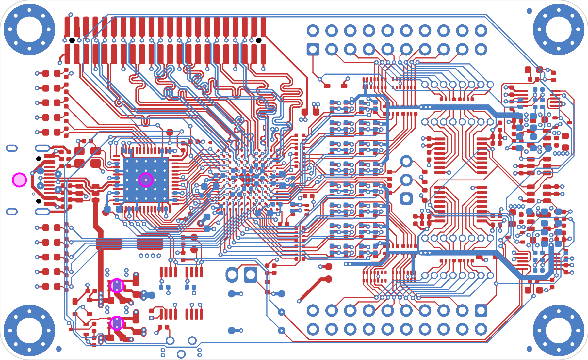

# glasgow-route-astra-20261120-1041

| | |
|---|---|
| Task | route only, placement kept |
| Model | gpt-6.2-astra (Codex CLI, `codex exec`, effort high) |
| Tools given | bt (see the README) |
| Time | 0:21 (finished on its own) |
| Cost at API prices | $4.94 (OpenAI list price for the token counts Codex reported, reasoning counted as output) |
| Turns | 149 |
| DRC errors | 4 (footprint_type_mismatch 4) |
| Unconnected | 0 |
| Copper | 4416 mm of track, 416 vias |
| Hosts reached | chatgpt.com (95), sdmntprcentralus.oaiusercontent.com (1), sdmntprwestus.oaiusercontent.com (1), sdmntprsouthcentralus.oaiusercontent.com (1), pypi.org (2), deb.debian.org (3), repo.maven.apache.org (1), registry.npmjs.org (1), data.jsdelivr.com (1), ghproxy.net (4), files.pythonhosted.org (1), ab.chatgpt.com (1); denied: raw.githubusercontent.com, glasgow-embedded.org, www.crowdsupply.com, api.github.com, cdn.jsdelivr.net, github.com, codeload.github.com, gitlab.com |

DRC is KiCad 10 with zones refilled, on the board the agent saved. Some boards start with findings of their own; see `../../../boards/README.md`.

## Pictures

Start is the board as the agent got it (pads and part outlines; in placement runs the free parts sit in a grid below the board). Reference is the human-routed original ([boards/glasgow-revc3](../../../boards/glasgow-revc3)). The copper pictures show F.Cu (red) and B.Cu (blue) with zone fills left out so the tracks show; DRC errors are circled in magenta on the result.

| Start | Reference | Result |
|---|---|---|
|  |  |  |

## The agent's own summary

From the start of its [NOTES.md](work/NOTES.md):

> The saved KiCad 10.0.8 board has **zero unconnected items and zero new DRC findings**. All 272 footprint definitions match the input byte for byte. The fabrication ZIP contains four copper layers, mask, legend, paste, profile, plated and nonplated drills, an IPC-D-356A netlist, the Gerber job file and fabricator instructions. [Fabrication package](glasgow-fabrication.zip) · [Four-layer view](progress/010-final-copper.png)

Its review of the bt tool: [BT-REVIEW.md](work/BT-REVIEW.md).

## Progress log

Saved by the agent as it worked, failed attempts included. The notes are here; the pictures are in the archive.

- [Fixed placement](work/progress/001-placement.md)
- [Signal routing](work/progress/002-signal-routing.md)
- [Inner planes and first copper DRC](work/progress/003-plane-refill.md)
- [Power via drill spacing](work/progress/004-via-spacing-review.md)
- [Rejected via positions](work/progress/005-array-trial.md)
- [Corrected power transitions](work/progress/006-array-clearances.md)
- [USB return current at the receptacle](work/progress/007-usb-return.md)
- [USB width and stackup trial](work/progress/008-usb-impedance-trial.md)
- [Routed-edge clearance](work/progress/009-edge-review.md)
- [Final four-layer copper](work/progress/010-final-copper.md)

## Raw files

The prompt is [brief.md](brief.md); the scores are [report.json](report.json). Everything else is in `glasgow-route-astra-20261120-1041.tar.xz`, attached to the `cross-model-2026-11` release:
the full transcript (`transcript.jsonl`, converted from Codex's own `codex.jsonl` events, which are there too), the input board, the agent's working directory with its scripts and intermediate boards, the progress pictures, all renders, the raw DRC and metrics, and the proxy log.
