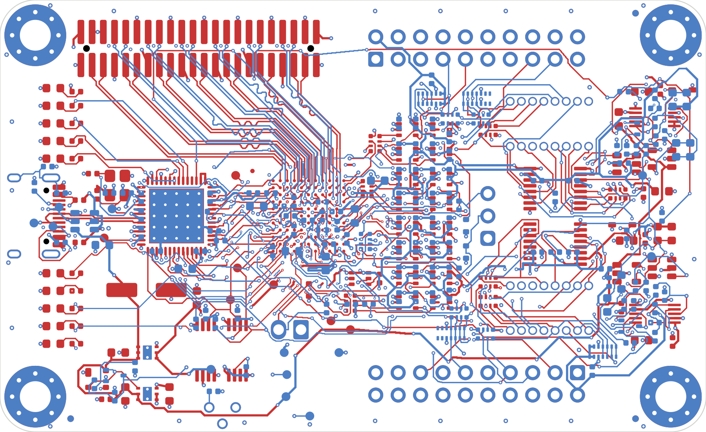

# glasgow-place-astra-20261120-1236

| | |
|---|---|
| Task | place the free parts and route |
| Model | gpt-6.2-astra (Codex CLI, `codex exec`, effort high) |
| Tools given | bt (see the README) |
| Time | 1:51 (finished on its own) |
| Cost at API prices | $31.69 (OpenAI list price for the token counts Codex reported, reasoning counted as output) |
| Turns | 430 |
| DRC errors | 0 |
| Unconnected | 0 |
| Copper | 5042 mm of track, 823 vias |
| Placement | outline 80.1 × 49.1 mm, parts on top 94 / bottom 149, flagged off the board: SW1 (the check also flags parts that overhang the edge on purpose) |
| Hosts reached | chatgpt.com (486), sdmntprcentralus.oaiusercontent.com (1), sdmntprsouthcentralus.oaiusercontent.com (1), sdmntprwestus.oaiusercontent.com (1), deb.debian.org (10), pypi.org (7), registry.npmjs.org (3), repo.maven.apache.org (7), files.pythonhosted.org (2), ab.chatgpt.com (2); denied: github.com, raw.githubusercontent.com, codeload.github.com, api.github.com, cdn.jsdelivr.net, glasgow-embedded.org, archive.ubuntu.com, sources.debian.org, proxy.golang.org, distfiles.macports.org, distfiles.gentoo.org, cache.nixos.org, files.openscad.org, gitlab.com, data.jsdelivr.com, archive.softwareheritage.org, ghproxy.net, raw.githack.com, storage.googleapis.com, pkg.go.dev, glasgow-embedded.github.io, gitlab.freedesktop.org |

DRC is KiCad 10 with zones refilled, on the board the agent saved. Some boards start with findings of their own; see `../../../boards/README.md`.

## Pictures

Start is the board as the agent got it (pads and part outlines; in placement runs the free parts sit in a grid below the board). Reference is the human-routed original ([boards/glasgow-revc3](../../../boards/glasgow-revc3)). The copper pictures show F.Cu (red) and B.Cu (blue) with zone fills left out so the tracks show; DRC errors are circled in magenta on the result.

| Start | Reference | Result |
|---|---|---|
|  |  |  |

## The agent's own summary

From the start of its [NOTES.md](work/NOTES.md):

> The saved KiCad 10.0.8 board has **zero unconnected items and zero active DRC errors**. All 243 movable footprints are placed. The 29 locked footprints retain their original positions, rotations and sides. The enclosed fabrication files use a **four-layer 1+2+1 HDI buildup with filled, capped via-in-pad construction**.

Its review of the bt tool: [BT-REVIEW.md](work/BT-REVIEW.md).

## Progress log

Saved by the agent as it worked, failed attempts included. The notes are here; the pictures are in the archive.

- [The input has 272 footprints and an 80 × 49 mm outline. The USB receptacle, headers, mounting holes and fiducials define the mechanical datum. All electrical routing is absent. This view records the board before placement.](work/progress/001-intake.md)
- [The fixed top silkscreen provides a mechanical floorplan. The 16 individual channel labels, two LED strips, power and measurement blocks, and connector keying determine where the user expects each function. I retained these landmarks and used the reverse face for bypass capacitors, feedback networks and probe pads. The view shows the original mask and top legend before fitting those circuits.](work/progress/002-floorplan-guide.md)
- [This first fit exposed several problems. A bounding-box search pushed the right-angle reset switch inward, displaced two level shifters from the channel grid and scattered the ESD arrays. I kept this view and revised the placement priorities before routing.](work/progress/003-first-fit.md)
- [I placed all 243 movable footprints. The shifters now follow the printed A0–A7 and B0–B7 channel positions, the ten LEDs form two aligned banks, and the reset switch faces the edge. I moved the ESD arrays to the reverse side near the headers. The FPGA and FX2 sit between the USB and I/O connectors.](work/progress/004-channel-placement.md)
- [The USB data pair has a direct top-layer path to the FX2. I drew coupled routes for all 13 expansion pairs in header pin order. Seven reach the FPGA balls on top, with 0.15 mm escapes at the 0.8 mm grid. The other six use adjacent vias at the header and paired runs on the reverse, leaving their short FPGA escapes for completion. Copper probing caught conflicts between neighboring diagonal runs and the outer ball necks. Adjusting the lane heights and aligning each breakout with its ball gap cleared all 234 proposed pieces.](work/progress/005-differential-routing.md)
- [In1 carries the full ground reference. In2 has a second ground region beneath the reverse-side expansion pairs and a shaped 3.3 V supply region serving the FX2 and both translator banks. The rest of In2 is available for breakout and local signals. I added short ground and 3.3 V pad-to-plane connections before the general routing pass and filled the zones.](work/progress/006-power-distribution.md)
- [I exported the placed board, the reference plane and the pre-routed copper to a local Specctra router. This snapshot has 1,734 track and via objects. The general pass is still connecting the two I/O banks, FPGA signals and supply branches. I am checking intermediate session imports in KiCad against the project rules.](work/progress/007-general-routing.md)
- [The first endpoint router joined three of twelve unfinished expansion signals in the constrained FPGA window. I replaced that trial with a joint search over interstitial vias and both outside copper layers. An earlier bend on Z4_N opened the last approach to Z4_P. All twelve reverse-side connections now reach the correct balls, with one 0.4/0.2 mm dogbone via per signal at the FPGA. The new copper passed the geometry probe.](work/progress/008-fpga-escapes.md)
- [The general router and a targeted pass have joined the bulk of the digital and analog nets. The targeted pass completed 47 of 121 selected nets and kept useful partial links. KiCad reports 131 open connections at this checkpoint. I set the outside dielectric thickness to 0.135 mm and the central core to 1.17 mm for a nominal 1.60 mm four-layer stack. A 2D electrostatic estimate gives about 90 Ω for the 0.19/0.15 mm USB pair and 101 Ω for the 0.16/0.18 mm expansion pairs over their local references.](work/progress/009-bank-routing.md)
- [KiCad's open-connection reports identified stranded pins around the FX2, the FPGA and the pull networks. A local grid search joined further links, using the third signal layer and short inner-layer escapes where the outside layers were blocked. I also removed conflicting sections left by combining the hand-routed FPGA escapes with the general router. This view records the central area before the last isolated-pin escapes.](work/progress/010-local-repair.md)
- [The first local rework added 84 pad escapes and removed 166 interfering copper items. Routing the displaced connections recovered much of the lost connectivity, but KiCad still found 74 opens, compared with 62 before rework. Several FPGA balls now had an escape via surrounded by other vias too close together for a 0.15 mm trace and two 0.15 mm clearances. The picture shows the USB controller and FPGA region. I retained the previous board as a checkpoint and used this version to test narrower routing.](work/progress/011-fanout-rework.md)
- [The local rip-up and repair pass connected the crystal and brought the native open count to 41. Outer ground pours rejoined several separated ground stubs. KiCad still found seven breaks in the 3.3 V distribution. The In2 view shows where the routes and the original narrow supply-zone boundary leave too little space for the fill. I tested a larger 3.3 V zone with a ground region reserved under the expansion pairs.](work/progress/012-power-islands.md)
- [Adjacent-layer laser vias gave access to signal-routing space under the FPGA and on the backside of the I/O banks without a through via blocking all four layers. I used 0.35/0.15 mm laser vias in the 0.135 mm outer dielectric. The broader 3.3 V plane and these local joins connected all separated 3.3 V groups. KiCad reported 21 remaining opens. This version requires an HDI fabricator and filled, capped in-pad vias.](work/progress/013-hdi-escape.md)
- [Two missing connections appeared in KiCad as links between entire ground zones at their outline origins. I separated the actual filled polygons, pads, tracks and vias by physical connectivity. One island contained ten FPGA ground balls and nearby bypass capacitors. The other contained a translator ground pad. A ground join from the BGA island and a via at (94.45, 96.85) connected the two groups to the main ground. KiCad then reported 19 open connections, all on other nets.](work/progress/014-fpga-ground.md)
- [I brought the USB pair back to a 0.15 mm edge gap for most of the run from its first bend to the FX2, opening the pair locally at the controller pads. I then tuned the shorter expansion-pair members. The largest initial mismatch was 2.873 mm on Z9. This trial preserved connectivity and introduced no new copper-clearance error in KiCad. The picture shows the detours near the expansion routes.](work/progress/015-pair-tuning.md)
- [A further sequence of local repairs reached five native DRC opens. Three were power or ground groups in the FPGA field. One ended at the FPGA reset pull-down and the other at an outer-row FPGA ball. The existing vias and internal tracks surrounded that ball even though its pin row was at the edge. I kept this checkpoint and reopened a small group of nearby digital routes to try alternative crossing orders.](work/progress/016-last-connections.md)
- [I moved the 100 kΩ FPGA reset pull-down to a clear reverse-side position beside the FX2, where a short spur reaches the existing reset network. I also reopened two small FPGA routing windows and compared escape orders within each. The selected order connected all of the channel signals while retaining the 1.2 V and 3.3 V distribution. KiCad reported one remaining ground connection at this checkpoint.](work/progress/017-joined-signal-field.md)
- [KiCad reported zero opens after I anchored the final ground crossing to physical copper and rerouted DB4. I then adjusted neighboring laser and buried vias so each transition is either a centered stack or meets drill spacing. Native DRC found no copper, hole-spacing or connectivity fault at this checkpoint. The four supplied assembly-type flags and the deliberately coaxial drill pairs remain identifiable separately.](work/progress/018-electrical-closure.md)
- [I extended the In2 ground reference along the reverse-side expansion breakout and under the USB protection and test branches. Forty new ground stitches tie adjacent return regions together, including fourteen beside signal transitions. I shifted the channel labels clear of the translator pads. The four remaining silk-to-mask warnings were already present on the input artwork. The enlarged ground regions and stitching preserved full electrical connectivity.](work/progress/019-return-paths.md)
- [I tested a front-only route for XTALOUT after the whole board was connected. The crystal and load capacitor connected on top, but the route could not leave the FX2 pin without disturbing the adjacent signal escapes. This picture records the discarded trial. The release keeps the connected two-via output path. XTALIN stays on the front.](work/progress/020-crystal-trial.md)
- [The release board has zero KiCad errors and zero unconnected items. The final cleanup removed hanging track branches and vias, moved the reset switch inward by 0.175 mm, and brought copper to at least 0.25 mm from the routed edge. This KiCad view shows the front on the left and reverse on the right, using the specified white mask and black legend. It depicts the bare PCB. The four copper layers, masks, paste, silkscreens, outline and all five drill groups were exported for fabrication.](work/progress/021-fabrication-release.md)

## Raw files

The prompt is [brief.md](brief.md); the scores are [report.json](report.json). Everything else is in `glasgow-place-astra-20261120-1236.tar.xz`, attached to the `cross-model-2026-11` release:
the full transcript (`transcript.jsonl`, converted from Codex's own `codex.jsonl` events, which are there too), the input board, the agent's working directory with its scripts and intermediate boards, the progress pictures, all renders, the raw DRC and metrics, and the proxy log.
