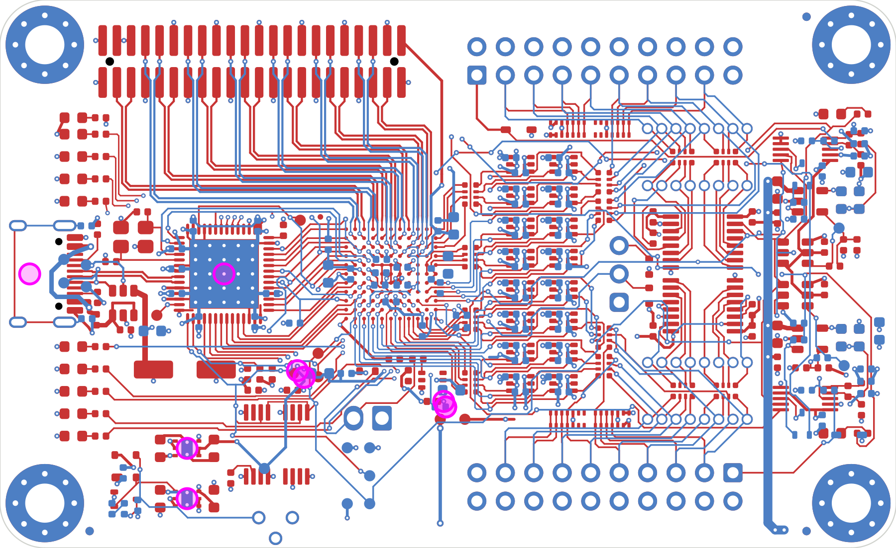

# glasgow-place-fable-20261119-1818

| | |
|---|---|
| Task | place the free parts and route |
| Model | claude-fable-5-2 (Claude Code, `claude -p`, effort high) |
| Tools given | bt (see the README) |
| Time | 5:55 (agent exit 1; agent exit 1 (leg 1); resumed 1 time with "Continue." after a plan usage limit, time is agent time only) |
| Cost at API prices | $138.70 |
| Turns | 232 |
| DRC errors | 11 (shorting_items 2, clearance 2, hole_clearance 1, footprint_type_mismatch 4, solder_mask_bridge 2) |
| Unconnected | 15 items in 11 nets |
| Copper | 4082 mm of track, 476 vias |
| Placement | outline 80.1 × 49.1 mm, parts on top 136 / bottom 107, flagged off the board: SW1 (the check also flags parts that overhang the edge on purpose) |
| Hosts reached | api.anthropic.com (47), http-intake.logs.us5.datadoghq.com (172) |

DRC is KiCad 10 with zones refilled, on the board the agent saved. Some boards start with findings of their own; see `../../../boards/README.md`.

## Pictures

Start is the board as the agent got it (pads and part outlines; in placement runs the free parts sit in a grid below the board). Reference is the human-routed original ([boards/glasgow-revc3](../../../boards/glasgow-revc3)). The copper pictures show F.Cu (red) and B.Cu (blue) with zone fills left out so the tracks show; DRC errors are circled in magenta on the result.

| Start | Reference | Result |
|---|---|---|
|  |  |  |

## The agent's own summary

From the start of its [NOTES.md](work/NOTES.md):

> (Status section at the end says what is finished and what is not.)

Its review of the bt tool: [BT-REVIEW.md](work/BT-REVIEW.md).

## Progress log

Saved by the agent as it worked, failed attempts included. The notes are here; the pictures are in the archive.

- [001 – first complete placement (no routing yet, except the FPGA fan-out stubs)](work/progress/001-placement.md)
- [002 – critical nets routed by hand (scripted geometry), one autoroute attempt thrown away](work/progress/002-critical-routes.md)
- [003 – shifter cells, DA lines, +5V trunk by hand; first global autoroute pass](work/progress/003-autoroute-pass1.md)

## Raw files

The prompt is [brief.md](brief.md); the scores are [report.json](report.json). Everything else is in `glasgow-place-fable-20261119-1818.tar.xz`, attached to the `cross-model-2026-11` release:
the full transcript (`transcript.jsonl`), the input board, the agent's working directory with its scripts and intermediate boards, the progress pictures, all renders, the raw DRC and metrics, and the proxy log.
