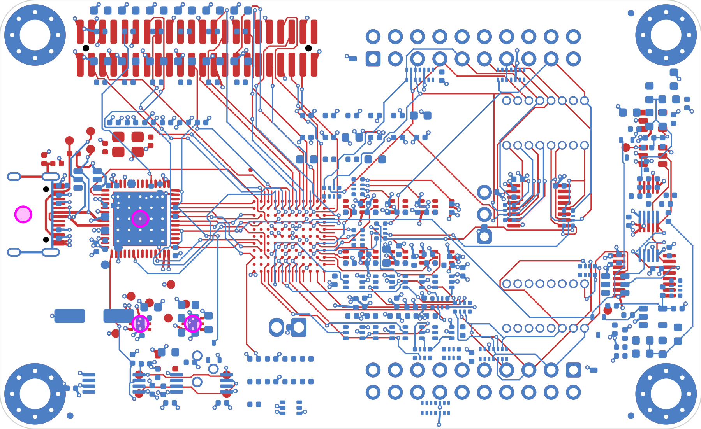

# glasgow-place-haiku-20261119-1818

| | |
|---|---|
| Task | place the free parts and route |
| Model | claude-haiku-5-5 (Claude Code, `claude -p`, effort max) |
| Tools given | bt (see the README) |
| Time | 4:00 (finished on its own) |
| Cost at API prices | $11.23 |
| Turns | 357 |
| DRC errors | 4 (footprint_type_mismatch 4) |
| Unconnected | 321 items in 138 nets |
| Copper | 2155 mm of track, 434 vias |
| Placement | outline 80.1 × 49.1 mm, parts on top 41 / bottom 202 |
| Hosts reached | api.anthropic.com (19), http-intake.logs.us5.datadoghq.com (234) |

DRC is KiCad 10 with zones refilled, on the board the agent saved. Some boards start with findings of their own; see `../../../boards/README.md`.

## Pictures

Start is the board as the agent got it (pads and part outlines; in placement runs the free parts sit in a grid below the board). Reference is the human-routed original ([boards/glasgow-revc3](../../../boards/glasgow-revc3)). The copper pictures show F.Cu (red) and B.Cu (blue) with zone fills left out so the tracks show; DRC errors are circled in magenta on the result.

| Start | Reference | Result |
|---|---|---|
|  |  |  |

## The agent's own summary

From the start of its [NOTES.md](work/NOTES.md):

> **Status: NOT FINISHED. The board is not ready to order.**

Its review of the bt tool: [BT-REVIEW.md](work/BT-REVIEW.md).

## Progress log

Saved by the agent as it worked, failed attempts included. The notes are here; the pictures are in the archive.

- [001 — first placement pass (everything on the board, no routing yet)](work/progress/001-placement-first-pass.md)
- [002 — FPGA escape (bt fan) and planes](work/progress/002-fpga-escape.md)
- [003 — USB connector and transceiver routed (J1, U15, FX2 D+/D-, CC, VBUS, shield)](work/progress/003-usb-routed.md)
- [004 — FX2 moved up 2 mm; FX2-to-FPGA bus re-routed (in progress)](work/progress/004-fx2-moved-up.md)
- [005 — IO banks: buffers, RN networks, FPGA bank pins (first routing pass)](work/progress/005-io-banks-routed.md)
- [006 — planes, plane vias, and the state of the remaining routing](work/progress/006-planes-and-vias.md)
- [007 — final state of this session (overview)](work/progress/007-final-state.md)
- [008 — FPGA area at the end of the session](work/progress/008-final-fpga-area.md)

## Raw files

The prompt is [brief.md](brief.md); the scores are [report.json](report.json). Everything else is in `glasgow-place-haiku-20261119-1818.tar.xz`, attached to the `cross-model-2026-11` release:
the full transcript (`transcript.jsonl`), the input board, the agent's working directory with its scripts and intermediate boards, the progress pictures, all renders, the raw DRC and metrics, and the proxy log.
