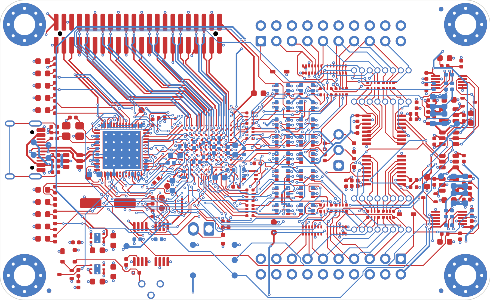

# glasgow-route-astra-20261120-1145

| | |
|---|---|
| Task | route only, placement kept |
| Model | gpt-6.2-astra (Codex CLI, `codex exec`, effort high) |
| Tools given | bt (see the README) |
| Time | 1:09 (finished on its own) |
| Cost at API prices | $19.29 (OpenAI list price for the token counts Codex reported, reasoning counted as output) |
| Turns | 299 |
| DRC errors | 0 |
| Unconnected | 0 |
| Copper | 4291 mm of track, 672 vias |
| Hosts reached | chatgpt.com (330), auth.openai.com (1), pypi.org (9), deb.debian.org (3), registry.npmjs.org (3), repo.maven.apache.org (11), files.pythonhosted.org (4), ab.chatgpt.com (1); denied: github.com, api.github.com, raw.githubusercontent.com, codeload.github.com, cdn.jsdelivr.net, data.jsdelivr.com, gitlab.com, archive.ubuntu.com, sources.debian.org, glasgow-embedded.org, git.sr.ht, packages.hub.ace-research.openai.org, proxy.golang.org, api.freerouting.app |

DRC is KiCad 10 with zones refilled, on the board the agent saved. Some boards start with findings of their own; see `../../../boards/README.md`.

## Pictures

Start is the board as the agent got it (pads and part outlines; in placement runs the free parts sit in a grid below the board). Reference is the human-routed original ([boards/glasgow-revc3](../../../boards/glasgow-revc3)). The copper pictures show F.Cu (red) and B.Cu (blue) with zone fills left out so the tracks show; DRC errors are circled in magenta on the result.

| Start | Reference | Result |
|---|---|---|
|  |  |  |

## The agent's own summary

From the start of its [NOTES.md](work/NOTES.md):

> The saved board has **zero unconnected items and zero unexcluded errors** in KiCad 10.0.8. A fresh zone fill gives the same result. The board has 3,381 straight track segments, 672 through vias and 12 filled zones. All 272 footprint identities, positions, rotations, sides and lock states match the input, as do all 1,149 physical pads, their geometry, drills and net assignments.

Its review of the bt tool: [BT-REVIEW.md](work/BT-REVIEW.md).

## Progress log

Saved by the agent as it worked, failed attempts included. The notes are here; the pictures are in the archive.

- [Unrouted Rev C3 board](work/progress/001-unrouted.md)
- [USB and oscillator](work/progress/002-usb-crystal.md)
- [Return and supply planes](work/progress/003-power-regions.md)
- [J5 expansion routing](work/progress/004-expansion-pairs.md)
- [Current sensing and local power](work/progress/005-local-power.md)
- [Plane review and rejected routing trial](work/progress/006-plane-review.md)
- [First general routing pass](work/progress/007-outer-routing.md)
- [Congested digital channels](work/progress/008-congestion.md)
- [FPGA escape review](work/progress/009-fpga-escapes.md)
- [Power-plane continuity](work/progress/010-power-continuity.md)
- [Last FPGA connections](work/progress/011-last-connections.md)
- [First fully connected board](work/progress/012-first-fully-connected.md)
- [Reference clock reroute](work/progress/013-clock-review.md)
- [Final copper and fabrication checks](work/progress/014-fabrication-check.md)

## Raw files

The prompt is [brief.md](brief.md); the scores are [report.json](report.json). Everything else is in `glasgow-route-astra-20261120-1145.tar.xz`, attached to the `cross-model-2026-11` release:
the full transcript (`transcript.jsonl`, converted from Codex's own `codex.jsonl` events, which are there too), the input board, the agent's working directory with its scripts and intermediate boards, the progress pictures, all renders, the raw DRC and metrics, and the proxy log.
