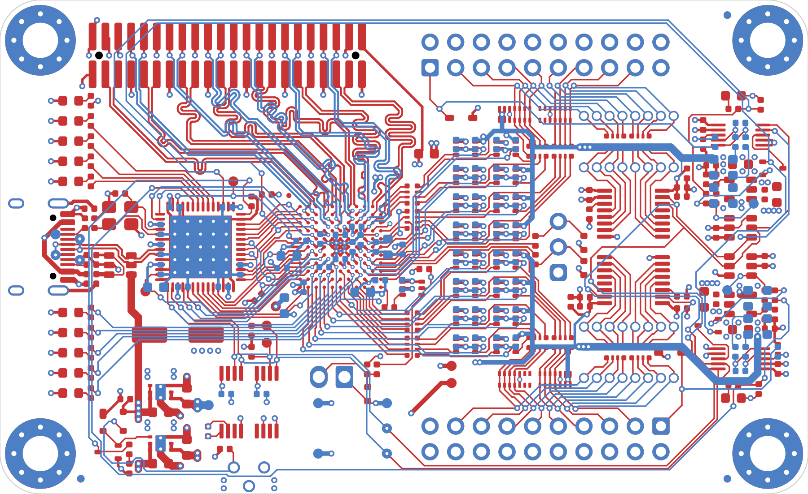
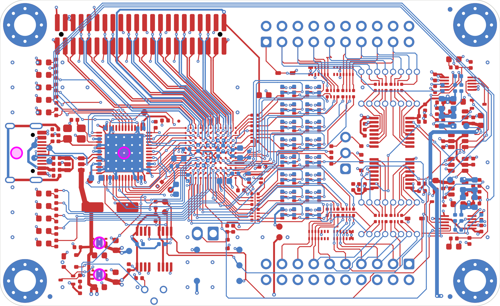

# glasgow-route-fable-20261119-1818

| | |
|---|---|
| Task | route only, placement kept |
| Model | claude-fable-5-2 (Claude Code, `claude -p`, effort high) |
| Tools given | bt (see the README) |
| Time | 4:54 (agent exit 1; resumed 1 time with "Continue." after a plan usage limit, time is agent time only) |
| Cost at API prices | $159.26 |
| Turns | 344 |
| DRC errors | 4 (footprint_type_mismatch 4) |
| Unconnected | 0 |
| Copper | 4175 mm of track, 475 vias |
| Hosts reached | api.anthropic.com (38), http-intake.logs.us5.datadoghq.com (222) |

DRC is KiCad 10 with zones refilled, on the board the agent saved. Some boards start with findings of their own; see `../../../boards/README.md`.

## Pictures

Start is the board as the agent got it (pads and part outlines; in placement runs the free parts sit in a grid below the board). Reference is the human-routed original ([boards/glasgow-revc3](../../../boards/glasgow-revc3)). The copper pictures show F.Cu (red) and B.Cu (blue) with zone fills left out so the tracks show; DRC errors are circled in magenta on the result.

| Start | Reference | Result |
|---|---|---|
|  |  |  |

## The agent's own summary

From the start of its [NOTES.md](work/NOTES.md):

> Board: `/work/glasgow.kicad_pcb` (KiCad 10), 80 × 49 mm, 4 copper layers.
> Placement was not touched; only tracks, vias and zones were added. The `.kicad_pro` is unchanged.

Its review of the bt tool: [BT-REVIEW.md](work/BT-REVIEW.md).

## Progress log

Saved by the agent as it worked, failed attempts included. The notes are here; the pictures are in the archive.

- [001 – starting point](work/progress/001-start.md)
- [002 – planes created, FPGA (U30, BGA-121 0.8 mm) dog-bone fan-out](work/progress/002-bga-fanout.md)
- [003 – LVDS pairs FPGA -> J5 (13 pairs) and VIO_AUX](work/progress/003-lvds-pairs.md)
- [004 – FX2 power stubs, FX2 <-> FPGA bus on F.Cu, bottom-layer escapes under the BGA](work/progress/004-fx2-fpga-channel.md)
- [005 – clocks, WR/RD, config signals, crystal, USB](work/progress/005-usb-clocks-channel.md)
- [006 – level-shifter banks (16 x SN74LVC1T45), scripted](work/progress/006-level-shifter-banks.md)
- [007 – FPGA -> series resistors, and the 16 direction (DIR) lines](work/progress/007-direction-lines.md)
- [008 – connector side of both I/O banks](work/progress/008-io-connectors.md)
- [009 – power distribution](work/progress/009-power.md)
- [010 – router sweep over everything left](work/progress/010-router-sweep.md)
- [011 – last signal nets (east of the FPGA, long control lines)](work/progress/011-last-signals.md)
- [012 – ground: pours, plane vias, DRC clean-up](work/progress/012-ground.md)
- [013 – final state of the power layer (In2)](work/progress/013-final-in2.md)

## Raw files

The prompt is [brief.md](brief.md); the scores are [report.json](report.json). Everything else is in `glasgow-route-fable-20261119-1818.tar.xz`, attached to the `cross-model-2026-11` release:
the full transcript (`transcript.jsonl`), the input board, the agent's working directory with its scripts and intermediate boards, the progress pictures, all renders, the raw DRC and metrics, and the proxy log.
