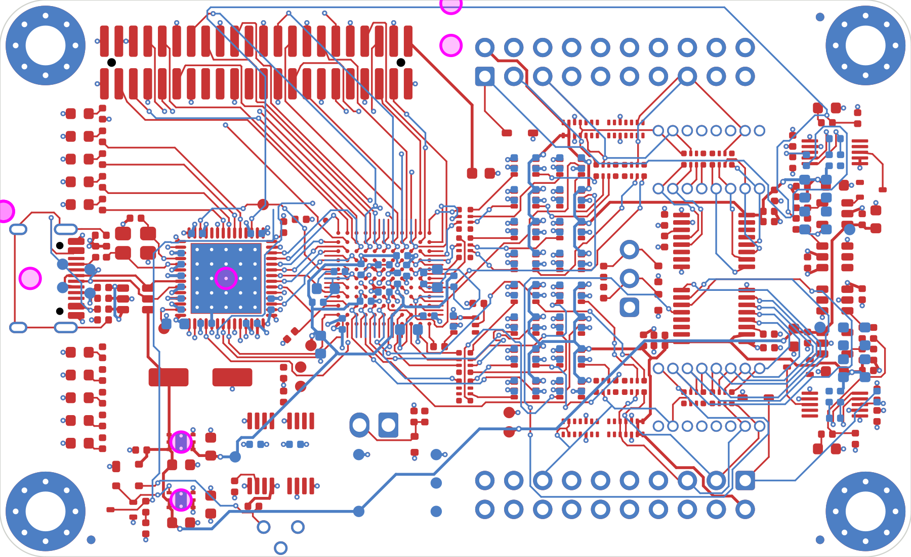

# glasgow-route-haiku-20261119-1818

| | |
|---|---|
| Task | route only, placement kept |
| Model | claude-haiku-5-5 (Claude Code, `claude -p`, effort max) |
| Tools given | bt (see the README) |
| Time | 2:27 (finished on its own) |
| Cost at API prices | $13.07 |
| Turns | 7 |
| DRC errors | 8 (zones_intersect 4, footprint_type_mismatch 4) |
| Unconnected | 153 items in 79 nets |
| Copper | 2759 mm of track, 429 vias |
| Hosts reached | api.anthropic.com (27), http-intake.logs.us5.datadoghq.com (193) |

DRC is KiCad 10 with zones refilled, on the board the agent saved. Some boards start with findings of their own; see `../../../boards/README.md`.

## Pictures

Start is the board as the agent got it (pads and part outlines; in placement runs the free parts sit in a grid below the board). Reference is the human-routed original ([boards/glasgow-revc3](../../../boards/glasgow-revc3)). The copper pictures show F.Cu (red) and B.Cu (blue) with zone fills left out so the tracks show; DRC errors are circled in magenta on the result.

| Start | Reference | Result |
|---|---|---|
|  |  |  |

## The agent's own summary

None: the run ended before the agent wrote NOTES.md.

## Progress log

Saved by the agent as it worked, failed attempts included. The notes are here; the pictures are in the archive.

- [000 — placement as received (unrouted)](work/progress/000-placement.md)
- [000b — IO buffer region (close-up, unrouted)](work/progress/000b-io-region.md)
- [001 — planes set up, BGA zoom](work/progress/001-bga-zoom-pre.md)
- [002 — first BGA fan-out (bt fan U30, F/B/In2): PARTLY KEPT, then discarded](work/progress/002-bga-fan-attempt.md)
- [003 — greedy batch route of the 98 BGA nets (partial, discarded)](work/progress/003-bga-batch-partial.md)
- [004 — BGA redone, power balls first (kept)](work/progress/004-bga-power-first.md)
- [005 — GND and +3V3 plane vias for the whole board (kept)](work/progress/005-planes-placed.md)
- [006 — IO region with planes and plane vias (picture, unrouted)](work/progress/006-io-region-planes.md)
- [007 — FX2 west side, USB pair and crystal (kept)](work/progress/007-usb-xtal-fx2-west.md)
- [008 — LVDS pairs, first routing (partial)](work/progress/008-lvds-pairs-partial.md)
- [009 — IO and power corridors (picture, before VIO routing)](work/progress/009-io-power-corridors.md)
- [010 — VIOA routed (`bt route --net /IO_Banks/VIOA --all --width .25 --layers F.Cu,B.Cu`)](work/progress/010-vioa-routed.md)
- [011 — rails merged onto the working board (VIOA, VIOB, +1V2, +5V, VIO_AUX/VUSB partial)](work/progress/011-vio-power-merge.md)
- [012 — IO channels routed one at a time (in progress)](work/progress/012-io-channels.md)

## Raw files

The prompt is [brief.md](brief.md); the scores are [report.json](report.json). Everything else is in `glasgow-route-haiku-20261119-1818.tar.xz`, attached to the `cross-model-2026-11` release:
the full transcript (`transcript.jsonl`), the input board, the agent's working directory with its scripts and intermediate boards, the progress pictures, all renders, the raw DRC and metrics, and the proxy log.
