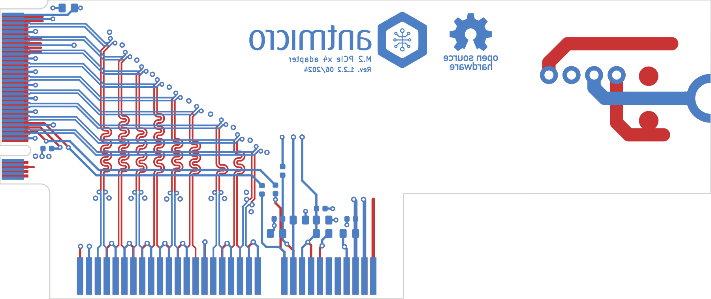
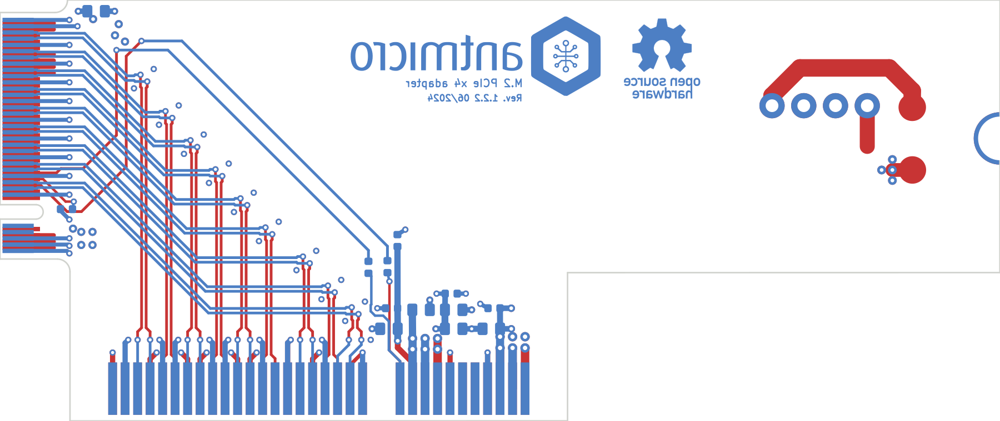

# m2-route-astra-20261120-1624

| | |
|---|---|
| Task | route only, placement kept |
| Model | gpt-6.2-astra (Codex CLI, `codex exec`, effort high) |
| Tools given | bt (see the README) |
| Time | 0:31 (finished on its own) |
| Cost at API prices | $6.66 (OpenAI list price for the token counts Codex reported, reasoning counted as output) |
| Turns | 107 |
| DRC errors | 0 |
| Unconnected | 0 |
| Copper | 1015 mm of track, 125 vias |
| Hosts reached | chatgpt.com (109), sdmntprcentralus.oaiusercontent.com (1), sdmntprwestus.oaiusercontent.com (1), sdmntprsouthcentralus.oaiusercontent.com (1), files.pythonhosted.org (2), pypi.org (2), ab.chatgpt.com (1); denied: github.com, api.github.com, raw.githubusercontent.com |

DRC is KiCad 10 with zones refilled, on the board the agent saved. Some boards start with findings of their own; see `../../../boards/README.md`.

## Pictures

Start is the board as the agent got it (pads and part outlines; in placement runs the free parts sit in a grid below the board). Reference is the human-routed original ([boards/m2-pcie-adapter](../../../boards/m2-pcie-adapter)). The copper pictures show F.Cu (red) and B.Cu (blue) with zone fills left out so the tracks show; DRC errors are circled in magenta on the result.

| Start | Reference | Result |
|---|---|---|
|  |  |  |

## The agent's own summary

From the start of its [NOTES.md](work/NOTES.md):

> The finished KiCad 10.0.8 project has 373 track segments, 125 through vias including the retention hole, and seven filled zones. KiCad reports **zero DRC errors, zero unconnected items and zero schematic-parity differences**. All 20 footprints and all 163 pads match the supplied board in identity, position, side and net assignment. The schematic is unchanged.

Its review of the bt tool: [BT-REVIEW.md](work/BT-REVIEW.md).

## Progress log

Saved by the agent as it worked, failed attempts included. The notes are here; the pictures are in the archive.

- [The supplied M.2 edge fingers are on opposite faces. All nine PCIe pairs start on the back, while the x4 socket divides them between its A and B rows. The board starts with 98 open connections in KiCad and 20 library lookup warnings. The inner layers are empty. I will use two ground references and keep power distribution out of the space directly under the pairs.](work/progress/001-placement.md)
- [First geometry trial, shown around lane 3. Probing found 96 failing segments or vias out of 282 items. The inside offsets on the diagonal bends squeezed the pair, and the transition fan-in approached the other signal via too soon. I discarded this geometry before applying signal copper to the working board.](work/progress/002-pair-launch-trial.md)
- [All four transmit pairs, all four receive pairs, and REFCLK now reach the socket. The revised matched launches and return vias pass the geometry probe. Signal vias are 0.50/0.25 mm. The A-row pairs change back to the bottom near the socket. The B-row pairs land directly from the top.](work/progress/003-pcie.md)
- [The automatic escape trials found no solution when the insertion area was supplied as an avoid box. Requiring socket vias outside its courtyard found 16 of 21 grounds. I used pad-specific stubs instead, reaching both reference planes beside the socket and the bottom reference beside the M.2 fingers. The vias on the M.2 end sit behind the finger field. I also defined the rail distribution outlines, leaving ground under the high-speed routes.](work/progress/004-connector-returns.md)
- [In1 now has a 3.3 V supply area feeding all three groups of M.2 supply fingers and the socket supply contacts. The 12 V path uses parallel top and inner copper along the board arm, with multiple vias near the load and the spring contact. The layer shown also retains ground throughout the front-side PCIe corridor. In2 remains ground throughout the board. The 5 V spring contact has its own 1.4 mm route.](work/progress/005-power.md)
- [Trial of an outer-layer route for all five sideband nets. The search connected them in three seconds, but the long reset and wake runs each changed layers three times and spent part of their length beside the PCIe lanes. I kept the trial picture and sought paths with one transition per sideband. The saved-fill DRC also caught a spring-contact via that had acquired the ground net. I replaced that array inside the 12 V copper, clear of the contact's solder land.](work/progress/006-sideband-trial.md)
- [All schematic connections are complete. The final reset and wake paths each change layers once and pass around the high-speed via field. KiCad and bt report zero errors and zero opens, with the original 20 missing-library warnings. Mechanical review then identified an empty mounting position at the far end of the M.2 card, marked by two mask rings and an edge-clearance exclusion in the supplied project.](work/progress/007-connected.md)
- [Reconstructed the grounded retention feature at the saved edge-exception location. The 3.50 mm plated drill matches the diameter of the retention cutout in KiCad’s M.2 2280 M-key reference footprint. The untented 4.20 mm copper diameter follows the supplied mask rings. An exact-position edge rule permits the mill to bisect this one hole. The plated drill file and both mask plots contain the feature. I also moved the CLKREQ strap's ground via behind the M.2 insertion area.](work/progress/008-retention.md)
- [A two-dimensional electrostatic estimate of the uniform coupled microstrip gave roughly 92 Ω for the inherited 0.185 mm trace on this stack. I widened the signal copper to 0.218 mm and set the routed gap to 0.147 mm, targeting approximately 85 Ω. All 230 replacement signal segments passed the clearance probe with the other copper in place. The image shows the revised widths at two transitions.](work/progress/009-impedance.md)
- [The four panels show the final copper by net, projected from the front. A 25 µm sampling pass along every high-speed track centerline found ground on the adjacent layer everywhere outside the immediate signal-via antipads. The saved-board check passes with zero errors and zero opens. I independently compared all 20 footprint transforms and 163 pad identities, positions and nets with the starting board, and checked the exported drill and mask data at the retention hole.](work/progress/010-final.md)

## Raw files

The prompt is [brief.md](brief.md); the scores are [report.json](report.json). Everything else is in `m2-route-astra-20261120-1624.tar.xz`, attached to the `cross-model-2026-11` release:
the full transcript (`transcript.jsonl`, converted from Codex's own `codex.jsonl` events, which are there too), the input board, the agent's working directory with its scripts and intermediate boards, the progress pictures, all renders, the raw DRC and metrics, and the proxy log.
