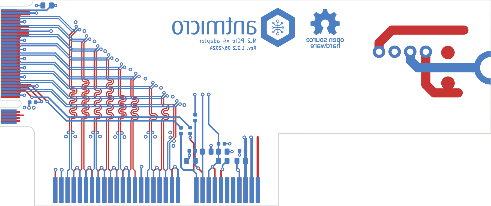
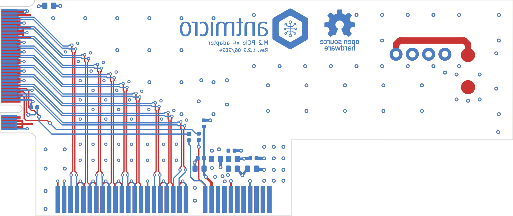

# m2-route-fable-20261120-2027

| | |
|---|---|
| Task | route only, placement kept |
| Model | claude-fable-5-2 (Claude Code, `claude -p`, effort high) |
| Tools given | bt (see the README) |
| Time | 0:33 (finished on its own) |
| Cost at API prices | $11.18 |
| Turns | 57 |
| DRC errors | 0 |
| Unconnected | 0 |
| Copper | 889 mm of track, 189 vias |
| Hosts reached | api.anthropic.com (8), http-intake.logs.us5.datadoghq.com (27) |

DRC is KiCad 10 with zones refilled, on the board the agent saved. Some boards start with findings of their own; see `../../../boards/README.md`.

## Pictures

Start is the board as the agent got it (pads and part outlines; in placement runs the free parts sit in a grid below the board). Reference is the human-routed original ([boards/m2-pcie-adapter](../../../boards/m2-pcie-adapter)). The copper pictures show F.Cu (red) and B.Cu (blue) with zone fills left out so the tracks show; DRC errors are circled in magenta on the result.

| Start | Reference | Result |
|---|---|---|
|  |  |  |

## The agent's own summary

From the start of its [NOTES.md](work/NOTES.md):

> State: routed, poured, ready to order. KiCad 10 DRC at all severities: 0 errors, 0 unconnected,
> schematic parity clean. The only messages left are 20 "footprint library 'antmicro-footprints' not
> configured" warnings that the unrouted board already had. No footprint was moved.
> 362 track segments, 189 vias, 21 zones (5 of them no-fill rule areas).

Its review of the bt tool: [BT-REVIEW.md](work/BT-REVIEW.md).

## Progress log

Saved by the agent as it worked, failed attempts included. The notes are here; the pictures are in the archive.

- [001 – starting point](work/progress/001-start.md)
- [002 – differential pairs](work/progress/002-pairs.md)
- [003 – ground vias, slow signals, power, first pour (one open)](work/progress/003-zones-f.md)
- [004 – corner reworked, plane voids, reproducible build](work/progress/004-rebuilt-f.md)
- [005 – In2 after the rebuild](work/progress/005-in2-voids.md)
- [006 – final board](work/progress/006-final-all.md)

## Raw files

The prompt is [brief.md](brief.md); the scores are [report.json](report.json). Everything else is in `m2-route-fable-20261120-2027.tar.xz`, attached to the `cross-model-2026-11` release:
the full transcript (`transcript.jsonl`), the input board, the agent's working directory with its scripts and intermediate boards, the progress pictures, all renders, the raw DRC and metrics, and the proxy log.
