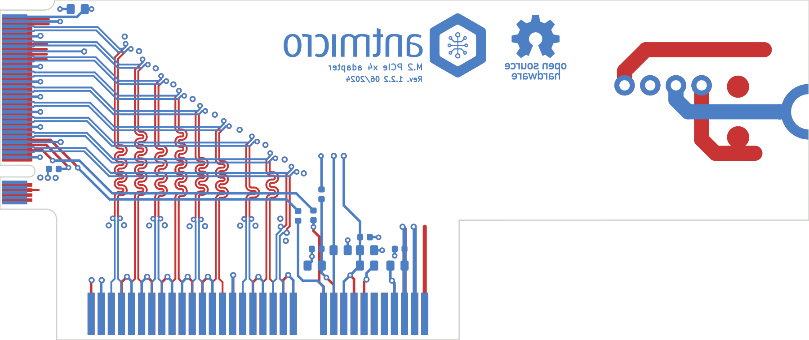
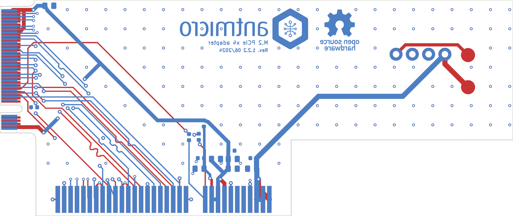

# m2-route-haiku-20261120-0158

| | |
|---|---|
| Task | route only, placement kept |
| Model | claude-haiku-5-5 (Claude Code, `claude -p`, effort max) |
| Tools given | bt (see the README) |
| Time | 2:05 (finished on its own) |
| Cost at API prices | $8.35 |
| Turns | 267 |
| DRC errors | 0 |
| Unconnected | 9 items in 1 nets |
| Copper | 959 mm of track, 199 vias |
| Hosts reached | api.anthropic.com (15), http-intake.logs.us5.datadoghq.com (144) |

DRC is KiCad 10 with zones refilled, on the board the agent saved. Some boards start with findings of their own; see `../../../boards/README.md`.

## Pictures

Start is the board as the agent got it (pads and part outlines; in placement runs the free parts sit in a grid below the board). Reference is the human-routed original ([boards/m2-pcie-adapter](../../../boards/m2-pcie-adapter)). The copper pictures show F.Cu (red) and B.Cu (blue) with zone fills left out so the tracks show; DRC errors are circled in magenta on the result.

| Start | Reference | Result |
|---|---|---|
|  |  |  |

## The agent's own summary

From the start of its [NOTES.md](work/NOTES.md):

> - `bt check` on the saved board: **0 DRC errors, 0 bt findings**, zones filled.
> - **Ground is not complete: 9 KiCad unconnected items (10 pads)**:
>   M.2 (J2) ground pins 9, 21, 27, 33, 39, 45, 51; PCIe (J1) pad A15 and the pair A27/A28.
>   These are the open item. Details and why below.
> - Everything else is routed: all 18 PCIe lane legs (IN, OUT, REFCLK), PERST#/PWRGD, WAKE#,
>   CLKREQ# (with R2/R3/R4 as in the schematic), +12V, +3V3, +3V3_AUX, +5V, and the decoupling
>   caps' power pins. Each lane pair is length-matched to within 0.003 mm.
> - Progress log with pictures and notes: `progress/001` … `progress/006`.
> - Tool notes: `BT-REVIEW.md`.

Its review of the bt tool: [BT-REVIEW.md](work/BT-REVIEW.md).

## Progress log

Saved by the agent as it worked, failed attempts included. The notes are here; the pictures are in the archive.

- [001 — starting point (no copper, placement as given)](work/progress/001-initial-board.md)
- [002 — all 18 lane nets routed (IN, OUT, REFCLK), written to the board](work/progress/002-lanes-routed.md)
- [003 — why the M.2 ground pins cannot be reached (zoom on J2, state after lanes)](work/progress/003-m2-fanout-gnd-blocked.md)
- [004 — fan-out rework to free the M.2 ground column: tried, rolled back](work/progress/004-fanout-rework-rolled-back.md)
- [005 — power, control and zones (full board, state after this step)](work/progress/005-power-control-zones.md)
- [006 — lanes length-matched, GND stitched, board checked](work/progress/006-tuned-stitched-state.md)
- [007 — last try on the PCIe ground pads A27/A28 and A15 (rolled back)](work/progress/007-j1-gnd-pads-attempt.md)

## Raw files

The prompt is [brief.md](brief.md); the scores are [report.json](report.json). Everything else is in `m2-route-haiku-20261120-0158.tar.xz`, attached to the `cross-model-2026-11` release:
the full transcript (`transcript.jsonl`), the input board, the agent's working directory with its scripts and intermediate boards, the progress pictures, all renders, the raw DRC and metrics, and the proxy log.
