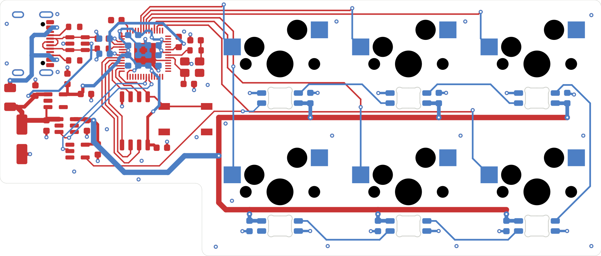

# macropad-route-astra-20261118-1937

| | |
|---|---|
| Task | route only, placement kept |
| Model | gpt-6.2-astra (Codex CLI, `codex exec`, effort high) |
| Tools given | bt (see the README) |
| Time | 0:20 (agent exit 1; resumed 1 time with "Continue." after a plan usage limit, time is agent time only) |
| Cost at API prices | $5.88 (OpenAI list price for the token counts Codex reported, reasoning counted as output) |
| Turns | 104 |
| DRC errors | 0 |
| Unconnected | 0 |
| Copper | 908 mm of track, 88 vias |
| Hosts reached | auth.openai.com (5), chatgpt.com (115), sdmntprwestus3.oaiusercontent.com (1), sdmntprcentralus.oaiusercontent.com (1), sdmntprsouthcentralus.oaiusercontent.com (1), ab.chatgpt.com (2), sdmntprwestus.oaiusercontent.com (1) |

DRC is KiCad 10 with zones refilled, on the board the agent saved. Some boards start with findings of their own; see `../../../boards/README.md`.

## Pictures

Start is the board as the agent got it (pads and part outlines; in placement runs the free parts sit in a grid below the board). Reference is the human-routed original ([boards/macropad-top](../../../boards/macropad-top)). The copper pictures show F.Cu (red) and B.Cu (blue) with zone fills left out so the tracks show; DRC errors are circled in magenta on the result.

| Start | Reference | Result |
|---|---|---|
|  |  |  |

## The agent's own summary

From the start of its [NOTES.md](work/NOTES.md):

> The layout is complete for a standard **two-layer, 1.6 mm FR-4 board with 1 oz copper and tented through vias**. The maximum board dimensions are 89.15 × 38.10 mm. The fabrication archive [macropad-top-JLCPCB.zip](macropad-top-JLCPCB.zip) contains both copper, mask and legend layers, the routed profile, and separate plated and non-plated drill files.

Its review of the bt tool: [BT-REVIEW.md](work/BT-REVIEW.md).

## Progress log

Saved by the agent as it worked, failed attempts included. The notes are here; the pictures are in the archive.

- [The fixed placement has a compact RP2040, flash and USB section on the left and a two-row switch and reverse-mount LED array on the right. The initial board has no copper connections. I mapped the six LED windows, bypass capacitors on the underside of the MCU and the two switch rows before allocating routing space.](work/progress/001-unrouted.md)
- [I routed both USB plug orientations into the ESD array, then through the series resistors to the MCU, all on the front. The crystal loop also stays on the front. Two 0.8 mm switched-supply branches serve the LED rows, with vias beside the local capacitors. The serial data follows the package order on the back. Clearance probing caught a collision between my first front-side VBUS escape and the connector locating holes. I took VBUS to the back just beyond its lands and joined it there.](work/progress/002-critical-and-led.md)
- [The six flash nets now leave the MCU west edge in pin order and reach the SOIC on the front without vias. BOOTSEL branches from chip select at the flash. I escaped the two MCU rails locally, using the space between the perimeter pins and exposed pad, and connected TESTEN directly to the exposed ground pad. A first escape toward the west collided with the flash fanout. The inner escape keeps that corridor clear. The two ground vias sit outside the exposed land.](work/progress/003-controller.md)
- [The six GPIO traces now each change layers once. The upper three use the north edge and drop to their switch column. The lower three use gaps between switch bores and LED windows. I moved the upper-row LED supply vias directly onto the front feeder so KEY6 could use the narrow corridor below the windows. The main power rails, MCU supply pins, reverse-side bypass capacitors and flash supply are now joined by explicit tracks.](work/progress/004-key-fanout.md)
- [The first batch route for the LED control signals boxed in RP2040 pin 8 with pin 9’s via. I replaced those two escapes as a pair and the second pass completed all three LED control/data connections. I then filled ground on both layers. KiCad found two open ground connections, one in the crystal area and one near the flash. I kept the image from this pass to show where continuous-looking copper still needs a connection between layers.](work/progress/005-first-fill.md)
- [Ground vias beside the crystal loads and flash, short bypass returns, and local stitches on either side of the LED windows connected the two pours. The courtyard-enabled check now reports zero errors, zero open connections and the original U103 library warning. This back-layer view also shows the LED supply crossing beneath the flash. I used this connected version as a checkpoint before moving that crossing and auditing via drills against solder lands on both sides.](work/progress/006-stitched.md)
- [I moved the switched LED feed around the south end of the SOIC and brought it to the inter-row branch at the left of the key field. This clears the supply crossing under the flash bus. The two MCU-to-LED control signals now travel together through the controller area, leaving more contiguous back-side ground. I also moved two same-net ground stitches outside the hot-swap solder lands. A conservative drill-to-pad audit on both faces now finds every via drill more than 0.12 mm from each SMD copper bounding box.](work/progress/007-return-paths.md)
- [Final front and back copper views. KiCad found zero errors, zero open connections and zero schematic parity issues. Enabling the normally disabled via-centering check caught a 0.0005 mm rounding difference at the level-shifter input. I corrected it, refilled and regenerated the fabrication files. The only warning is the U103 library mismatch present on the original board. The exported profile has seven closed contours including the six LED windows, and the plated drill file contains all 88 vias and four connector shell slots.](work/progress/008-fabrication.md)

## Raw files

The prompt is [brief.md](brief.md); the scores are [report.json](report.json). Everything else is in `macropad-route-astra-20261118-1937.tar.xz`, attached to the `cross-model-2026-11` release:
the full transcript (`transcript.jsonl`, converted from Codex's own `codex.jsonl` events, which are there too), the input board, the agent's working directory with its scripts and intermediate boards, the progress pictures, all renders, the raw DRC and metrics, and the proxy log.
