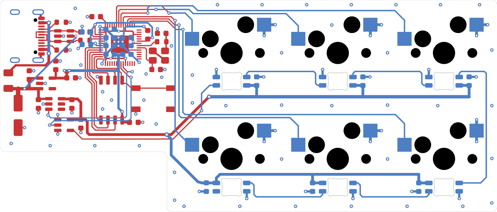

# macropad-route-fable-20261118-1937

| | |
|---|---|
| Task | route only, placement kept |
| Model | claude-fable-5-2 (Claude Code, `claude -p`, effort high) |
| Tools given | bt (see the README) |
| Time | 0:38 (finished on its own) |
| Cost at API prices | $15.33 |
| Turns | 73 |
| DRC errors | 0 |
| Unconnected | 0 |
| Copper | 949 mm of track, 128 vias |
| Hosts reached | api.anthropic.com (9), http-intake.logs.us5.datadoghq.com (32), jlcpcb.com (1) |

DRC is KiCad 10 with zones refilled, on the board the agent saved. Some boards start with findings of their own; see `../../../boards/README.md`.

## Pictures

Start is the board as the agent got it (pads and part outlines; in placement runs the free parts sit in a grid below the board). Reference is the human-routed original ([boards/macropad-top](../../../boards/macropad-top)). The copper pictures show F.Cu (red) and B.Cu (blue) with zone fills left out so the tracks show; DRC errors are circled in magenta on the result.

| Start | Reference | Result |
|---|---|---|
|  |  |  |

## The agent's own summary

From the start of its [NOTES.md](work/NOTES.md):

> The board is fully routed and filled. KiCad 10 DRC (all severities, with schematic parity) reports 0 errors, 0 unconnected items and 0 parity issues. The one warning, "U103 footprint does not match the library copy", was already there on the unrouted board. No footprint was moved, rotated, added or removed.

Its review of the bt tool: [BT-REVIEW.md](work/BT-REVIEW.md).

## Progress log

Saved by the agent as it worked, failed attempts included. The notes are here; the pictures are in the archive.

- [001 – starting point](work/progress/001-unrouted.md)
- [002 – MCU corner, USB, power entry](work/progress/002-mcu-usb-power.md)
- [003 – keys, LED power and LED data](work/progress/003-signals-routed.md)
- [004 – ground](work/progress/004-ground-pours-stitching.md)
- [005 – final state](work/progress/005-final.md)

## Raw files

The prompt is [brief.md](brief.md); the scores are [report.json](report.json). Everything else is in `macropad-route-fable-20261118-1937.tar.xz`, attached to the `cross-model-2026-11` release:
the full transcript (`transcript.jsonl`), the input board, the agent's working directory with its scripts and intermediate boards, the progress pictures, all renders, the raw DRC and metrics, and the proxy log.
