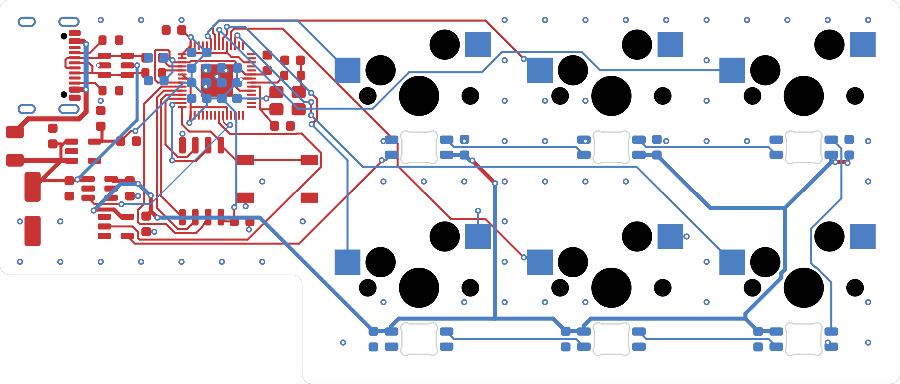

# macropad-route-haiku-20261118-1937

| | |
|---|---|
| Task | route only, placement kept |
| Model | claude-haiku-5-5 (Claude Code, `claude -p`, effort max) |
| Tools given | bt (see the README) |
| Time | 1:34 (finished on its own) |
| Cost at API prices | $6.59 |
| Turns | 219 |
| DRC errors | 0 |
| Unconnected | 0 |
| Copper | 852 mm of track, 107 vias |
| Hosts reached | api.anthropic.com (8), http-intake.logs.us5.datadoghq.com (129) |

DRC is KiCad 10 with zones refilled, on the board the agent saved. Some boards start with findings of their own; see `../../../boards/README.md`.

## Pictures

Start is the board as the agent got it (pads and part outlines; in placement runs the free parts sit in a grid below the board). Reference is the human-routed original ([boards/macropad-top](../../../boards/macropad-top)). The copper pictures show F.Cu (red) and B.Cu (blue) with zone fills left out so the tracks show; DRC errors are circled in magenta on the result.

| Start | Reference | Result |
|---|---|---|
|  |  |  |

## The agent's own summary

From the start of its [NOTES.md](work/NOTES.md):

> Board: `macropad-top.kicad_pcb`, 2 copper layers, JLCPCB standard 2-layer. Placement untouched (no footprint moved, rotated, flipped, added or removed).

Its review of the bt tool: [BT-REVIEW.md](work/BT-REVIEW.md).

## Progress log

Saved by the agent as it worked, failed attempts included. The notes are here; the pictures are in the archive.

- [000 — placement as delivered (no copper)](work/progress/000-placement.md)
- [000b — RP2040 area at placement (no copper)](work/progress/000b-rp2040-area.md)
- [000c — key field at placement (no copper)](work/progress/000c-key-area.md)
- [001 — USB pair, VBUS, +5V tree, CC pulldowns](work/progress/001-usb-vbus-5v.md)
- [002 — crystal nets (applied)](work/progress/002-crystal.md)
- [003 — QSPI, first pass (applied)](work/progress/003-qspi-first.md)
- [004 — +3V3, first trial (not applied)](work/progress/004-3v3-trial.md)
- [004b — +3V3 at 0.2 mm, trial (not applied)](work/progress/004b-3v3-w02-trial.md)
- [005 — +3V3 applied on a scratch copy, before +1V1 (what +1V1 had to fit)](work/progress/005-3v3-before-1v1.md)
- [006 — six GPIO key nets, router trial (5 of 6 connect)](work/progress/006-keys-trial.md)
- [007 — QSPI and +1V1 applied; ratsnest for the rest](work/progress/007-qspi-1v1-applied.md)
- [008 — LED data chain and +5V_LED (trial, then applied)](work/progress/008-led-chain-trial.md)
- [009 — every net connected (ratsnest 0), GND pours on both layers](work/progress/009-all-connected.md)
- [010 — key field as applied](work/progress/010-keys-leds-5v.md)
- [011 — RP2040 area in the final state](work/progress/011-rp2040-final.md)
- [012 — final DRC round, and a stale-fill catch](work/progress/012-final-drc.md)

## Raw files

The prompt is [brief.md](brief.md); the scores are [report.json](report.json). Everything else is in `macropad-route-haiku-20261118-1937.tar.xz`, attached to the `cross-model-2026-11` release:
the full transcript (`transcript.jsonl`), the input board, the agent's working directory with its scripts and intermediate boards, the progress pictures, all renders, the raw DRC and metrics, and the proxy log.
