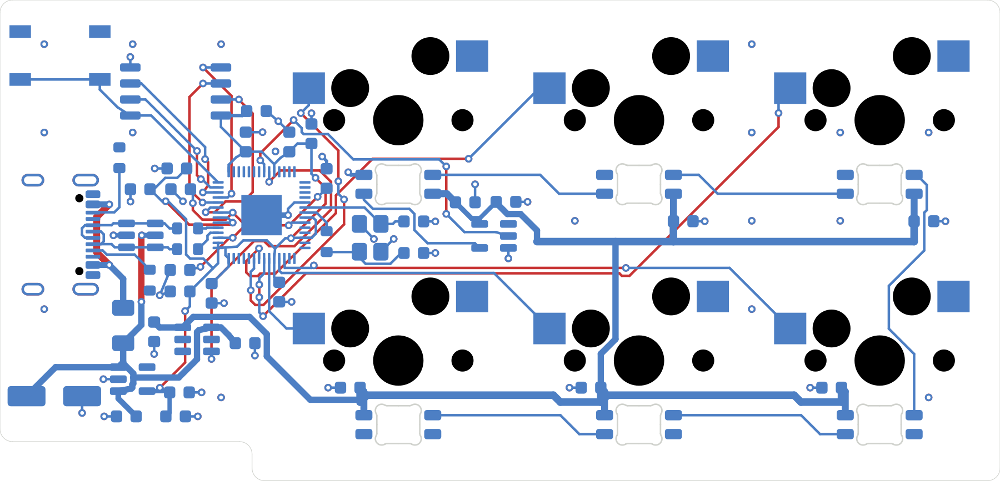

# macropad-small-astra-20261118-1937

| | |
|---|---|
| Task | place the free parts and route |
| Model | gpt-6.2-astra (Codex CLI, `codex exec`, effort high) |
| Tools given | bt (see the README) |
| Time | 0:28 (agent exit 1; resumed 1 time with "Continue." after a plan usage limit, time is agent time only) |
| Cost at API prices | $9.28 (OpenAI list price for the token counts Codex reported, reasoning counted as output) |
| Turns | 121 |
| DRC errors | 0 |
| Unconnected | 0 |
| Copper | 801 mm of track, 94 vias |
| Placement | outline 79.2 × 38.15 mm, parts on top 0 / bottom 42, flagged off the board: J101 (the check also flags parts that overhang the edge on purpose) |
| Hosts reached | auth.openai.com (5), chatgpt.com (157), sdmntprcentralus.oaiusercontent.com (1), sdmntprwestus3.oaiusercontent.com (1), sdmntprsouthcentralus.oaiusercontent.com (1), ab.chatgpt.com (2), sdmntprwestus.oaiusercontent.com (1) |

DRC is KiCad 10 with zones refilled, on the board the agent saved. Some boards start with findings of their own; see `../../../boards/README.md`.

## Pictures

Start is the board as the agent got it (pads and part outlines; in placement runs the free parts sit in a grid below the board). Reference is the human-routed original ([boards/macropad-top](../../../boards/macropad-top)). The copper pictures show F.Cu (red) and B.Cu (blue) with zone fills left out so the tracks show; DRC errors are circled in magenta on the result.

| Start | Reference | Result |
|---|---|---|
|  |  |  |

## The agent's own summary

From the start of its [NOTES.md](work/NOTES.md):

> The bare-board order file is `macropad-top-JLCPCB.zip`. It contains both copper layers, both solder masks, both silkscreens, the routed outline with all six LED windows, and separate plated and non-plated metric drill files. The intended order is a single 79.15 × 38.10 mm board in standard two-layer FR-4, 1.6 mm thick, with 1 oz copper and tented vias. The plated drill file includes the USB shell slots.

Its review of the bt tool: [BT-REVIEW.md](work/BT-REVIEW.md).

## Progress log

Saved by the agent as it worked, failed attempts included. The notes are here; the pictures are in the archive.

- [The supplied board has six locked switch/LED pairs, six LED windows, and 42 loose footprints below the perimeter. The ratsnest includes the RP2040 clock and flash, the USB interface, three logic/power rails and a switched LED supply. This is the placement and connectivity baseline.](work/progress/001-start.md)
- [First placement trial. The left-facing USB receptacle sits on its footprint edge datum and faces the USB pins of the RP2040. The flash and BOOTSEL switch sit above this path. The narrower outline keeps the key geometry. The trial crowded several capacitor courtyards, especially at the crystal and first LED, so this placement was rejected before routing.](work/progress/002-floorplan.md)
- [All 42 loose footprints are on the back. This placement clears the locked socket courtyards, mounting posts, and reverse-LED windows. The connector datum coincides with the straight left edge. KiCad reported zero placement errors, two silk overlaps and the original QFN library warning. The clock load capacitor above the first socket still had a long path, so the oscillator cluster needed a further adjustment.](work/progress/003-placement.md)
- [Moved the load capacitors and series resistor into the crystal cluster. Hand-routed both USB connector orientations through the ESD array and series resistors to the RP2040, entirely on the back. The crystal loop stays on that face as well. The QFN inner pad-row gap carries power escapes clear of the solder pads. A clearance probe caught an initial USB bend and the proximity of two supply escapes before committing the copper.](work/progress/004-usb-clock.md)
- [The first six-net flash routing pass escaped SCLK but obstructed adjacent data pins at the west QFN row. The shove pass recovered SD0 and SD1. SD2 remained open. I kept this view to document the unsuccessful fanout order.](work/progress/005-flash-attempt.md)
- [Added 0.60 mm back-side distribution traces along the LED rows, with local branches to the pixel capacitors, plus the straight inter-pixel data runs. The lower rail bends between the switch center holes and LED windows. A trial straight line crossed the window clearance; the revised path passed the copper probe.](work/progress/006-led-feeds.md)
- [Replaced the first flash routing attempt after its reported 12.17 mm SD0 route measured 37.45 mm of installed copper. The revised fanout uses staggered escapes, deliberate clock and data runs to the SOIC, and a back-side chip-select connection to BOOTSEL. All six nets now connect. The clock and four data nets each measure 11.0–14.8 mm of installed copper.](work/progress/007-qspi.md)
- [Routed each RP2040 supply to a nearby bypass or regulator capacitor first. Added direct regulator input/output capacitor connections, LED switch bypass connections, and a local ground via at the ESD array. Eighteen of nineteen prescribed connections completed. IOVDD pin 22 still needed an escape between the oscillator and neighboring QFN pins.](work/progress/008-local-supplies.md)
- [Both LED row rails and all three supply voltages are connected. Five key inputs, both CC pull-downs, and the LED data chain are routed. The first signal pass left KEY4 and the LED load-switch enable open at the RP2040. These need local escapes before the ground fills can be finalized.](work/progress/009-key-routing.md)
- [All signal and supply nets are connected. A small lateral move of the KEY3 fanout via opened a direct back-side route from the MCU to KEY4. For LED enable, routing from an explicit front-side escape around the MCU cleared a blocked exit. The remaining ratsnest consists of ground connections, before adding pours.](work/progress/010-signals-complete.md)
- [The first ground fills and local return vias connect most of the board. The MCU exposed pad, the C115 ground and the first LED ground still need inspection. KEY3 has been moved away from the crystal body, making space for the crystal ground connections.](work/progress/011-ground-fill.md)
- [Three targeted vias connected the MCU ground island, C115 and the first LED. Moving two digital routes opened the required ground paths. The level-shifter output now reaches the first LED in 12 mm on the back without a via. After refilling, the board has zero airwires.](work/progress/012-ground-closure.md)
- [Final back-side copper and fills. Removed the remaining KEY1 dead branch and redundant via, moved two ground vias clear of nearby SMD solder lands, and marked the BOOTSEL button. KiCad reported zero errors, zero opens and zero schematic-parity differences. The sole warning is the supplied RP2040 footprint’s library mismatch. The Gerbers and separate PTH/NPTH files were exported from this layout.](work/progress/013-release.md)

## Raw files

The prompt is [brief.md](brief.md); the scores are [report.json](report.json). Everything else is in `macropad-small-astra-20261118-1937.tar.xz`, attached to the `cross-model-2026-11` release:
the full transcript (`transcript.jsonl`, converted from Codex's own `codex.jsonl` events, which are there too), the input board, the agent's working directory with its scripts and intermediate boards, the progress pictures, all renders, the raw DRC and metrics, and the proxy log.
