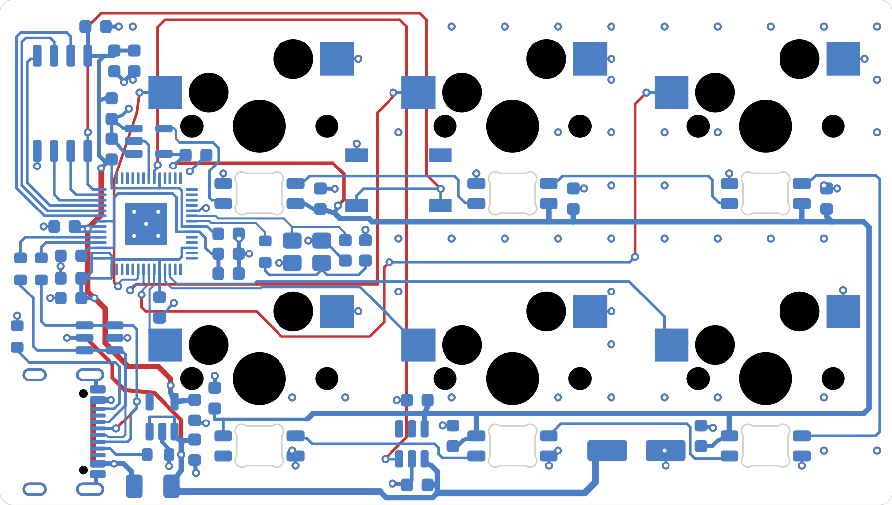

# macropad-small-fable-20261118-1937

| | |
|---|---|
| Task | place the free parts and route |
| Model | claude-fable-5-2 (Claude Code, `claude -p`, effort high) |
| Tools given | bt (see the README) |
| Time | 1:38 (finished on its own) |
| Cost at API prices | $33.20 |
| Turns | 92 |
| DRC errors | 0 |
| Unconnected | 0 |
| Copper | 987 mm of track, 118 vias |
| Placement | outline 67.2 × 38.15 mm, parts on top 0 / bottom 42, flagged off the board: J101 (the check also flags parts that overhang the edge on purpose) |
| Hosts reached | api.anthropic.com (13), http-intake.logs.us5.datadoghq.com (58) |

DRC is KiCad 10 with zones refilled, on the board the agent saved. Some boards start with findings of their own; see `../../../boards/README.md`.

## Pictures

Start is the board as the agent got it (pads and part outlines; in placement runs the free parts sit in a grid below the board). Reference is the human-routed original ([boards/macropad-top](../../../boards/macropad-top)). The copper pictures show F.Cu (red) and B.Cu (blue) with zone fills left out so the tracks show; DRC errors are circled in magenta on the result.

| Start | Reference | Result |
|---|---|---|
|  |  |  |

## The agent's own summary

From the start of its [NOTES.md](work/NOTES.md):

> Result: `macropad-top.kicad_pcb`, 2 layers, 67.15 × 38.1 mm rectangle (R1 corners).
> KiCad 10 DRC (with courtyards and schematic parity): **0 errors, 0 unconnected, 0 parity issues,
> 3 warnings** (see "Known issues"). Locked switches/LEDs untouched; all 42 placed parts are on B.Cu.
> The step-by-step picture log is in `progress/`.

Its review of the bt tool: [BT-REVIEW.md](work/BT-REVIEW.md).

## Progress log

Saved by the agent as it worked, failed attempts included. The notes are here; the pictures are in the archive.

- [001 – starting point](work/progress/001-start.md)
- [002 – first placement attempt (thrown away in part)](work/progress/002-placement-v1.md)
- [003 – placement v2 (kept)](work/progress/003-placement-v2.md)
- [004 – first copper: under-chip links, QSPI, USB](work/progress/004-usb-qspi.md)
- [005 – back layer routing (signals, LED chain, power)](work/progress/005-back-layer-routing.md)
- [006 – front-layer links, ground pours, first full check](work/progress/006-front-layer-and-ground.md)
- [007 – final board](work/progress/007-final.md)

## Raw files

The prompt is [brief.md](brief.md); the scores are [report.json](report.json). Everything else is in `macropad-small-fable-20261118-1937.tar.xz`, attached to the `cross-model-2026-11` release:
the full transcript (`transcript.jsonl`), the input board, the agent's working directory with its scripts and intermediate boards, the progress pictures, all renders, the raw DRC and metrics, and the proxy log.
