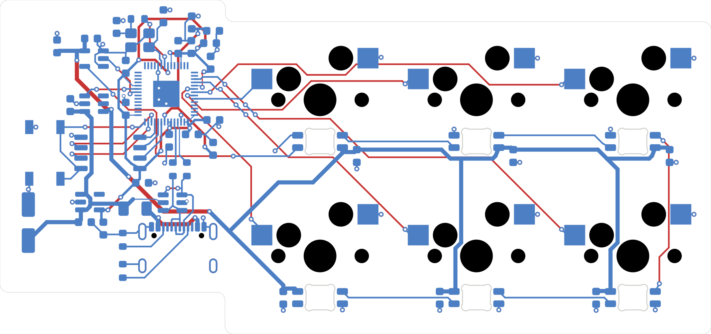

# macropad-small-haiku-20261118-1937

| | |
|---|---|
| Task | place the free parts and route |
| Model | claude-haiku-5-5 (Claude Code, `claude -p`, effort max) |
| Tools given | bt (see the README) |
| Time | 1:27 (finished on its own) |
| Cost at API prices | $9.23 |
| Turns | 42 |
| DRC errors | 0 |
| Unconnected | 0 |
| Copper | 836 mm of track, 92 vias |
| Placement | outline 86.65 × 40.8 mm, parts on top 0 / bottom 42 |
| Hosts reached | api.anthropic.com (9), http-intake.logs.us5.datadoghq.com (147) |

DRC is KiCad 10 with zones refilled, on the board the agent saved. Some boards start with findings of their own; see `../../../boards/README.md`.

## Pictures

Start is the board as the agent got it (pads and part outlines; in placement runs the free parts sit in a grid below the board). Reference is the human-routed original ([boards/macropad-top](../../../boards/macropad-top)). The copper pictures show F.Cu (red) and B.Cu (blue) with zone fills left out so the tracks show; DRC errors are circled in magenta on the result.

| Start | Reference | Result |
|---|---|---|
|  |  |  |

## The agent's own summary

From the start of its [NOTES.md](work/NOTES.md):

> Board: `/work/macropad-top.kicad_pcb` (KiCad 10). Checks at the end of the work:
> - `bt check`: CHECK OK, 0 DRC errors, 2 warnings, 0 unconnected, 0 nets in pieces.
> - KiCad's own DRC (`kicad-cli pcb drc`): 0 errors, 2 warnings, 0 unconnected, 0 schematic-parity issues.
> - `bt same` against the original: no locked footprint moved; no footprint added or removed; no pad net changed.

Its review of the bt tool: [BT-REVIEW.md](work/BT-REVIEW.md).

## Progress log

Saved by the agent as it worked, failed attempts included. The notes are here; the pictures are in the archive.

- [001 start: the board as received](work/progress/001-start.md)
- [002 core parts placed (left block, first pass)](work/progress/002-core-placed.md)
- [003 left block placed (full first pass)](work/progress/003-block-placed.md)
- [004 key area: LED decoupling caps](work/progress/004-leds-decoupled.md)
- [005 every part placed](work/progress/005-all-placed.md)
- [006 USB, VBUS, +5V and +3V3 routed](work/progress/006-usb-power-routed.md)
- [007 RP2040 bottom escape](work/progress/007-mcu-escape.md)
- [008 key strip: first attempts (scratch)](work/progress/008-keys-strip-scratch.md)
- [009 escape vias for the six key pins](work/progress/009-key-escape.md)
- [010 six keys routed, QSPI untangled, DRC clean](work/progress/010-keys-qspi-clean.md)
- [011 all signal nets routed (before the GND vias)](work/progress/011-all-signals-routed.md)
- [012 GND vias, dangling vias removed: DRC clean](work/progress/012-gnd-vias-clean.md)
- [013 outline set, final checks](work/progress/013-final-outline.md)

## Raw files

The prompt is [brief.md](brief.md); the scores are [report.json](report.json). Everything else is in `macropad-small-haiku-20261118-1937.tar.xz`, attached to the `cross-model-2026-11` release:
the full transcript (`transcript.jsonl`), the input board, the agent's working directory with its scripts and intermediate boards, the progress pictures, all renders, the raw DRC and metrics, and the proxy log.
