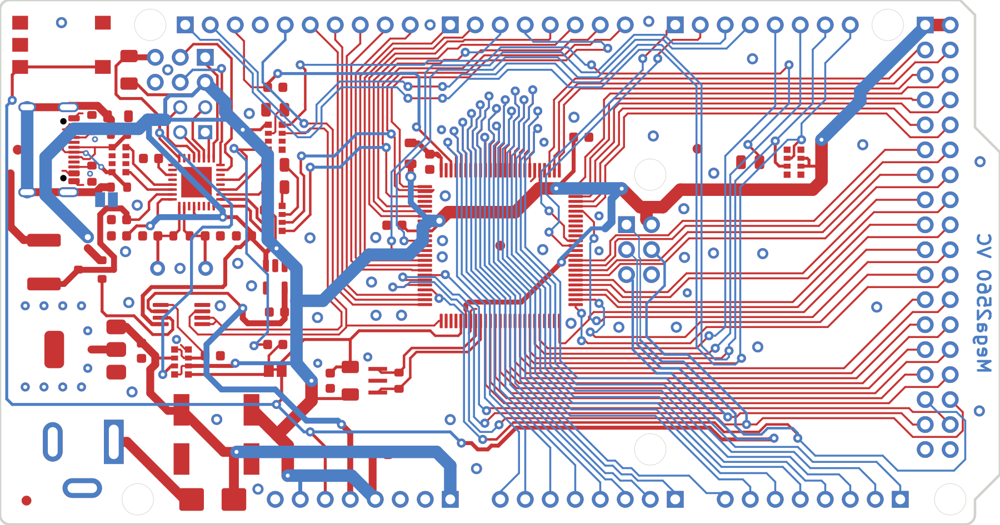
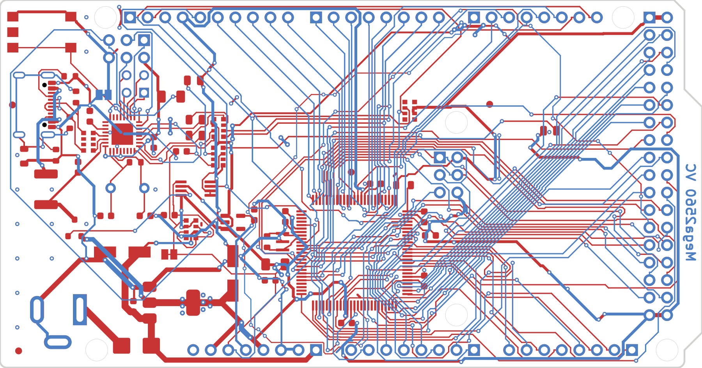

# mega-place-astra-20261119-2320

| | |
|---|---|
| Task | place the free parts and route |
| Model | gpt-6.2-astra (Codex CLI, `codex exec`, effort high) |
| Tools given | bt (see the README) |
| Time | 2:14 (agent exit 1; agent exit 1 (leg 1); agent exit 1 (leg 2); resumed 3 times with "Continue." after a plan usage limit, time is agent time only) |
| Cost at API prices | $37.10 (OpenAI list price for the token counts Codex reported, reasoning counted as output) |
| Turns | 443 |
| DRC errors | 4 (courtyards_overlap 4) |
| Unconnected | 0 |
| Copper | 5364 mm of track, 287 vias |
| Placement | outline 101.85 × 53.59 mm, parts on top 48 / bottom 1 |
| Hosts reached | chatgpt.com (506), sdmntprwestus.oaiusercontent.com (1), sdmntprcentralus.oaiusercontent.com (1), sdmntprsouthcentralus.oaiusercontent.com (1), repo.maven.apache.org (15), registry.npmjs.org (3), deb.debian.org (1), downloads.sourceforge.net (1), pypi.org (10), files.pythonhosted.org (8), data.jsdelivr.com (1), repos.ecosyste.ms (1), www.google.com (1), ab.chatgpt.com (4), auth.openai.com (1); denied: api.github.com, github.com, codeload.github.com, raw.githubusercontent.com, cdn.jsdelivr.net |

DRC is KiCad 10 with zones refilled, on the board the agent saved. Some boards start with findings of their own; see `../../../boards/README.md`.

## Pictures

Start is the board as the agent got it (pads and part outlines; in placement runs the free parts sit in a grid below the board). Reference is the human-routed original ([boards/mega](../../../boards/mega)). The copper pictures show F.Cu (red) and B.Cu (blue) with zone fills left out so the tracks show; DRC errors are circled in magenta on the result.

| Start | Reference | Result |
|---|---|---|
|  |  |  |

## The agent's own summary

From the start of its [NOTES.md](work/NOTES.md):

> The fabrication archive contains the nine Gerber layers and the separate plated and non-plated Excellon drill files for the saved KiCad 10.0.8 board. The board is 1.6 mm thick and has two copper layers. The finished profile measures 101.60 × 53.34 mm on the routing centerline. Its six 3.20 mm mounting holes are circular cutouts on Edge.Cuts.

Its review of the bt tool: [BT-REVIEW.md](work/BT-REVIEW.md).

## Progress log

Saved by the agent as it worked, failed attempts included. The notes are here; the pictures are in the archive.

- [The input has two copper layers, 66 footprints, six outline cutouts and no routes. The fixed headers, connectors, fiducials and USB clock dictate the floorplan. The loose parts start below the board.](work/progress/001-as-received.md)
- [I grouped the USB bridge around the fixed HC49 crystal, the regulator around the jack, and the Mega near the analog headers. The first coordinates failed the grouped placement trial on 30 moves. The crystal courtyard and its load capacitors, the jack-side bulk capacitors, and the USB fuse needed more room. This image records the rejected trial.](work/progress/002-first-floorplan.md)
- [The ATmega2560 sits between the analog headers and the USB/power section with a resonator at its oscillator side. The USB bridge faces both the Type-C data pins and the fixed crystal. The jack diode, two bulk capacitors, regulators and power selector occupy the lower left. JP1 is the original underside jumper. I used the existing LED legends to position the four indicators.](work/progress/003-placed.md)
- [The USB-C duplicate data contacts join at the connector. The main data paths reach RN2 and U4 on top. I routed both clocks, the UCAP connection, the AVCC filter and the Mega’s four local digital bypass loops before opening the board to I/O routing. The jack-to-diode and regulator-input path uses 1 mm copper where it fits. The thirty requested local connections all closed on F.Cu without vias.](work/progress/004-critical-routes.md)
- [The first KiCad DRC on the local routing found no new copper errors. The front legend plot showed an assembly problem that the copper view missed. The original POWER and ANALOG IN lettering and logo run through the new MCU land pattern. The locked footprints still account for all four courtyard errors. The short ground vias will need their pours before their connectivity can be checked.](work/progress/005-legend-conflicts.md)
- [I moved the two-piece front logo into the open space above the MEGA wordmark, shortened the header separator lines, and adjusted the POWER, ANALOG IN and A0 legends around their headers. KiCad found zero new silkscreen collisions on this revision relative to the original. The signal router is running with dedicated underside corridors kept clear under the clocks and USB pair.](work/progress/006-clear-legends.md)
- [I compared the multi-net router with a Specctra global-routing trial that reserved the local clock, USB and bypass traces. After importing the latter, eight nets still needed connections. Most of the remaining airwires belonged to GND and +5V. Several header signals were also open. This is the trial capture before planes or repairs.](work/progress/007-global-route-trial.md)
- [I filled the reverse side with ground and tried a 5 V pour on the component side to spread heat at U1 and carry current to the expansion headers. The first fills left separate islands on both rails. Ground drops beside SMD pads joined several of them. The bridge supply pins also needed a change to the crystal feedback resistor placement and local routing.](work/progress/008-plane-trial.md)
- [I used the boundaries of the filled copper islands to choose layer changes for supply and return paths. This let several 5 V sections join close to their edges. I also moved the USB crystal feedback resistor slightly, escaped both bridge supply pins, and restored both crystal nets on top. KiCad found 12 open connections at the first check after these repairs, down from 244 in the input.](work/progress/009-power-bridges.md)
- [I rebuilt the power distribution before routing the shield I/O. The regulator feeds the power header, the ICSP header and the far expansion header through dedicated copper. The USB bridge supply and analog ground pins have explicit escapes. This version also restores the front legend adjustments from entry 006. I carried this checkpoint forward so the rail paths could be checked independently of the pours.](work/progress/010-wired-supplies.md)
- [The 5 V and ground pads now have explicit copper paths before any fill is counted. I added ground on both faces and reserved copper at the NCP1117 output tab for heat spreading. The local regulator copper has priority over the ground pours. The USB protection, both MCU clocks and the power circuits are held in place during the remaining signal-routing search.](work/progress/011-return-copper.md)
- [The first signal passes encountered congestion where GPIO leaves U3 beside a bypass capacitor or a supply branch. I tried early routes for several boxed-in pins, then reserved staggered via exits on the inner side of selected QFP pads. The other pins still have top-side exits. I am comparing this routing trial against the unescaped version on the same outline.](work/progress/012-mcu-escapes.md)
- [This signal-routing pass used the finished 5 V and ground tracks as obstacles. The headers now have most of their connections. KiCad found 22 open connections, concentrated around the large MCU, the bridge and the resistor arrays. I saved this version before letting the router move selected signal traces and lower-current power branches.](work/progress/013-header-fanout.md)
- [I joined the remaining comparator-sense branch and added five 0.7 mm vias with 0.3 mm drills beside the regulator output tab. The vias fall outside its solderable pad and connect the copper spreaders on the two faces. A reset trace occupies one of the candidate via rows, so I used the clear sites on either side and refilled the board.](work/progress/014-regulator-tab.md)
- [This placement trial rotates the Mega together with its clock, reset, analog filter and bypass capacitors. The PL pins face the far header in matching order. The jack and USB section stay in place. The earlier orientation subsequently achieved complete signal routing, so I kept it as the working layout and concentrated on its supply distribution.](work/progress/015-rotated-mega.md)
- [After freeing the central routing corridors and allowing the existing signals to move, the global signal route completed. KiCad confirmed every connector I/O and USB-bridge signal. The remaining opens were five on GND, 25 on +5V, three on AREF and one on VIN's protected VCC net. The ADC reference, regulator feeds and ground islands now need individual connections.](work/progress/016-signals-connected.md)
- [The component side now has a broad 5 V pour, with ground on the back and in the remaining front-side area. I traced each disconnected island to the nearest reachable copper and used checked tracks and vias to bridge it. This closed the protected jack supply, restored the main power-header feeds and brought the ratsnest down to five links on +5V, four on GND and one on AREF.](work/progress/017-supply-bridges.md)
- [All digital, USB, clock and reference signals are connected. The regulator has eight clear heat-spreader vias outside its tab pad. I provided ground copper at the two return pins on the far header and removed isolated copper left from an earlier bridge. This KiCad run has five open supply or ground links and no new clearance, thermal-relief or dangling-copper violations. I am testing explicit copper connections for the remaining supply islands.](work/progress/018-return-review.md)
- [C5 now has a ground return from the AREF bypass to the surrounding copper. The 0.15 mm section passes two corners of its neighboring rounded pad. The bt probe flagged those corners using a more conservative clearance envelope. I checked the actual land pattern in KiCad with a fresh fill. DRC found no new rule violations and four remaining supply links.](work/progress/019-aref-return.md)
- [I routed explicit connections through the existing pour copper to keep the supply and ground paths intact when an I/O route moves. Those tracks follow the available copper around the bypass capacitors, regulators and headers. This routing pass joins all supplies, all returns and the comparator sense circuit. The only remaining airwires are TXD3 and PL5, both between the Mega and a fixed header.](work/progress/020-wired-returns.md)
- [KiCad's refilled-board check confirms PL5 is continuous from the Mega to the far shield header. The new trace passes two rounded passive pads without a copper clearance violation. TXD3 is the only remaining open connection; its adjacent RXD3 escape limits the available space under U3.](work/progress/021-pl5-connected.md)
- [KiCad reports zero open connections and zero new DRC findings relative to the input. Two short RXD3 fanout shifts gave TXD3 room at the main processor and the power header. I removed an unused AREF via and a dead PL0 branch, completed the J5 ground-pin thermal relief, and added eight vias outside the regulator tab to tie its two copper spreaders together.](work/progress/022-all-connected.md)
- [I removed the open drill from the USB controller's exposed ground pad. Removing it alone disconnected U4 pins 3, 28 and 33. Two 0.30 mm return drills now sit between the exposed land and the two ground leads. Short top copper joins each lead to the exposed pad. KiCad confirms all pads are connected and the new geometry introduces no DRC findings.](work/progress/023-usb-controller-ground.md)
- [These are the top and underside views reconstructed from the fabrication archive. I simplified the last PL5 route from 83 to 36 track segments and refilled all six zones. KiCad reports zero unconnected items, zero new errors and zero new warnings. The independent archive read found nine Gerbers, separate plated and non-plated drill files and seven closed profile contours, including the six 3.20 mm mounting holes. The four supplied locked courtyard overlaps remain visible in the project DRC.](work/progress/024-fabrication-plots.md)

## Raw files

The prompt is [brief.md](brief.md); the scores are [report.json](report.json). Everything else is in `mega-place-astra-20261119-2320.tar.xz`, attached to the `cross-model-2026-11` release:
the full transcript (`transcript.jsonl`, converted from Codex's own `codex.jsonl` events, which are there too), the input board, the agent's working directory with its scripts and intermediate boards, the progress pictures, all renders, the raw DRC and metrics, and the proxy log.
