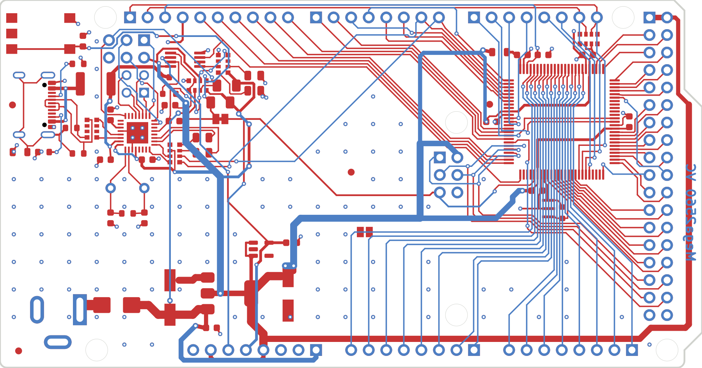

# mega-place-fable-20261119-1148

| | |
|---|---|
| Task | place the free parts and route |
| Model | claude-fable-5-2 (Claude Code, `claude -p`, effort high) |
| Tools given | bt (see the README) |
| Time | 1:53 (finished on its own) |
| Cost at API prices | $45.48 |
| Turns | 147 |
| DRC errors | 4 (courtyards_overlap 4) |
| Unconnected | 0 |
| Copper | 3364 mm of track, 216 vias |
| Placement | outline 101.85 × 53.59 mm, parts on top 49 / bottom 0 |
| Hosts reached | api.anthropic.com (11), http-intake.logs.us5.datadoghq.com (92) |

DRC is KiCad 10 with zones refilled, on the board the agent saved. Some boards start with findings of their own; see `../../../boards/README.md`.

## Pictures

Start is the board as the agent got it (pads and part outlines; in placement runs the free parts sit in a grid below the board). Reference is the human-routed original ([boards/mega](../../../boards/mega)). The copper pictures show F.Cu (red) and B.Cu (blue) with zone fills left out so the tracks show; DRC errors are circled in magenta on the result.

| Start | Reference | Result |
|---|---|---|
|  |  |  |

## The agent's own summary

From the start of its [NOTES.md](work/NOTES.md):

> Result: `/work/Arduino_Mega_2560.kicad_pcb`, 2 layers, all 49 loose parts placed on F.Cu, fully routed,
> GND poured on both layers. KiCad 10 DRC: 0 unconnected, 4 errors – all four are courtyard overlaps between
> *locked* parts (J2/J3, J2/J6, J1/FID3, J4/FID2) that are in the board as delivered. Locked parts, outline and
> mounting holes untouched (`bt same` ok). Generator scripts for the hand-drawn copper are in `/work/scripts`,
> the step-by-step pictures in `/work/progress`.

Its review of the bt tool: [BT-REVIEW.md](work/BT-REVIEW.md).

## Progress log

Saved by the agent as it worked, failed attempts included. The notes are here; the pictures are in the archive.

- [001 – first placement](work/progress/001-first-placement.md)
- [002 – escapes under U3 (hand-generated, scripts/a_adc.py … d_decap.py)](work/progress/002-u3-under-chip-escape.md)
- [003 – U3 fan-out to J5/J8 and the trunk to J7/J6](work/progress/003-u3-fanout-trunk.md)
- [004 – everything round U3 connected](work/progress/004-u3-complete.md)
- [005 – USB-C, 16U2, power input and the +5 V trunks](work/progress/005-usb-power-west.md)
- [005a – discarded: first autoroute of the 16U2 / power-select area](work/progress/005a-autoroute-attempt-discarded.md)
- [006 – last nets, ground pours, checks](work/progress/006-routed-with-pours.md)

## Raw files

The prompt is [brief.md](brief.md); the scores are [report.json](report.json). Everything else is in `mega-place-fable-20261119-1148.tar.xz`, attached to the `cross-model-2026-11` release:
the full transcript (`transcript.jsonl`), the input board, the agent's working directory with its scripts and intermediate boards, the progress pictures, all renders, the raw DRC and metrics, and the proxy log.
