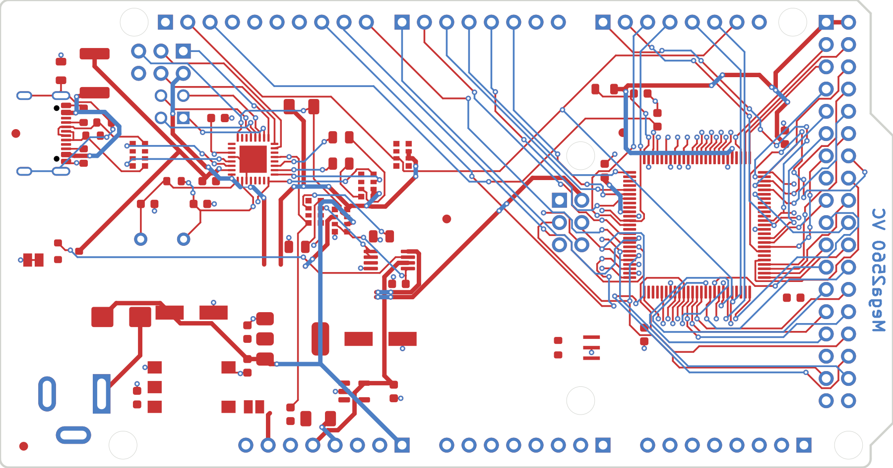

# mega-place-haiku-20261119-1149

| | |
|---|---|
| Task | place the free parts and route |
| Model | claude-haiku-5-5 (Claude Code, `claude -p`, effort max) |
| Tools given | bt (see the README) |
| Time | 2:48 (finished on its own) |
| Cost at API prices | $9.02 |
| Turns | 24 |
| DRC errors | 4 (courtyards_overlap 4) |
| Unconnected | 58 items in 29 nets |
| Copper | 2385 mm of track, 214 vias |
| Placement | outline 101.85 × 53.59 mm, parts on top 49 / bottom 0 |
| Hosts reached | api.anthropic.com (28), http-intake.logs.us5.datadoghq.com (130) |

DRC is KiCad 10 with zones refilled, on the board the agent saved. Some boards start with findings of their own; see `../../../boards/README.md`.

## Pictures

Start is the board as the agent got it (pads and part outlines; in placement runs the free parts sit in a grid below the board). Reference is the human-routed original ([boards/mega](../../../boards/mega)). The copper pictures show F.Cu (red) and B.Cu (blue) with zone fills left out so the tracks show; DRC errors are circled in magenta on the result.

| Start | Reference | Result |
|---|---|---|
|  |  |  |

## The agent's own summary

From the start of its [NOTES.md](work/NOTES.md):

> - 27 signal nets are still open: ADC0–ADC15 (16), XTAL1, XTAL2, RESET, PB7, PB5, PB6, PB3, PE0, PE1,
>   SCL, PC3. Seven GND pour pieces and six +5V pour pieces are not joined to their pour (listed below).
> - Everything else is routed or is a locked footprint. The two pours (GND, +5V) are only partly joined (see Problems 7).
> - Locked footprints: unchanged (`bt same` clean). Board outline and mounting holes: unchanged.
> - Net classes and rules: Default (clearance 0.15, track 0.2, via 0.6/0.3); Power (+5V, VCC, +3.3V,
>   Net-(D4-A), USBVCC, XVCC: track 0.5, via 0.6/0.3). Board minimums: clearance 0.127, track 0.127,
>   edge 0.5. Vias everywhere are 0.6/0.3 (JLCPCB standard).
> - Pours: GND on B.Cu over the outline, solid connection to all pads (changed from thermal on the
>   through-hole pads, which left one starved thermal).
>   +5V on F.Cu over the bottom-left power block (box 104–156 × 108–126).
> - KiCad DRC (kicad-cli on the saved file): 58 unconnected items; 4 courtyard overlaps between
>   locked footprints that were already in the file (J2/J3, J2/J6, FID3/J1, FID2/J4; I may not move
>   locked parts); 50 dangling escape vias belonging to the open nets; 1 starved thermal (fixed);
>   92 silk-over-copper and 67 silk-overlap warnings (footprint graphics over their own pads; I may not
>   change footprint definitions); 51 library-footprint mismatch warnings.
> - `bt check`: CHECK FAILED — 58 unconnected items, 29 nets in pieces (the 27 signal nets and the
>   GND and +5V pour pieces).

Its review of the bt tool: [BT-REVIEW.md](work/BT-REVIEW.md).

## Progress log

Saved by the agent as it worked, failed attempts included. The notes are here; the pictures are in the archive.

- [001 — initial board (as delivered)](work/progress/001-initial.md)
- [002 — major parts placed (top side)](work/progress/002-major-parts.md)
- [003 — every part placed](work/progress/003-all-placed.md)
- [004 — TQFP dog-bone escape (written to the board)](work/progress/004-tqfp-escape.md)
- [005 — ATmega16U2 dog-bone escape (written to the board)](work/progress/005-u4-escape.md)
- [006 — J5 corridor: the 30-signal bundle, and the attempts that did not finish (scratch copies)](work/progress/006-j5-corridor-attempts.md)
- [007 — 16U2 / USB / LED group routed (real board)](work/progress/007-u4-group-routed.md)
- [008 — top-right corner: where SCL cannot get through](work/progress/008-top-right-corner.md)
- [009 — whole board after the 16U2, J8 and west-face groups (real board)](work/progress/009-after-wface.md)
- [010 — ADC bus, both layers, west-face lanes out of the way (scratch copy, not kept as is)](work/progress/010-adc-both-layers-10of16.md)
- [011 — final state of this session (not finished)](work/progress/011-final-state.md)

## Raw files

The prompt is [brief.md](brief.md); the scores are [report.json](report.json). Everything else is in `mega-place-haiku-20261119-1149.tar.xz`, attached to the `cross-model-2026-11` release:
the full transcript (`transcript.jsonl`), the input board, the agent's working directory with its scripts and intermediate boards, the progress pictures, all renders, the raw DRC and metrics, and the proxy log.
