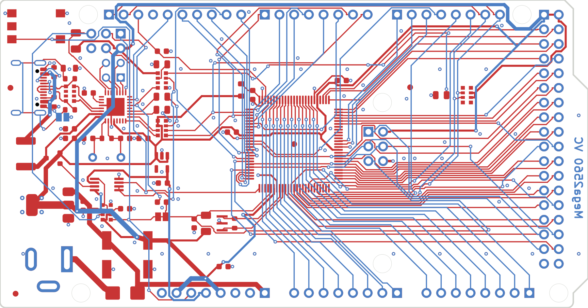

# mega-route-astra-20261119-1818

| | |
|---|---|
| Task | route only, placement kept |
| Model | gpt-6.2-astra (Codex CLI, `codex exec`, effort high) |
| Tools given | bt (see the README) |
| Time | 0:23 (finished on its own) |
| Cost at API prices | $6.37 (OpenAI list price for the token counts Codex reported, reasoning counted as output) |
| Turns | 159 |
| DRC errors | 12 (courtyards_overlap 12) |
| Unconnected | 0 |
| Copper | 4603 mm of track, 200 vias |
| Hosts reached | chatgpt.com (106), sdmntprcentralus.oaiusercontent.com (1), sdmntprsouthcentralus.oaiusercontent.com (1), sdmntprwestus.oaiusercontent.com (1), repo.maven.apache.org (6), deb.debian.org (11), freerouting.org (2), www.freerouting.org (2), registry.npmjs.org (7), pypi.org (6), files.pythonhosted.org (4), registry.hub.docker.com (6), downloads.kicad.org (1), repository.kicad.org (1), www.freerouting.net (1), metadata.googlezip.net (1), search.maven.org (1), www.layouteditor.com (1), layouteditor.com (1), api.registry.kicad.org (1), auth.docker.io (5), registry-1.docker.io (10), production.cloudfront.docker.com (5), ab.chatgpt.com (1); denied: github.com, api.github.com, codeload.github.com, cdn.jsdelivr.net |

DRC is KiCad 10 with zones refilled, on the board the agent saved. Some boards start with findings of their own; see `../../../boards/README.md`.

## Pictures

Start is the board as the agent got it (pads and part outlines; in placement runs the free parts sit in a grid below the board). Reference is the human-routed original ([boards/mega](../../../boards/mega)). The copper pictures show F.Cu (red) and B.Cu (blue) with zone fills left out so the tracks show; DRC errors are circled in magenta on the result.

| Start | Reference | Result |
|---|---|---|
|  |  |  |

## The agent's own summary

From the start of its [NOTES.md](work/NOTES.md):

> The saved KiCad 10.0.8 board has **zero unconnected items and zero new DRC errors or warnings** against the supplied placement. All 66 footprint blocks and all board-level drawing blocks compare byte-for-byte with the input. A separate check matched the identities, locations, orientations, sides, pad geometry and net assignments of all 410 pads.

Its review of the bt tool: [BT-REVIEW.md](work/BT-REVIEW.md).

## Progress log

Saved by the agent as it worked, failed attempts included. The notes are here; the pictures are in the archive.

- [The fixed placement has 66 footprints and 244 open connections. The USB bridge and power selector share the small west end. The 100-pin MCU fans out to three sides of the board, and its ADC pins face away from their headers. I reserved the local USB, oscillator and supply connections for the first routing stage. The original KiCad check also found 12 courtyard overlaps and 101 warnings.](work/progress/001-placement.md)
- [The USB connector, series resistors and 16U2 now have front-layer data paths. Two vias cross the duplicate D− contact under the connector. Several trial bends crowded C12, R4 or the resistor-array pads. I adjusted them and probed the complete geometry before applying it. The USB crystal and Mega resonator are also routed on the front without vias, as are UCAP and the filtered analog supply.](work/progress/002-usb-clock.md)
- [The jack-to-diode feed is 1.05 mm. The protected input, regulator tab, USB fuse and 5 V header feeds have wider paths than the logic signals. Local supply and return connections were also reserved at the two MCUs. Two links timed out in the first batch, including the regulator output to its bulk capacitor. I retained the successful links and gave the regulator connection a separate pass.](work/progress/003-power.md)
- [All sixteen analog inputs now escape the north edge of the Mega into staggered rows of vias under the package. The back-layer traces travel south in pin order toward J9 and J10. The first fan pattern put two lanes too close to a mounting hole. I kept fourteen complete lanes and both partial escapes, then worked on the two approaches to J10 separately.](work/progress/004-analog-fanout.md)
- [ADC6 and ADC7 now pass the lower mounting hole on the same layer as the rest of the bank. Routing ADC6 alone had taken some of ADC7’s corridor. Moving two corners gave both lanes room, and the complete replacement passed the copper probe. Each analog channel uses one through via. Local ground vias were also added near the bypass capacitors and MCU ground pins.](work/progress/005-analog-complete.md)
- [I fixed the local circuits, power trunks and analog fanout in the routing exchange, then used Freerouting for the remaining digital nets and supply branches. One exchange trial represented the outer edge as a closed keepout path and generated no new routes. Narrow polygon strips along the edge worked. The second result had one open RESET branch, which bt connected to J11. The unfilled ground network is still visible at this stage.](work/progress/006-digital-route.md)
- [Both faces now carry ground pours. Smaller, higher-priority 5 V areas spread heat from the regulator tab across four vias. The first fill left three disconnected ground groups and a one-spoke thermal at the ICSP header. KiCad also found small dangling track ends from the routing exchange. I used these results to guide the finishing pass.](work/progress/007-first-fill.md)
- [An 8 mm stitching grid joined some ground regions but missed two connections. I temporarily retained floating fill on a copy and looked for overlaps between top and bottom ground regions where a standard via fit. The added stitches also provide nearby returns at signal transitions. With island removal restored, KiCad reports zero open connections and no dangling copper. The ICSP header’s front thermal still has only one spoke.](work/progress/008-ground-stitching.md)
- [A narrower global thermal setting still left J12 pin 6 with a single front spoke. I restored the original pour settings and added a 0.42 mm front track from the pin to the adjacent ground stitching via. The saved refill now has zero open connections and exactly the original placement and artwork findings. The next check addresses 5 V distribution to the far header.](work/progress/009-header-return.md)
- [The first digital pass fed the far shield header through distributed 0.35 mm logic-supply branches. I gave J5 its own feed from the regulator through J2 and along the top edge on the back. Most of this feed is 0.55–0.65 mm wide. Moving the power LED route freed the long straight corridor. Seven-via cross-board supply alternatives were discarded. U3 pin 31 now receives its branch through C6.](work/progress/010-shield-supply.md)
- [Front and back views from the final Gerber and drill export. I verified the profile as seven closed contours, including all six round mounting cutouts, and checked all 200 via drill locations and diameters. The bare-board ZIP contains seven Gerbers and two drill files. The saved board passes the routing comparison with zero new DRC findings and zero open connections. The original courtyard, silkscreen and library findings are recorded in NOTES.md.](work/progress/011-fabrication-preview.md)

## Raw files

The prompt is [brief.md](brief.md); the scores are [report.json](report.json). Everything else is in `mega-route-astra-20261119-1818.tar.xz`, attached to the `cross-model-2026-11` release:
the full transcript (`transcript.jsonl`, converted from Codex's own `codex.jsonl` events, which are there too), the input board, the agent's working directory with its scripts and intermediate boards, the progress pictures, all renders, the raw DRC and metrics, and the proxy log.
