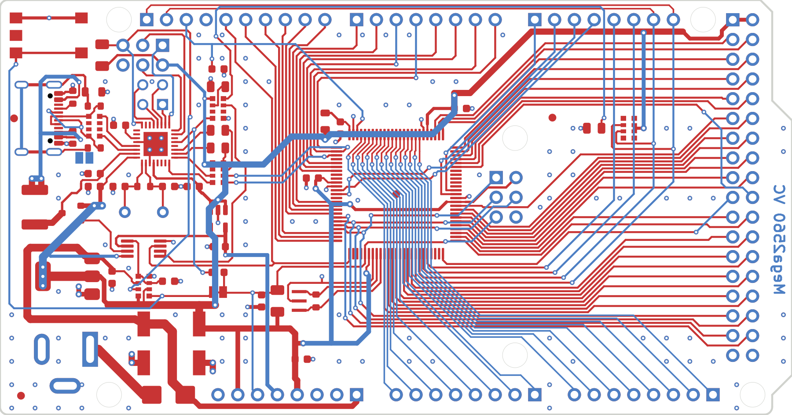

# mega-route-fable-20261119-1148

| | |
|---|---|
| Task | route only, placement kept |
| Model | claude-fable-5-2 (Claude Code, `claude -p`, effort high) |
| Tools given | bt (see the README) |
| Time | 1:19 (finished on its own) |
| Cost at API prices | $31.16 |
| Turns | 110 |
| DRC errors | 12 (courtyards_overlap 12) |
| Unconnected | 0 |
| Copper | 4641 mm of track, 221 vias |
| Hosts reached | api.anthropic.com (12), http-intake.logs.us5.datadoghq.com (63) |

DRC is KiCad 10 with zones refilled, on the board the agent saved. Some boards start with findings of their own; see `../../../boards/README.md`.

## Pictures

Start is the board as the agent got it (pads and part outlines; in placement runs the free parts sit in a grid below the board). Reference is the human-routed original ([boards/mega](../../../boards/mega)). The copper pictures show F.Cu (red) and B.Cu (blue) with zone fills left out so the tracks show; DRC errors are circled in magenta on the result.

| Start | Reference | Result |
|---|---|---|
|  |  |  |

## The agent's own summary

From the start of its [NOTES.md](work/NOTES.md):

> Board file: `Arduino_Mega_2560.kicad_pcb` (KiCad 10), rules in `Arduino_Mega_2560.kicad_pro`
> and `Arduino_Mega_2560.kicad_dru`. Placement is untouched (`bt same`: nothing moved, added or
> removed, pad nets unchanged).

Its review of the bt tool: [BT-REVIEW.md](work/BT-REVIEW.md).

## Progress log

Saved by the agent as it worked, failed attempts included. The notes are here; the pictures are in the archive.

- [001 – starting point and rules](work/progress/001-start.md)
- [002 – under the ATmega2560](work/progress/002-u3-interior.md)
- [003 – east side fan-out (ports A, C, G, L, UARTs, I2C)](work/progress/003-east-fan.md)
- [004 – ADC bus to J10/J9, I2C/UART1 to J8, top-edge strip](work/progress/004-adc-bus.md)
- [005 – west side of the MCU: header nest, crystal corner, SPI drop](work/progress/005-west-nest.md)
- [006 – USB, bridge MCU, power, and the rest of the west side](work/progress/006-all-signals.md)
- [007 – ground: vias at every ground pad, pours on both layers, stitching](work/progress/007-ground-back-first-fill.md)
- [008 – final state](work/progress/008-final-both.md)

## Raw files

The prompt is [brief.md](brief.md); the scores are [report.json](report.json). Everything else is in `mega-route-fable-20261119-1148.tar.xz`, attached to the `cross-model-2026-11` release:
the full transcript (`transcript.jsonl`), the input board, the agent's working directory with its scripts and intermediate boards, the progress pictures, all renders, the raw DRC and metrics, and the proxy log.
