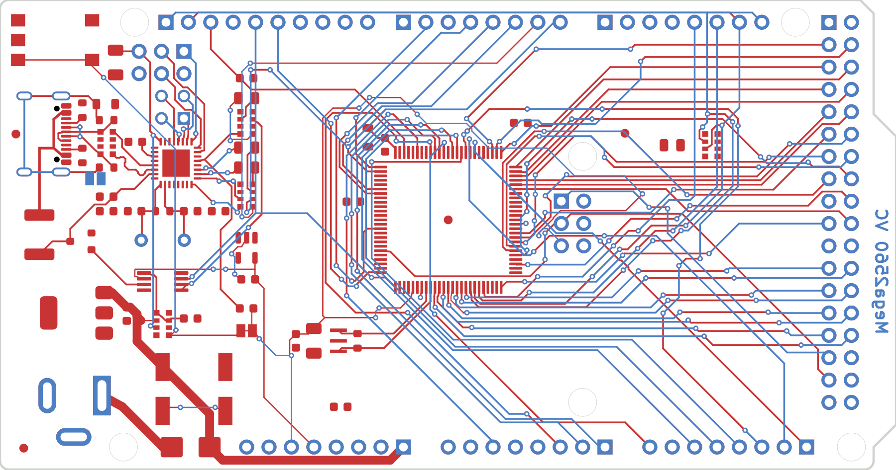

# mega-route-haiku-20261119-1148

| | |
|---|---|
| Task | route only, placement kept |
| Model | claude-haiku-5-5 (Claude Code, `claude -p`, effort max) |
| Tools given | bt (see the README) |
| Time | 2:17 (finished on its own) |
| Cost at API prices | $16.21 |
| Turns | 1 |
| DRC errors | 12 (courtyards_overlap 12) |
| Unconnected | 88 items in 25 nets |
| Copper | 3326 mm of track, 169 vias |
| Hosts reached | api.anthropic.com (16), http-intake.logs.us5.datadoghq.com (274), jlcpcb.com (1) |

DRC is KiCad 10 with zones refilled, on the board the agent saved. Some boards start with findings of their own; see `../../../boards/README.md`.

## Pictures

Start is the board as the agent got it (pads and part outlines; in placement runs the free parts sit in a grid below the board). Reference is the human-routed original ([boards/mega](../../../boards/mega)). The copper pictures show F.Cu (red) and B.Cu (blue) with zone fills left out so the tracks show; DRC errors are circled in magenta on the result.

| Start | Reference | Result |
|---|---|---|
|  |  |  |

## The agent's own summary

From the start of its [NOTES.md](work/NOTES.md):

> The board is routed in part. The last `bt check` says CHECK FAILED:

Its review of the bt tool: [BT-REVIEW.md](work/BT-REVIEW.md).

## Progress log

Saved by the agent as it worked, failed attempts included. The notes are here; the pictures are in the archive.

- [001 start-unrouted](work/progress/001-start-unrouted.md)
- [002 USB block and ATmega16U2 routed](work/progress/002-usb-u4-routed.md)
- [003 East bus (MCU E side to J5) partly routed](work/progress/003-east-bus-partial.md)
- [004 South bus (MCU S side to J5 lower rows) routed](work/progress/004-south-bus.md)
- [005 Top headers J6/J7/J8: top-right group routed](work/progress/005-top-headers.md)
- [006 West side to top headers J6/J7 routed](work/progress/006-west-top-headers.md)
- [007 ADC bus first, then the rest (partly successful)](work/progress/007-adc-first-attempt.md)
- [008 Final state of this session (NOT finished)](work/progress/008-final-state.md)

## Raw files

The prompt is [brief.md](brief.md); the scores are [report.json](report.json). Everything else is in `mega-route-haiku-20261119-1148.tar.xz`, attached to the `cross-model-2026-11` release:
the full transcript (`transcript.jsonl`), the input board, the agent's working directory with its scripts and intermediate boards, the progress pictures, all renders, the raw DRC and metrics, and the proxy log.
