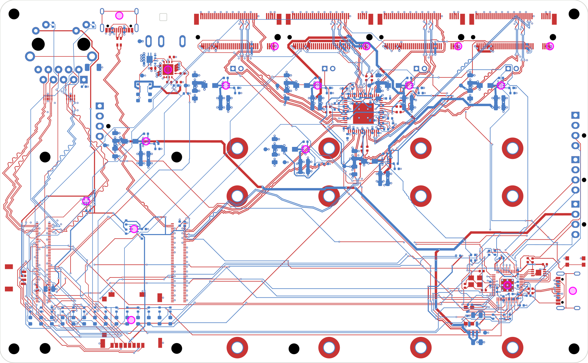

# nas-place-astra-20261120-1530

| | |
|---|---|
| Task | place the free parts and route |
| Model | gpt-6.2-astra (Codex CLI, `codex exec`, effort high) |
| Tools given | bt (see the README) |
| Time | 1:15 (finished on its own) |
| Cost at API prices | $21.46 (OpenAI list price for the token counts Codex reported, reasoning counted as output) |
| Turns | 281 |
| DRC errors | 17 (footprint_type_mismatch 17) |
| Unconnected | 0 |
| Copper | 7647 mm of track, 845 vias |
| Placement | outline 147.55 × 91.15 mm, parts on top 31 / bottom 185 |
| Hosts reached | chatgpt.com (297), sdmntprwestus.oaiusercontent.com (1), sdmntprsouthcentralus.oaiusercontent.com (1), sdmntprcentralus.oaiusercontent.com (1), pypi.org (6), registry.npmjs.org (4), repo.maven.apache.org (9), files.pythonhosted.org (4), pip-assets.raspberrypi.com (2), datasheets.raspberrypi.com (2), pip.raspberrypi.com (2), www.ti.com (2), www.mouser.com (3), ab.chatgpt.com (1); denied: api.github.com, github.com, api.freerouting.app, www.maxlinear.com, www.raspberrypi.com |

DRC is KiCad 10 with zones refilled, on the board the agent saved. Some boards start with findings of their own; see `../../../boards/README.md`.

## Pictures

Start is the board as the agent got it (pads and part outlines; in placement runs the free parts sit in a grid below the board). Reference is the human-routed original ([boards/cm4-nvme-nas](../../../boards/cm4-nvme-nas)). The copper pictures show F.Cu (red) and B.Cu (blue) with zone fills left out so the tracks show; DRC errors are circled in magenta on the result.

| Start | Reference | Result |
|---|---|---|
|  |  |  |

## The agent's own summary

From the start of its [NOTES.md](work/NOTES.md):

> **Release hold.** The placement and routing are complete against the supplied PCB netlist. KiCad 10.0.8 reports zero unconnected items, shorts, clearance violations, copper slivers, starved thermals and dangling tracks or vias. I would hold the fabrication order and first power-up until the circuit and schematic-parity issues below are resolved.

Its review of the bt tool: [BT-REVIEW.md](work/BT-REVIEW.md).

## Progress log

Saved by the agent as it worked, failed attempts included. The notes are here; the pictures are in the archive.

- [The incoming panel of loose parts sits below the locked sockets, headers and module. The 147.4 × 91 mm outline has a cutout. There are 254 footprints and no copper routes or pours. The drawing records the initial state for the placement and locked-part comparison.](work/progress/001-incoming.md)
- [All 216 movable parts are on the board. The switch sits between the compute module and the four sockets. Repeated buck stages and most bypass capacitors are on the underside. The first placement check caught R69 too close to a plated ground hole in the RP2040 package. I added those holes to the backside placement obstacles and repeated the placement. I also corrected the orientation of three series-capacitor pairs.](work/progress/002-placement.md)
- [A trial of bt pair for port 2 reported zero track-length skew. Inspection showed one conductor on the top layer and its partner on the underside for nearly the entire link. I discarded this trial and switched to routing each long pair from a common centerline.](work/progress/003-pair-trial.md)
- [The first common-centerline pass routed PCIe, Ethernet and USB pairs with both conductors following the same bends. It also connected the switch to its AC-coupling capacitors. Several launches were obstructed by earlier pairs or by backside bypass capacitors. I kept this checkpoint for comparison while testing other escape orders.](work/progress/004-coupled-routing.md)
- [The switch pin escapes and a second capacitor placement allowed all 15 long PCIe pairs to be routed from common centerlines. This view shows the In2 distribution copper. Each M.2 connector has a separate 3.3 V region, fed by its own converter. The protected 12 V supply has a wide trunk. Short, wider tracks serve the switch nodes and output capacitors, and multiple vias transfer current to the plane regions.](work/progress/005-power-distribution.md)
- [Switch detail after the revised capacitor placement. The through vias at the differential launches and the ground and supply taps are now present. With the inner pours filled, KiCad reported 250 remaining connections and the same violation categories and counts as the incoming board. This was the starting point for the low-speed and local interconnect routing.](work/progress/006-switch-escapes.md)
- [I tested priority ground strips on In2 under the underside high-speed tracks, with a ground via beside each transition where there was room. This supplies a return path where the differential pairs cross power-region boundaries. The trial exposed six additional power connections and four narrow copper slivers. I kept the trial image and will check those regions again after the signal routing.](work/progress/007-return-paths.md)
- [The batch signal pass added 718 segments and 95 vias. KiCad now reports 107 missing connections with the return-path copper included. The pass did well on short local links. Several RP2040, compute-module and switch power pins still need escapes. The next pass will take its starting and ending copper groups from KiCad connectivity.](work/progress/008-secondary-routing.md)
- [The detailed routing pass used KiCad’s connected copper groups as endpoints. It closed the isolated M.2 and main 12 V plane connections, completed the 1.2 V bypass network and routed more of the RP2040 controls. The RP2040 and module connector still have pads boxed in by earlier tracks. A finer search is testing short third-layer escapes while keeping the main reference plane clear.](work/progress/009-detail-routing.md)
- [Nine opens remained in the KiCad report after adding individual fine-pitch escapes and repairing earlier tracks. This close-up shows the 0.4 mm compute-module connector. The dense rows required some short control escapes on In1. Their permitted areas exclude the high-speed top-layer paths. A separate Freerouting trial with the existing channels protected ran for over twelve minutes without producing a completed first-pass session, so I discarded it.](work/progress/010-last-escapes.md)
- [I revised the service-controller block after finding that its USB data nets had taken 35 and 43 mm of track with different via counts. Rotating the RP2040 brought the USB pins to the connector side. Both main USB runs from the series resistors are now 6.7 mm on the front, and the duplicated receptacle contacts join at the socket. All six flash signals run on the front, and the crystal and load capacitors are on the opposite edge. The controller’s other pins have staggered via escapes.](work/progress/011-service-controller.md)
- [The new controller placement routed the fan signals on the first detailed pass. The saved-board DRC exposed small disconnected areas on the standby supply, a missing ground on one bypass capacitor and two resistor connections. This underside view records the review. Searching for a via within 5 mm of the affected pads worked for R66 and failed for C78 and R67. I am moving those two small parts to copper already connected to their respective signals.](work/progress/012-ground-audit.md)
- [KiCad reported zero unconnected items on the saved board. Moving C78 to accessible core-supply copper and locating R67 along the existing sensor connection resolved two trapped passive pads. The compute-module RUN signal now has a staggered escape. The RP2040 standby region extends to its remote pullup. This checkpoint precedes cleanup and length tuning.](work/progress/013-connected.md)
- [I rerouted the switch-to-C49 leg beside its partner on the front, removing two unequal layer changes. The PCIe tuning pass includes both segments on channels with series capacitors. Port 4 needed the largest correction. On Ethernet pair 3, reversing the lane order along the shared route let both conductors stay on the front and eliminated four unnecessary transition vias.](work/progress/014-length-tuning.md)
- [The first path-length audit traced each Ethernet conductor from the CM4 to the magnetics, including through-via travel. Pair 0 differed by 8.79 mm. I tested a shorter escape between the ESD arrays and the jack. The proposed four-pair replacement could not clear the existing pads and other pairs, so I kept the verified copper and used the endpoint measurements to guide tuning.](work/progress/015-ethernet-audit.md)
- [Enabling the courtyard check exposed two overlaps beside the RP2040 crystal. A trial shift of all three packages cleared the courtyards, but it moved the crystal pads across existing tracks. KiCad caught two shorts. I discarded that shift and searched for positions for the two passives with the crystal and surrounding copper fixed. The separate cleanup pass removed redundant vias and dead branches while retaining every pad connection.](work/progress/016-crystal-clearance.md)
- [The crystal stayed in place. A jog in the switch-enable trace made room for C75, and R58 moved 0.36 mm. The saved-board KiCad check reported zero opens and no shorts, clearance, sliver, thermal or dangling-copper findings. This view shows the switch and regulator area from the underside after enlarging and separating the movable reference fields. I kept all reference fields visible.](work/progress/017-copper-and-labels.md)
- [The incoming project allowed zero copper-to-hole clearance. A separate 0.20 mm drill audit found 79 pour edges at nonplated holes and eight signal segments inside the proposed clearance. I increased the project rule, moved four low-speed nets and refilled the board. The two USB-C land patterns have 0.165 mm between their own ground pads and locating holes. They use a 0.16 mm within-footprint rule. KiCad now reports zero hole-clearance violations, opens or copper slivers.](work/progress/018-drill-clearance.md)
- [KiCad’s top and bottom views of the final board. Only models available in this installation can appear. The final drill export contains 917 plated and 27 nonplated holes. Both masks, paste layers, silkscreens, all four copper layers and Edge.Cuts plotted successfully. The input footprint and schematic findings and the circuit release holds are recorded in NOTES.md.](work/progress/019-final-board.md)

## Raw files

The prompt is [brief.md](brief.md); the scores are [report.json](report.json). Everything else is in `nas-place-astra-20261120-1530.tar.xz`, attached to the `cross-model-2026-11` release:
the full transcript (`transcript.jsonl`, converted from Codex's own `codex.jsonl` events, which are there too), the input board, the agent's working directory with its scripts and intermediate boards, the progress pictures, all renders, the raw DRC and metrics, and the proxy log.
