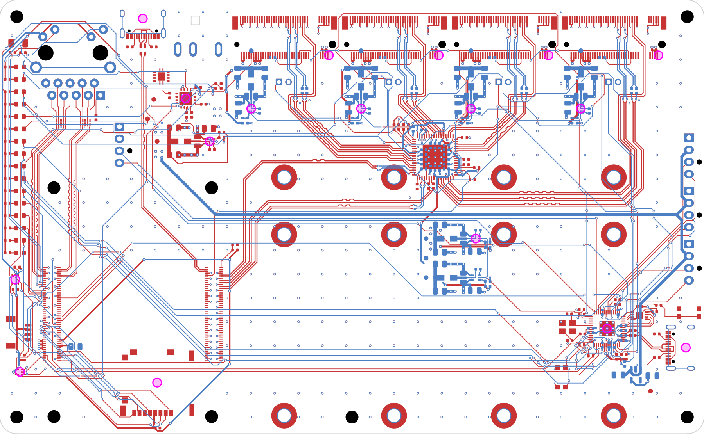

# nas-place-fable-20261120-1650

| | |
|---|---|
| Task | place the free parts and route |
| Model | claude-fable-5-2 (Claude Code, `claude -p`, effort high) |
| Tools given | bt (see the README) |
| Time | 3:15 (finished on its own) |
| Cost at API prices | $41.54 |
| Turns | 192 |
| DRC errors | 17 (footprint_type_mismatch 17) |
| Unconnected | 0 |
| Copper | 7615 mm of track, 755 vias |
| Placement | outline 147.55 × 91.15 mm, parts on top 107 / bottom 109 |
| Hosts reached | api.anthropic.com (25), http-intake.logs.us5.datadoghq.com (167) |

DRC is KiCad 10 with zones refilled, on the board the agent saved. Some boards start with findings of their own; see `../../../boards/README.md`.

## Pictures

Start is the board as the agent got it (pads and part outlines; in placement runs the free parts sit in a grid below the board). Reference is the human-routed original ([boards/cm4-nvme-nas](../../../boards/cm4-nvme-nas)). The copper pictures show F.Cu (red) and B.Cu (blue) with zone fills left out so the tracks show; DRC errors are circled in magenta on the result.

| Start | Reference | Result |
|---|---|---|
|  |  |  |

## The agent's own summary

From the start of its [NOTES.md](work/NOTES.md):

> State of `/work/RaspberryPiNVMeNAS.kicad_pcb`: all 254 footprints placed, every net connected (0 unrouted),
> KiCad 10 DRC shows nothing beyond what the untouched original already showed (17 `footprint_type_mismatch`
> errors and text/library warnings that belong to the footprints themselves). Locked parts, including their
> reference texts, are exactly where they were. Nothing was added to or removed from the netlist.

Its review of the bt tool: [BT-REVIEW.md](work/BT-REVIEW.md).

## Progress log

Saved by the agent as it worked, failed attempts included. The notes are here; the pictures are in the archive.

- [001 – first complete placement](work/progress/001-placement.md)
- [002 – placement revised before routing](work/progress/002-placement-final.md)
- [003 – PCIe pairs routed (hand-generated geometry)](work/progress/003-pcie.md)
- [004 – power stages, planes, Ethernet, USB](work/progress/004-power-and-pairs.md)
- [005 – bulk auto-route of the slow nets (partly thrown away)](work/progress/005-bulk-route.md)
- [006 – hand fixes after the auto-router (pictures: 006-led-strip.png, 006-fixes-switch.png)](work/progress/006-led-strip.md)
- [007 – final board (007-final.png all layers, -top, -bottom, -in2)](work/progress/007-final.md)

## Raw files

The prompt is [brief.md](brief.md); the scores are [report.json](report.json). Everything else is in `nas-place-fable-20261120-1650.tar.xz`, attached to the `cross-model-2026-11` release:
the full transcript (`transcript.jsonl`), the input board, the agent's working directory with its scripts and intermediate boards, the progress pictures, all renders, the raw DRC and metrics, and the proxy log.
