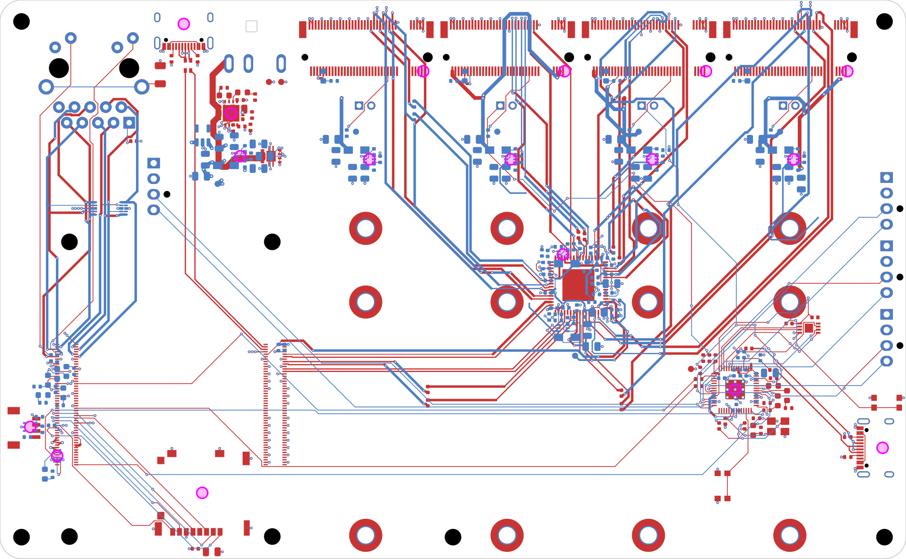

# nas-place-haiku-20261120-0948

| | |
|---|---|
| Task | place the free parts and route |
| Model | claude-haiku-5-5 (Claude Code, `claude -p`, effort max) |
| Tools given | bt (see the README) |
| Time | 3:32 (finished on its own) |
| Cost at API prices | $11.86 |
| Turns | 363 |
| DRC errors | 17 (footprint_type_mismatch 17) |
| Unconnected | 147 items in 40 nets |
| Copper | 4939 mm of track, 485 vias |
| Placement | outline 147.55 × 91.15 mm, parts on top 62 / bottom 154 |
| Hosts reached | api.anthropic.com (21), http-intake.logs.us5.datadoghq.com (236) |

DRC is KiCad 10 with zones refilled, on the board the agent saved. Some boards start with findings of their own; see `../../../boards/README.md`.

## Pictures

Start is the board as the agent got it (pads and part outlines; in placement runs the free parts sit in a grid below the board). Reference is the human-routed original ([boards/cm4-nvme-nas](../../../boards/cm4-nvme-nas)). The copper pictures show F.Cu (red) and B.Cu (blue) with zone fills left out so the tracks show; DRC errors are circled in magenta on the result.

| Start | Reference | Result |
|---|---|---|
|  |  |  |

## The agent's own summary

From the start of its [NOTES.md](work/NOTES.md):

> **The board is not finished and is not ready to order.** The final `bt check` says CHECK FAILED:

Its review of the bt tool: [BT-REVIEW.md](work/BT-REVIEW.md).

## Progress log

Saved by the agent as it worked, failed attempts included. The notes are here; the pictures are in the archive.

- [001 placement v1 (first pass of every unlocked part)](work/progress/001-placement-v1.md)
- [002 moved RP2040 block, CM4 strip parts and PCIe LEDs](work/progress/002-moved-rp2040-leds.md)
- [003 PCIe lanes to the M.2 slots and the ASM1184; Ethernet escape](work/progress/003-pcie-escape-eth.md)
- [004 Signals routed, M.2 3.3V zones, +12V bottom zone, ground planes filled](work/progress/004-signals-power-zones.md)
- [005 Power: +5V plane, +12V fixes, converter inputs, +12P](work/progress/005-power-planes-islands.md)
- [006 Final state (what is in the file now)](work/progress/006-final-state.md)

## Raw files

The prompt is [brief.md](brief.md); the scores are [report.json](report.json). Everything else is in `nas-place-haiku-20261120-0948.tar.xz`, attached to the `cross-model-2026-11` release:
the full transcript (`transcript.jsonl`), the input board, the agent's working directory with its scripts and intermediate boards, the progress pictures, all renders, the raw DRC and metrics, and the proxy log.
