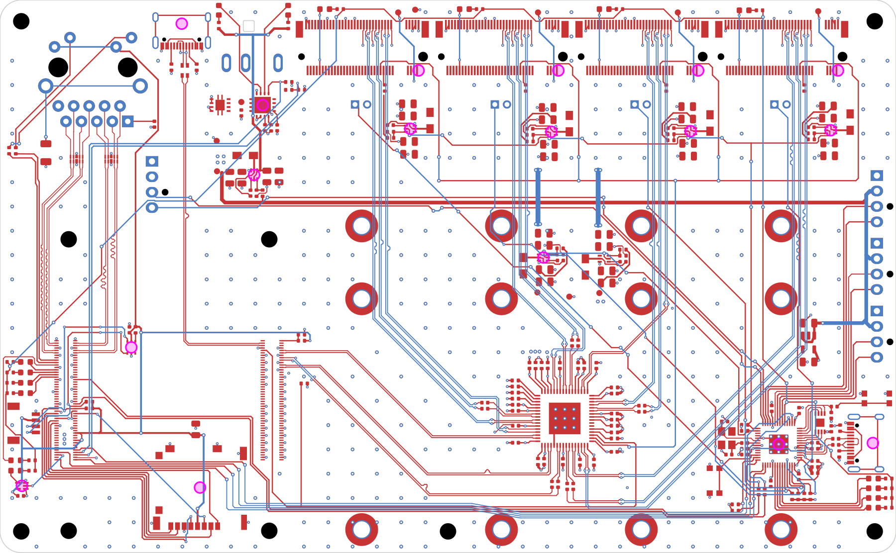

# nas-route-fable-20261120-0851

| | |
|---|---|
| Task | route only, placement kept |
| Model | claude-fable-5-2 (Claude Code, `claude -p`, effort high) |
| Tools given | bt (see the README) |
| Time | 2:21 (finished on its own) |
| Cost at API prices | $42.71 |
| Turns | 179 |
| DRC errors | 17 (footprint_type_mismatch 17) |
| Unconnected | 0 |
| Copper | 7464 mm of track, 756 vias |
| Hosts reached | api.anthropic.com (17), http-intake.logs.us5.datadoghq.com (126), files.pythonhosted.org (2), pypi.org (2) |

DRC is KiCad 10 with zones refilled, on the board the agent saved. Some boards start with findings of their own; see `../../../boards/README.md`.

## Pictures

Start is the board as the agent got it (pads and part outlines; in placement runs the free parts sit in a grid below the board). Reference is the human-routed original ([boards/cm4-nvme-nas](../../../boards/cm4-nvme-nas)). The copper pictures show F.Cu (red) and B.Cu (blue) with zone fills left out so the tracks show; DRC errors are circled in magenta on the result.

| Start | Reference | Result |
|---|---|---|
|  |  |  |

## The agent's own summary

From the start of its [NOTES.md](work/NOTES.md):

> State: every net is routed. KiCad 10 DRC on the saved file gives 0 errors and 0 warnings that were not already in the board as received, and 0 unconnected items. No footprint was moved, rotated, flipped, added or removed (checked against the original with pcbnew: 254 footprints, positions, angles and pad nets identical).

Its review of the bt tool: [BT-REVIEW.md](work/BT-REVIEW.md).

## Progress log

Saved by the agent as it worked, failed attempts included. The notes are here; the pictures are in the archive.

- [001 – starting point](work/progress/001-start.md)
- [002 – all 15 PCIe pairs](work/progress/002-pcie-pairs.md)
- [003 – power copper and the U12 breakout](work/progress/003-u12-power.md)
- [004 – RP2040 corner, resets, Ethernet/USB](work/progress/004-rp2040.md)
- [005 – every signal net routed (before ground pours)](work/progress/005-all-signals.md)
- [006 – finished board, all layers](work/progress/006-final-all.md)
- [007 – F.Cu](work/progress/007-final-top.md)
- [008 – B.Cu](work/progress/008-final-bottom.md)
- [009 – In2.Cu](work/progress/009-final-in2.md)

## Raw files

The prompt is [brief.md](brief.md); the scores are [report.json](report.json). Everything else is in `nas-route-fable-20261120-0851.tar.xz`, attached to the `cross-model-2026-11` release:
the full transcript (`transcript.jsonl`), the input board, the agent's working directory with its scripts and intermediate boards, the progress pictures, all renders, the raw DRC and metrics, and the proxy log.
