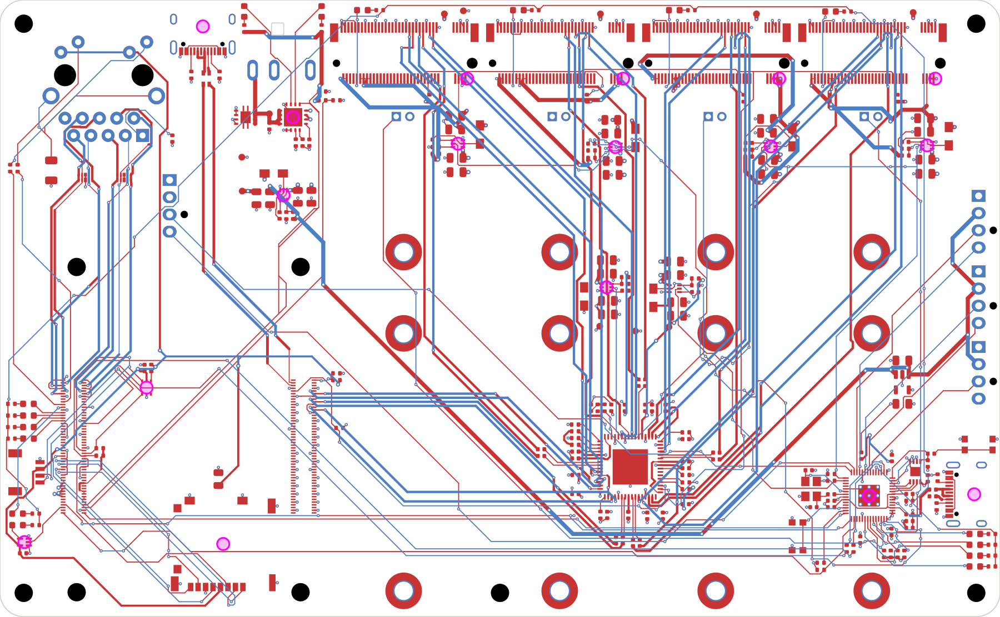

# nas-route-haiku-20261119-2226

| | |
|---|---|
| Task | route only, placement kept |
| Model | claude-haiku-5-5 (Claude Code, `claude -p`, effort max) |
| Tools given | bt (see the README) |
| Time | 3:31 (finished on its own) |
| Cost at API prices | $10.25 |
| Turns | 2 |
| DRC errors | 17 (footprint_type_mismatch 17) |
| Unconnected | 29 items in 15 nets |
| Copper | 7061 mm of track, 599 vias |
| Hosts reached | api.anthropic.com (28), http-intake.logs.us5.datadoghq.com (209) |

DRC is KiCad 10 with zones refilled, on the board the agent saved. Some boards start with findings of their own; see `../../../boards/README.md`.

## Pictures

Start is the board as the agent got it (pads and part outlines; in placement runs the free parts sit in a grid below the board). Reference is the human-routed original ([boards/cm4-nvme-nas](../../../boards/cm4-nvme-nas)). The copper pictures show F.Cu (red) and B.Cu (blue) with zone fills left out so the tracks show; DRC errors are circled in magenta on the result.

| Start | Reference | Result |
|---|---|---|
|  |  |  |

## The agent's own summary

From the start of its [NOTES.md](work/NOTES.md):

> **Status: not finished.** The board is routed to about 95 % of its connections and has no shorts and no track-to-track or track-to-pad clearance errors. `bt check` (last run) reports 13 nets with open pieces and no routing errors (no shorts, no crossing or clearance errors), plus 26 footprint-level DRC errors from the original placement (below). Do not send it to fab as it is. The open items and their locations are listed at the end.

Its review of the bt tool: [BT-REVIEW.md](work/BT-REVIEW.md).

## Progress log

Saved by the agent as it worked, failed attempts included. The notes are here; the pictures are in the archive.

- [001 – layer plan: In1 GND plane, In2 power zones, net classes](work/progress/001-planes-in2.md)
- [002 – PCIe lanes routed (switch U12 to four M.2 sockets, and CM4 uplink)](work/progress/002-pcie-routed.md)
- [003 – Ethernet pairs routed through the ESD arrays (CM4 to RJ45)](work/progress/003-eth-routed.md)
- [004 – general routing pass (bulk), after the PCIe and Ethernet pairs](work/progress/004-bulk-pass.md)
- [005 – zone connections (power vias and GND vias)](work/progress/005-power-and-ground-vias.md)
- [006 – final state of this session (not finished)](work/progress/006-final-state.md)

## Raw files

The prompt is [brief.md](brief.md); the scores are [report.json](report.json). Everything else is in `nas-route-haiku-20261119-2226.tar.xz`, attached to the `cross-model-2026-11` release:
the full transcript (`transcript.jsonl`), the input board, the agent's working directory with its scripts and intermediate boards, the progress pictures, all renders, the raw DRC and metrics, and the proxy log.
