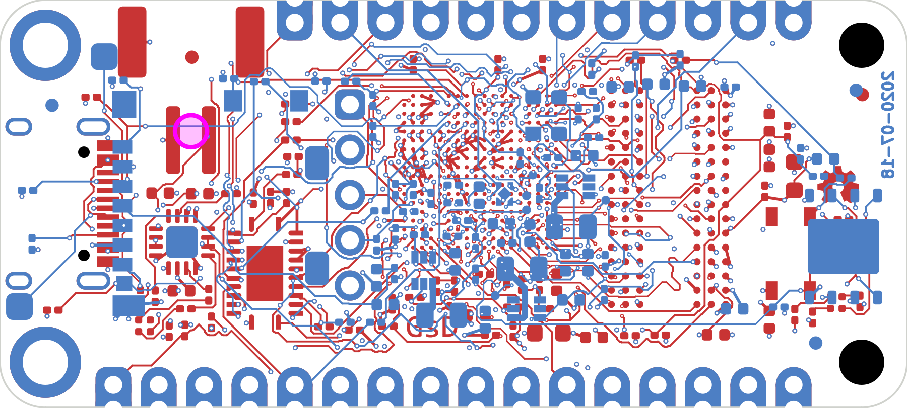

# orangecrab-place-astra-20261120-1431

| | |
|---|---|
| Task | place the free parts and route |
| Model | gpt-6.2-astra (Codex CLI, `codex exec`, effort high) |
| Tools given | bt (see the README) |
| Time | 1:52 (finished on its own) |
| Cost at API prices | $28.74 (OpenAI list price for the token counts Codex reported, reasoning counted as output) |
| Turns | 406 |
| DRC errors | 2 (malformed_courtyard 1, courtyards_overlap 1) |
| Unconnected | 0 |
| Copper | 2792 mm of track, 695 vias |
| Placement | outline 50.9 × 22.96 mm, parts on top 68 / bottom 76 |
| Hosts reached | chatgpt.com (456), sdmntprcentralus.oaiusercontent.com (1), sdmntprsouthcentralus.oaiusercontent.com (1), sdmntprwestus.oaiusercontent.com (1), deb.debian.org (1), repo.maven.apache.org (10), registry.npmjs.org (10), pypi.org (5), files.pythonhosted.org (3), ab.chatgpt.com (1); denied: api.github.com, github.com, raw.githubusercontent.com, cdn.jsdelivr.net, codeload.github.com, data.jsdelivr.com, gitlab.com, proxy.golang.org, oshwlab.com, orangecrab-fpga.github.io, sources.debian.org, kicad.github.io, api.freerouting.app |

DRC is KiCad 10 with zones refilled, on the board the agent saved. Some boards start with findings of their own; see `../../../boards/README.md`.

## Pictures

Start is the board as the agent got it (pads and part outlines; in placement runs the free parts sit in a grid below the board). Reference is the human-routed original ([boards/orangecrab](../../../boards/orangecrab)). The copper pictures show F.Cu (red) and B.Cu (blue) with zone fills left out so the tracks show; DRC errors are circled in magenta on the result.

| Start | Reference | Result |
|---|---|---|
|  |  |  |

## The agent's own summary

From the start of its [NOTES.md](work/NOTES.md):

> The six-layer board retains the Feather outline, the two castellated headers, the mounting holes and all fixed connectors. All 163 original footprints are present in the layout, 82 on the front and 81 on the back. The 19 locked footprints retain their original positions, orientations and sides.

Its review of the bt tool: [BT-REVIEW.md](work/BT-REVIEW.md).

## Progress log

Saved by the agent as it worked, failed attempts included. The notes are here; the pictures are in the archive.

- [The input has 163 footprints and 170 named nets on a 50.8 × 22.86 mm outline. The USB and battery connectors share the left end with the reverse-side microSD socket. The FPGA, DDR3 and three buck converters are off-board with the other loose parts. I saved a separate copy of the input for placement and DRC comparisons.](work/progress/001-input.md)
- [In the first floorplan the memory cleared the FPGA and both Feather rows, but left too little space for the switch between the memory, exposed front copper logo, fiducials and button legend. I moved the FPGA toward the USB end and above the JTAG legend, then reserved the switch area before fitting the DDR3 package.](work/progress/002-switch-trial.md)
- [All 144 movable footprints now fit on the board. KiCad reports the same violation counts as on the input, with no new courtyard overlaps. The placement review showed that two buck inductors landed opposite their regulators and that the oscillator ended up beyond the memory. I am revising those positions before routing.](work/progress/003-placement.md)
- [The three TLV62569 regulators, their input capacitors and the switch-node inductors now share the back side. The oscillator is back-side mounted alongside the FPGA. I reserved In1.Cu and In4.Cu for ground so the surface and internal signal layers each have an adjacent reference. The board still needs its power connections and BGA escapes.](work/progress/004-power-placement.md)
- [The switch nodes routed in 1.93, 1.93 and 3.81 mm. A first pair-routing test joined two USB-C contacts on the negative leg while routing the positive leg to its resistor. I rejected that result, defined both resistor endpoints, and checked the replacement copper. The image shows the main USB pair, DDR3 clock and lower-byte strobe. The main USB section measures 19.32 mm on each leg, excluding receptacle bridges, test points and the FPGA-side sections.](work/progress/005-pair-breakouts.md)
- [The flash exposed pad covered several FPGA escape sites, including the USB data breakout. I moved the flash to the right end on the back and relocated its nearby parts. With that change the plane tool reported ground access for 245 of 264 candidate pads. I applied the checked stubs, refilled the planes, and added the upper DDR3 strobe on In3.Cu with about 0.05 mm of planar skew.](work/progress/006-ground-escapes.md)
- [This is an intermediate signal-routing pass. I imported a session checkpoint into a copy, restored the project rules beside it, refilled the zones and ran KiCad DRC. KiCad counted 331 missing connections. The check also identified a test land too close to the USB shell and a few undersized imported track segments. These need correction before release.](work/progress/007-first-pass.md)
- [I added local distribution copper for the 1.1 V core, 1.35 V bank supply, VSYS and separately filtered DDR3 VDD and VDDQ. The 3.3 V region uses the residual In3 copper. Ground remains on the two dedicated layers, with additional pours on the faces. On this intermediate route KiCad finds 153 open connections. The supply regions still need more drops from BGA balls and decouplers.](work/progress/008-power-regions.md)
- [A geometry-based routing pass added 65 connections using the two outer and two internal signal layers. After refill, KiCad counted 86 opens, with zero copper-clearance, track-width or shorting violations. I removed redundant imported segments that ended inside the Feather castellations. The remaining work is concentrated at the FPGA and in the power-rail drops.](work/progress/009-fpga-escape.md)
- [I tried routing DDR3 before the bulk of the ground and supply escapes. On a fresh copy of the same placement, the first memory, clock and USB pass found 45 of 54 requested links. This freed space in the 0.5 mm ball field that had been blocked by otherwise legal power vias. I retained the earlier result for comparison.](work/progress/010-ddr-first.md)
- [I kept the DDR-first version. It uses through vias and single-layer laser microvias, so it can use a 1+4+1 buildup. Local escape traces now also occupy portions of In1 and In4. I connected isolated ground-pad groups to the large inner pours. KiCad connectivity puts 271 of 273 ground pads together and reports 17 opens across the board. Completing these and checking the ground reference beneath the high-speed paths remain priorities.](work/progress/011-return-vias.md)
- [KiCad now lists six open connections. Five are power or signal connections and one is an isolated ground region. I moved the remaining FPGA escapes to checked laser-via sites and rerouted around them. Local cuts in previously routed copper created short repair gaps. The outstanding clearance violation is 0.0783 mm between SD0_CMD and 3.3 V against the 0.0889 mm project rule.](work/progress/012-last-links.md)
- [KiCad reports zero missing connections for the first time. The last signal, ADC_MUX1, needed a short In1 escape to a staggered buried via. I rerouted the displaced ADC_CTRL1 and LED_B copper. Two trace-clearance violations, one hole-spacing warning and dangling routing remnants still need correction.](work/progress/013-all-connected.md)
- [The DDR-first layout now passes KiCad's copper clearance and hole-spacing checks with every connection present. I moved the SD0_DAT1 escape and its connected copper together to clear a neighboring hole. I also removed unused branches from earlier routing attempts, refilling and checking connectivity after each pass. The view shows the FPGA and memory routing on the upper three layers.](work/progress/014-clearance.md)
- [The lower-byte DQS differential legs now both measure 14.129 mm between the FPGA and DRAM, including the nominal layer transitions. The upper strobe skew is 0.047 mm and the clock skew is 0.120 mm. I retained length adjustments on 26 nets after testing their combined geometry against KiCad. Individual tuning proposals had collided when combined, so I removed the conflicting changes. Several data and address signals still need more length than straight-run tuning found.](work/progress/015-memory-tuning.md)
- [I changed 15 memory routes by searching for alternate paths between existing layer transitions. The first version cut a small ground connection near U3.G17. I restored the D10 path, refilled and checked the complete board. The retained version has zero opens, zero dangling copper and only the original footprint-related DRC findings. The USB internal pair has ground directly underneath about 97% of its centerline, based on 0.05 mm samples against the saved In4 fill.](work/progress/016-memory-paths.md)
- [I tested staggered laser-to-buried escapes on several short DDR3 nets. Four changes kept full connectivity through refill, including D1 and D4, now close to the lower strobe. I rejected an A1 alternative that isolated a ground region. A fabrication export trial generated all six copper layers, the board profile and five separate drill files. The PCB now includes a nominal physical stackup and filled/capped via-in-pad instructions.](work/progress/017-hdi-tuning.md)
- [A faster route for bank-address bit 0 initially stacked a laser via directly on a buried drill. I reused its original staggered FPGA breakout and connected it to the new path. KiCad verified the resulting geometry with no new findings. I also retained a D6 adjustment whose long internal section has adjacent pour beneath about 95% of its path. I discarded other timing options that crossed long gaps in the neighboring reference copper.](work/progress/018-bank-address.md)
- [This version shortens the longest upper-byte data path, D11, from 24.08 mm to 19.66 mm. D0 through D6 now run within 0.16 mm of the lower strobe. I adjusted the new track vertices to restore local copper clearance and verified the saved fill with KiCad. I also used residual space on In2 for grounded copper, leaving the higher-priority regulator and filtered-memory islands in place. D7 and several upper-byte and address signals still have larger timing differences.](work/progress/019-timing-and-returns.md)
- [I retained an A8 reroute that brought its FPGA-to-memory path close to the clock while preserving every connection. A separate D7 trial isolated the ground ball U4.G9 without creating a copper-clearance violation. I traced that island to its original front-to-In1 dogbone and tested alternative return-via sites. The image shows the accepted memory region before the final D7 selection.](work/progress/020-address-and-ground.md)
- [The saved board has 163 footprints, 695 vias, six copper layers and eleven filled zones. KiCad reports zero unconnected items, two fixed-footprint courtyard errors and the same 201 warnings as the input. The combined bt check found zero nets in pieces and confirmed the fills were current. I verified Gerber, drill and IPC-D-356 exports and compared all 1,097 pads and the board outline against the original. DDR3 timing and reference-plane limitations are quantified in NOTES.md.](work/progress/021-final.md)

## Raw files

The prompt is [brief.md](brief.md); the scores are [report.json](report.json). Everything else is in `orangecrab-place-astra-20261120-1431.tar.xz`, attached to the `cross-model-2026-11` release:
the full transcript (`transcript.jsonl`, converted from Codex's own `codex.jsonl` events, which are there too), the input board, the agent's working directory with its scripts and intermediate boards, the progress pictures, all renders, the raw DRC and metrics, and the proxy log.
