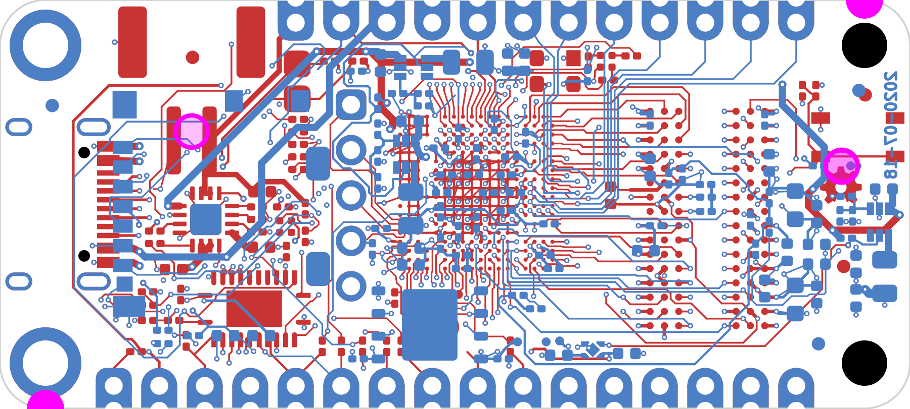

# orangecrab-place-fable-20261120-1033

| | |
|---|---|
| Task | place the free parts and route |
| Model | claude-fable-5-2 (Claude Code, `claude -p`, effort high) |
| Tools given | bt (see the README) |
| Time | 5:46 (finished on its own) |
| Cost at API prices | $115.96 |
| Turns | 407 |
| DRC errors | 90 (shorting_items 1, malformed_courtyard 1, courtyards_overlap 1, copper_edge_clearance 84, starved_thermal 2, solder_mask_bridge 1) |
| Unconnected | 27 items in 6 nets |
| Copper | 2647 mm of track, 457 vias |
| Placement | outline 50.9 × 22.96 mm, parts on top 51 / bottom 93 |
| Hosts reached | api.anthropic.com (33), http-intake.logs.us5.datadoghq.com (273), files.pythonhosted.org (1), pypi.org (1) |

DRC is KiCad 10 with zones refilled, on the board the agent saved. Some boards start with findings of their own; see `../../../boards/README.md`.

## Pictures

Start is the board as the agent got it (pads and part outlines; in placement runs the free parts sit in a grid below the board). Reference is the human-routed original ([boards/orangecrab](../../../boards/orangecrab)). The copper pictures show F.Cu (red) and B.Cu (blue) with zone fills left out so the tracks show; DRC errors are circled in magenta on the result.

| Start | Reference | Result |
|---|---|---|
|  |  |  |

## The agent's own summary

From the start of its [NOTES.md](work/NOTES.md):

> **The board is not ready to order.** All parts are placed, the DDR3 interface, flash, USB, SD,
> JTAG, header IO, LEDs, the three bucks and most of the power distribution are routed, and
> every piece of copper I wrote was clearance-checked before it went in. But KiCad's DRC still
> reports **27 unconnected items** (the 2V5 rail is the important one), 4 real errors, and
> several nets are routed in ways I would not sign off (signal tracks in a ground plane, thin
> links through the core plane, DDR not length-matched). The list is in "Not finished / not
> good" below; please read that section before anything else.

Its review of the bt tool: [BT-REVIEW.md](work/BT-REVIEW.md).

## Progress log

Saved by the agent as it worked, failed attempts included. The notes are here; the pictures are in the archive.

- [001 – first floorplan (superseded in part by 002)](work/progress/001-floorplan.md)
- [002 – floorplan revised (flash and 1V1 buck swapped out of the south strip; FPGA/RAM re-aligned)](work/progress/002-floorplan-rev.md)
- [003 – BGA breakouts (scripted) and first DDR lanes](work/progress/003-bga-breakouts.md)
- [004 – DDR3 routed (F.Cu + In2, a few nets on B.Cu)](work/progress/004-ddr-in2.md)
- [005 – FPGA power/ground vias, decoupling placement, header IO on B.Cu](work/progress/005-fpga-power-io.md)
- [006 – planes, power stubs, bucks, USB](work/progress/006-power-planes.md)
- [007 – autorouting the "easy" rest: mostly a failure](work/progress/007-autoroute-leftovers.md)
- [008 – south side redone by hand: flash, J2 header IO, RAM reset, button](work/progress/008-south-fan.md)
- [009 – north side of the FPGA: LEDs on In4, ADC fan, several thrown-away attempts](work/progress/009-north-cluster.md)
- [010 – where it stopped](work/progress/010-final-state.md)

## Raw files

The prompt is [brief.md](brief.md); the scores are [report.json](report.json). Everything else is in `orangecrab-place-fable-20261120-1033.tar.xz`, attached to the `cross-model-2026-11` release:
the full transcript (`transcript.jsonl`), the input board, the agent's working directory with its scripts and intermediate boards, the progress pictures, all renders, the raw DRC and metrics, and the proxy log.
