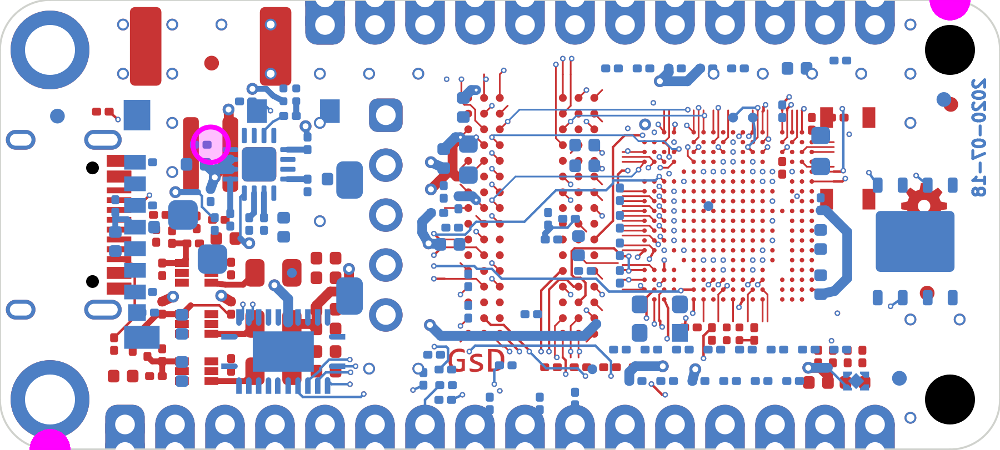

# orangecrab-place-haiku-20261119-2221

| | |
|---|---|
| Task | place the free parts and route |
| Model | claude-haiku-5-5 (Claude Code, `claude -p`, effort max) |
| Tools given | bt (see the README) |
| Time | 1:11 (finished on its own) |
| Cost at API prices | $16.02 |
| Turns | 1 |
| DRC errors | 86 (malformed_courtyard 1, courtyards_overlap 1, copper_edge_clearance 84) |
| Unconnected | 210 items in 76 nets |
| Copper | 1096 mm of track, 222 vias |
| Placement | outline 50.9 × 22.96 mm, parts on top 51 / bottom 93 |
| Hosts reached | api.anthropic.com (10), http-intake.logs.us5.datadoghq.com (187) |

DRC is KiCad 10 with zones refilled, on the board the agent saved. Some boards start with findings of their own; see `../../../boards/README.md`.

## Pictures

Start is the board as the agent got it (pads and part outlines; in placement runs the free parts sit in a grid below the board). Reference is the human-routed original ([boards/orangecrab](../../../boards/orangecrab)). The copper pictures show F.Cu (red) and B.Cu (blue) with zone fills left out so the tracks show; DRC errors are circled in magenta on the result.

| Start | Reference | Result |
|---|---|---|
|  |  |  |

## The agent's own summary

From the start of its [NOTES.md](work/NOTES.md):

> Status is updated at the end of the session. See the "Not finished" section before ordering anything.

Its review of the bt tool: [BT-REVIEW.md](work/BT-REVIEW.md).

## Progress log

Saved by the agent as it worked, failed attempts included. The notes are here; the pictures are in the archive.

- [001 core placement: FPGA and DDR3](work/progress/001-core-fpga-ddr3.md)
- [002 power section on the front-left](work/progress/002-power-section.md)
- [003 decoupling on the back, first attempt (later reverted)](work/progress/003-decaps-ddr3-fpga-back.md)
- [004 passives around the bucks, charger and microSD](work/progress/004-buck-charger-passives.md)
- [005 all parts placed (before routing)](work/progress/005-all-parts-placed.md)
- [006 decaps moved out of the ball field; planes and escape vias](work/progress/006-decaps-moved-and-escape.md)
- [007 first routing stage: DDR3 data/address and FPGA signal nets](work/progress/007-routing-stage1.md)
- [008 final state of this session](work/progress/008-final-state.md)

## Raw files

The prompt is [brief.md](brief.md); the scores are [report.json](report.json). Everything else is in `orangecrab-place-haiku-20261119-2221.tar.xz`, attached to the `cross-model-2026-11` release:
the full transcript (`transcript.jsonl`), the input board, the agent's working directory with its scripts and intermediate boards, the progress pictures, all renders, the raw DRC and metrics, and the proxy log.
