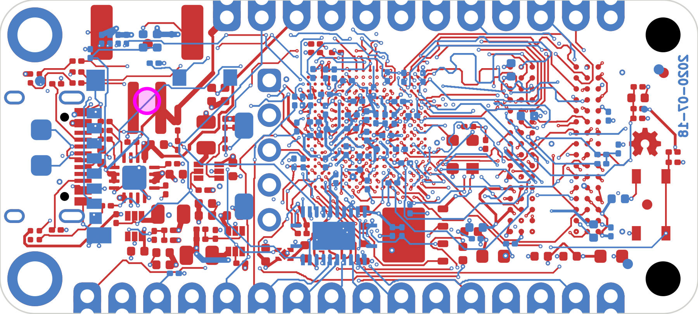

# orangecrab-route-astra-20261120-1258

| | |
|---|---|
| Task | route only, placement kept |
| Model | gpt-6.2-astra (Codex CLI, `codex exec`, effort high) |
| Tools given | bt (see the README) |
| Time | 1:34 (finished on its own) |
| Cost at API prices | $25.63 (OpenAI list price for the token counts Codex reported, reasoning counted as output) |
| Turns | 368 |
| DRC errors | 69 (malformed_courtyard 1, courtyards_overlap 68) |
| Unconnected | 0 |
| Copper | 2715 mm of track, 858 vias |
| Hosts reached | chatgpt.com (403), sdmntprwestus.oaiusercontent.com (1), sdmntprsouthcentralus.oaiusercontent.com (1), sdmntprcentralus.oaiusercontent.com (1), repo.maven.apache.org (9), registry.npmjs.org (3), pypi.org (7), files.pythonhosted.org (4), ab.chatgpt.com (1); denied: github.com, api.github.com, raw.githubusercontent.com, codeload.github.com, cdn.jsdelivr.net, data.jsdelivr.com, oshwlab.com, gitlab.com, www.crowdsupply.com, api.freerouting.app |

DRC is KiCad 10 with zones refilled, on the board the agent saved. Some boards start with findings of their own; see `../../../boards/README.md`.

## Pictures

Start is the board as the agent got it (pads and part outlines; in placement runs the free parts sit in a grid below the board). Reference is the human-routed original ([boards/orangecrab](../../../boards/orangecrab)). The copper pictures show F.Cu (red) and B.Cu (blue) with zone fills left out so the tracks show; DRC errors are circled in magenta on the result.

| Start | Reference | Result |
|---|---|---|
|  |  |  |

## The agent's own summary

From the start of its [NOTES.md](work/NOTES.md):

> The board is fully routed. KiCad 10.0.8 reports **zero unconnected items, shorts, copper-clearance violations, drill-spacing violations, starved thermals or dangling copper**. The saved board contains 3,756 track segments, 858 vias and 22 filled zones. A fresh fill reproduced all 22 saved polygon sets. I compared the original and delivered boards by UUID and verified all 163 footprint placements, all 1,097 pads and their nets, and all eight outline primitives.

Its review of the bt tool: [BT-REVIEW.md](work/BT-REVIEW.md).

## Progress log

Saved by the agent as it worked, failed attempts included. The notes are here; the pictures are in the archive.

- [Incoming board](work/progress/001-unrouted.md)
- [Power distribution and the first clock/strobe trial](work/progress/002-power-plan.md)
- [BGA escapes and protected routes](work/progress/003-escapes-and-pairs.md)
- [FPGA signal escapes](work/progress/004-fpga-breakout.md)
- [Memory routing trial](work/progress/005-memory-routes.md)
- [Whole-board routing and via-field congestion](work/progress/006-fanout-congestion.md)
- [Second ground plane and power-layer revision](work/progress/007-dual-ground.md)
- [Local power copper and laser-via escapes](work/progress/008-hdi-and-local-power.md)
- [Rejected north-bank rip-up](work/progress/009-north-bank-ripup.md)
- [Coupled memory clock and both strobes](work/progress/010-ddr-pairs.md)
- [Selecting compatible paths](work/progress/011-route-selection.md)
- [The north edge of U3 now escapes in pin order on the first three layers. This required two sequential laser build-up layers. KiCad found four remaining opens after refill. Two belonged to severed ground tracks, one to the DDR D4 connection and one to the microSD DAT0 connection. The new mask route reached the memory without disturbing the coupled strobes.](work/progress/012-ordered-breakout.md)
- [All 499 original ratsnest links are closed in a fresh KiCad DRC. The final DDR D4 and microSD DAT0 routes crossed short sections of RAM_D2 and IO_11. Cutting just those sections left space to reconnect both. The resulting board has no shorts, two copper clearances below 0.089 mm, three drill spacings below 0.25 mm and two incomplete thermals at top-side ground pads.](work/progress/013-connected.md)
- [KiCad now finds no opens, shorts, copper-clearance violations, drill-spacing violations or starved thermals. Top ground pads use solid connections and 13 ground vias link the reference planes near interface transitions. DDR tuning used pad-to-pad delay estimates including layer travel. Several short DQ and address lines gained useful length. The shortest address runs still arrive well ahead of CK, so this checkpoint is retained for comparison.](work/progress/014-ground-and-timing.md)
- [Selecting alternative paths between the ball escapes brought A8 from about 49 ps to 110 ps, A10 from 63 ps to 100 ps, and D7 from 78 ps to 98 ps in the routing delay estimate. Two trial paths had same-net vias closer than the drill process allows. Combining individually successful paths also created two conflicts with the data-mask and bank-address routes. I discarded those combinations, rerouted with the occupied copper present and added a 0.20 mm connection across a cut in the memory I/O supply pour. KiCad again reported zero opens and zero copper or drill-spacing violations.](work/progress/015-memory-retiming.md)
- [The clock and both strobes now have less than 0.01 mm calculated pad-to-pad length difference within their respective pairs. Three additional ground transfers sit near the USB and DDR transitions. An independent geometric check found three duplicate registrations of the same drill span in an earlier candidate. Those duplicates were removed. KiCad found no unconnected items, shorts, spacings below the rules or dangling copper. All six copper plots and eight drill files exported.](work/progress/016-release-checks.md)
- [A final review found room for wider current paths between the power inputs, charger and regulators. About 27 mm of VBUS, battery and system-supply routing gained width, with generous sections reaching 0.50 mm. The three buck output networks also gained wider feeds. The 0.36 mm switch-node links stay short and via-free. The project now records the minimum production width and clearance, the laser drill size and the differential-pair geometry. A fresh fill and KiCad DRC retained full connectivity and the same inherited footprint and documentation findings.](work/progress/017-supply-feeds.md)
- [The coupled USB trunk on L3 now has 0.150 mm traces and a 0.130 mm edge gap. The DDR pairs have 0.127 mm traces and a nominal 0.153 mm edge gap. Providing distinct geometries gives the fabricator a starting point for the 90 Ω and 100 Ω differential targets. KiCad still reports zero opens or electrical routing errors. The saved project contains the stackup and the specific castellated-pad and stacked-drill exceptions.](work/progress/018-final-board.md)

## Raw files

The prompt is [brief.md](brief.md); the scores are [report.json](report.json). Everything else is in `orangecrab-route-astra-20261120-1258.tar.xz`, attached to the `cross-model-2026-11` release:
the full transcript (`transcript.jsonl`, converted from Codex's own `codex.jsonl` events, which are there too), the input board, the agent's working directory with its scripts and intermediate boards, the progress pictures, all renders, the raw DRC and metrics, and the proxy log.
