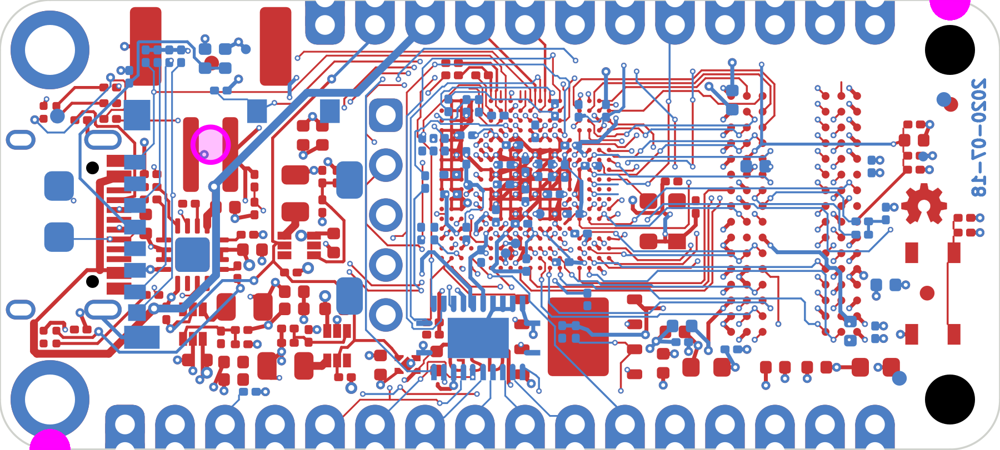

# orangecrab-route-fable-20261120-0455

| | |
|---|---|
| Task | route only, placement kept |
| Model | claude-fable-5-2 (Claude Code, `claude -p`, effort high) |
| Tools given | bt (see the README) |
| Time | 3:55 (finished on its own) |
| Cost at API prices | $52.15 |
| Turns | 196 |
| DRC errors | 153 (malformed_courtyard 1, courtyards_overlap 68, copper_edge_clearance 84) |
| Unconnected | 29 items in 25 nets |
| Copper | 2079 mm of track, 436 vias |
| Hosts reached | api.anthropic.com (27), http-intake.logs.us5.datadoghq.com (149) |

DRC is KiCad 10 with zones refilled, on the board the agent saved. Some boards start with findings of their own; see `../../../boards/README.md`.

## Pictures

Start is the board as the agent got it (pads and part outlines; in placement runs the free parts sit in a grid below the board). Reference is the human-routed original ([boards/orangecrab](../../../boards/orangecrab)). The copper pictures show F.Cu (red) and B.Cu (blue) with zone fills left out so the tracks show; DRC errors are circled in magenta on the result.

| Start | Reference | Result |
|---|---|---|
|  |  |  |

## The agent's own summary

From the start of its [NOTES.md](work/NOTES.md):

> **Status in one line: the board is NOT ready to order.** All supplies, the complete DDR3 interface and about 120 of the 143 signal nets are routed and the copper that exists is DRC-clean, but 23 signal nets are still open (list below), the DDR3 bus is not length-tuned, and a few compromises need review.

Its review of the bt tool: [BT-REVIEW.md](work/BT-REVIEW.md).

## Progress log

Saved by the agent as it worked, failed attempts included. The notes are here; the pictures are in the archive.

- [001 – Starting point](work/progress/001-start.md)
- [002 – DDR3 (U4) fan-out, hand-planned](work/progress/002-ddr3-fanout.md)
- [003 – FPGA (U3) power / ground fan-out](work/progress/003-fpga-power-fanout.md)
- [004 – DDR3 address/control + lower data byte: FPGA east side to the U4 slots](work/progress/004-ddr-east-switchbox.md)
- [005 – DDR3 bus complete (except slow RESET#)](work/progress/005-ddr-complete.md)
- [006 – Planes, pours and the supply section](work/progress/006-planes-and-power.md)
- [007 – FPGA north side (SD card, USB, LEDs, ADC mux, analog IO)](work/progress/007-fpga-north-side.md)
- [008 – Remaining signals, clean-up, final checks](work/progress/008-remaining-signals.md)
- [009 – Final state](work/progress/009-final.md)

## Raw files

The prompt is [brief.md](brief.md); the scores are [report.json](report.json). Everything else is in `orangecrab-route-fable-20261120-0455.tar.xz`, attached to the `cross-model-2026-11` release:
the full transcript (`transcript.jsonl`), the input board, the agent's working directory with its scripts and intermediate boards, the progress pictures, all renders, the raw DRC and metrics, and the proxy log.
