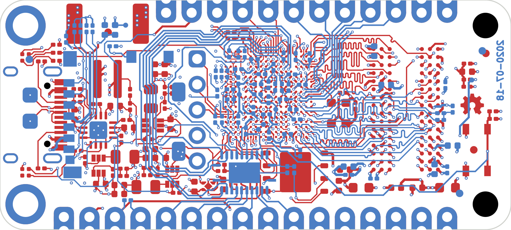
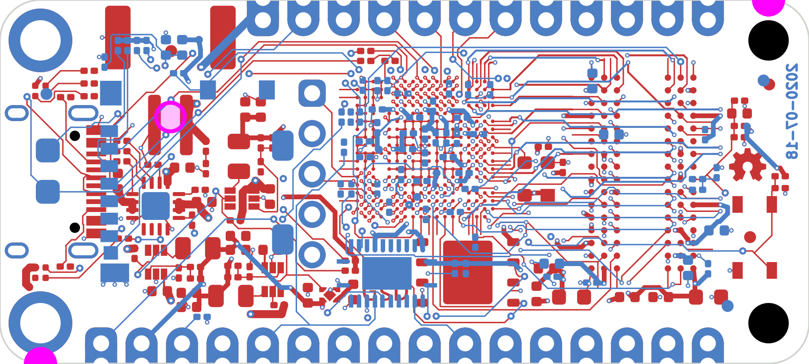

# orangecrab-route-haiku-20261119-2220

| | |
|---|---|
| Task | route only, placement kept |
| Model | claude-haiku-5-5 (Claude Code, `claude -p`, effort max) |
| Tools given | bt (see the README) |
| Time | 2:56 (finished on its own) |
| Cost at API prices | $6.62 |
| Turns | 222 |
| DRC errors | 153 (malformed_courtyard 1, courtyards_overlap 68, copper_edge_clearance 84) |
| Unconnected | 120 items in 54 nets |
| Copper | 2076 mm of track, 391 vias |
| Hosts reached | api.anthropic.com (10), http-intake.logs.us5.datadoghq.com (168) |

DRC is KiCad 10 with zones refilled, on the board the agent saved. Some boards start with findings of their own; see `../../../boards/README.md`.

## Pictures

Start is the board as the agent got it (pads and part outlines; in placement runs the free parts sit in a grid below the board). Reference is the human-routed original ([boards/orangecrab](../../../boards/orangecrab)). The copper pictures show F.Cu (red) and B.Cu (blue) with zone fills left out so the tracks show; DRC errors are circled in magenta on the result.

| Start | Reference | Result |
|---|---|---|
|  |  |  |

## The agent's own summary

From the start of its [NOTES.md](work/NOTES.md):

> **Status: NOT finished. Not ready to order.** 63 nets are not fully connected (120 unconnected items), and the
> board has 153 DRC errors. None of the errors are shorts, track clearance violations, track crossings or track-width
> violations; the errors are (a) copper that touches the board edge at the Feather headers, (b) courtyard overlaps in the
> placement, and (c) one malformed courtyard, all from the fixed placement. The open connections are listed below.

Its review of the bt tool: [BT-REVIEW.md](work/BT-REVIEW.md).

## Progress log

Saved by the agent as it worked, failed attempts included. The notes are here; the pictures are in the archive.

- [002 - FPGA (U3) escape, ground microvias and power vias](work/progress/002-fpga-escape-and-cluster-vias.md)
- [003 - DDR3 (U4) escape, DDR3 power/ground vias, first DDR3 signal routes](work/progress/003-ddr3-escape-and-first-signal-routes.md)
- [004 - FPGA I/O escape moved to In1 microvias (attempt, partly failed)](work/progress/004-io-escape-on-in1-attempt.md)
- [005 - Power rails, DDR3 supply, ground vias: state after the first full pass](work/progress/005-power-and-ground-state-in4.md)
- [006 - Final state of this session (not finished)](work/progress/006-final-state.md)
- [007 - FPGA ground: bridged groups instead of one microvia per ball](work/progress/007-fpga-ground-bridges-final.md)

## Raw files

The prompt is [brief.md](brief.md); the scores are [report.json](report.json). Everything else is in `orangecrab-route-haiku-20261119-2220.tar.xz`, attached to the `cross-model-2026-11` release:
the full transcript (`transcript.jsonl`), the input board, the agent's working directory with its scripts and intermediate boards, the progress pictures, all renders, the raw DRC and metrics, and the proxy log.
