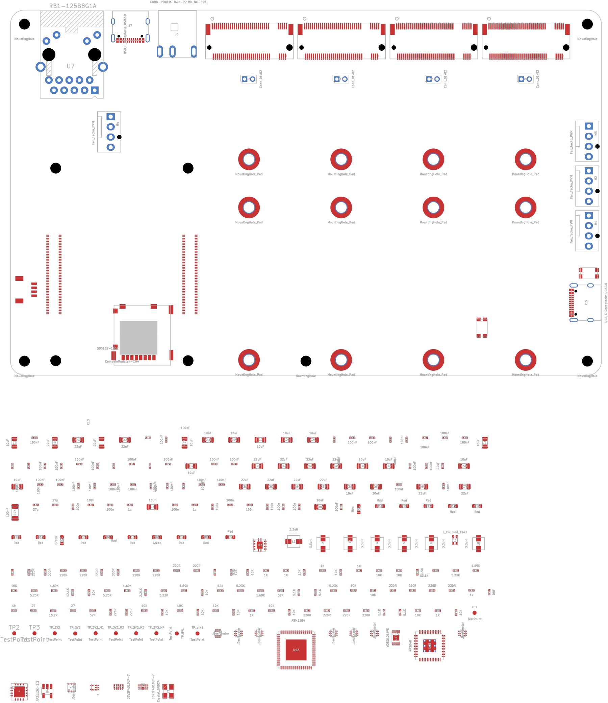
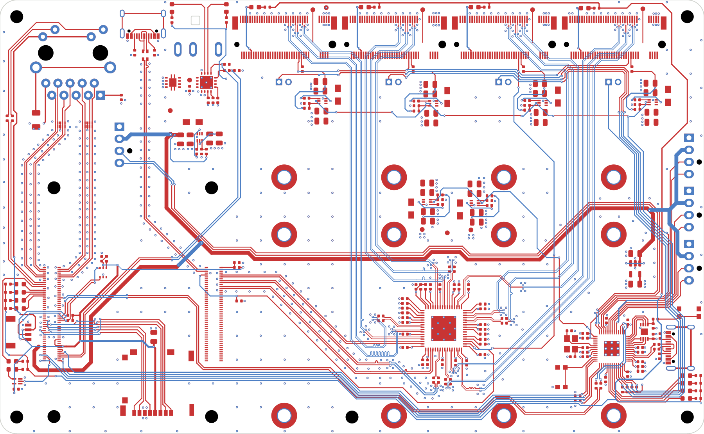
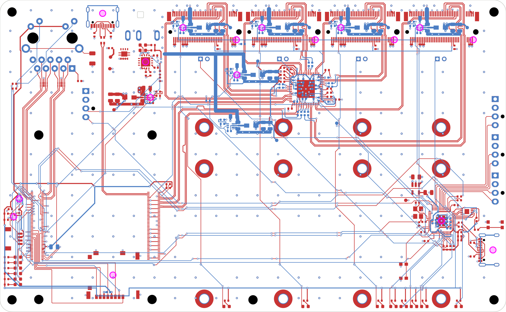
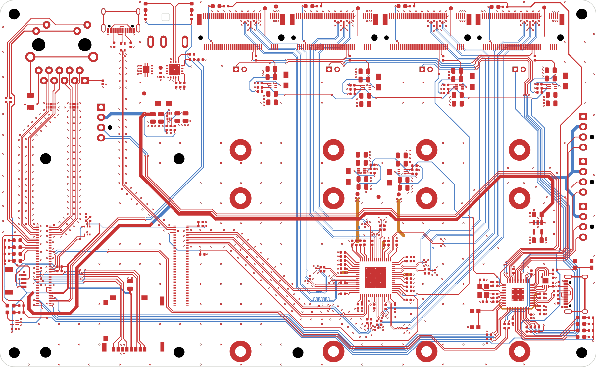
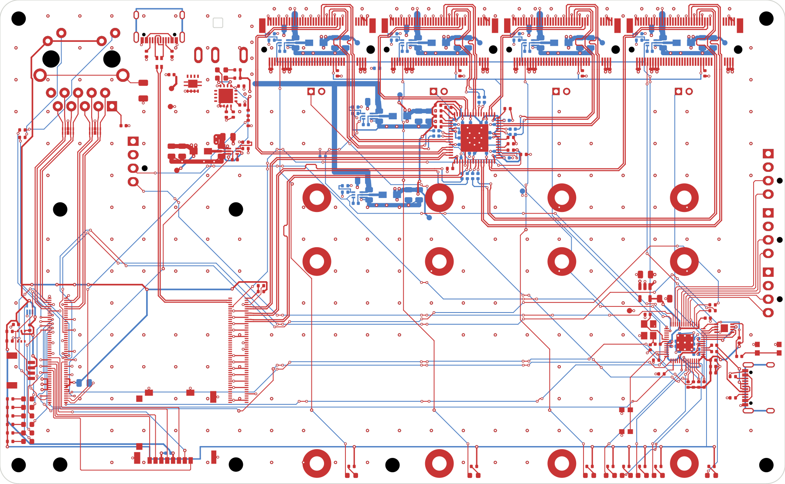
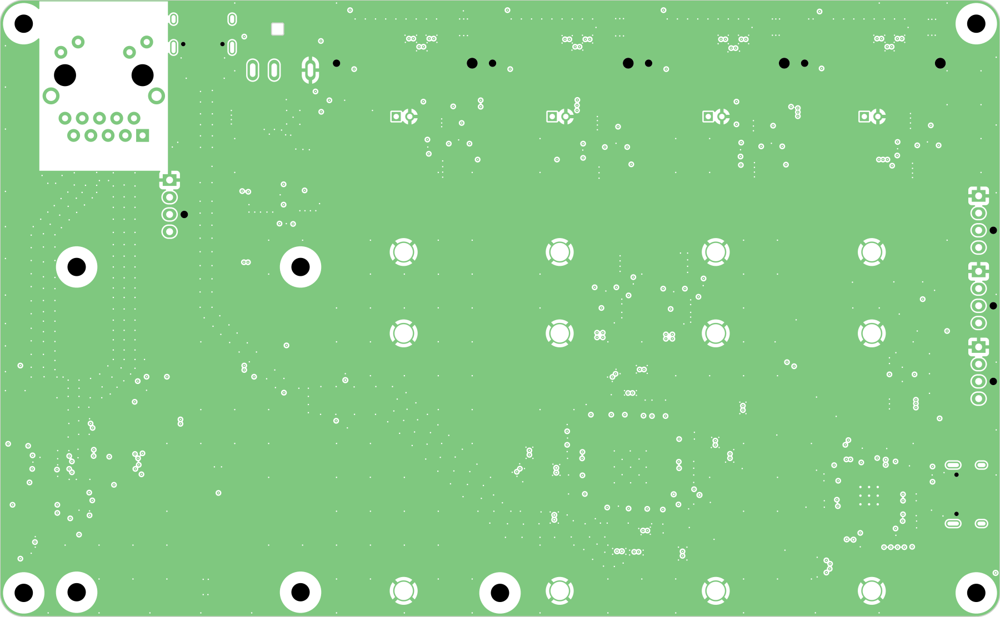
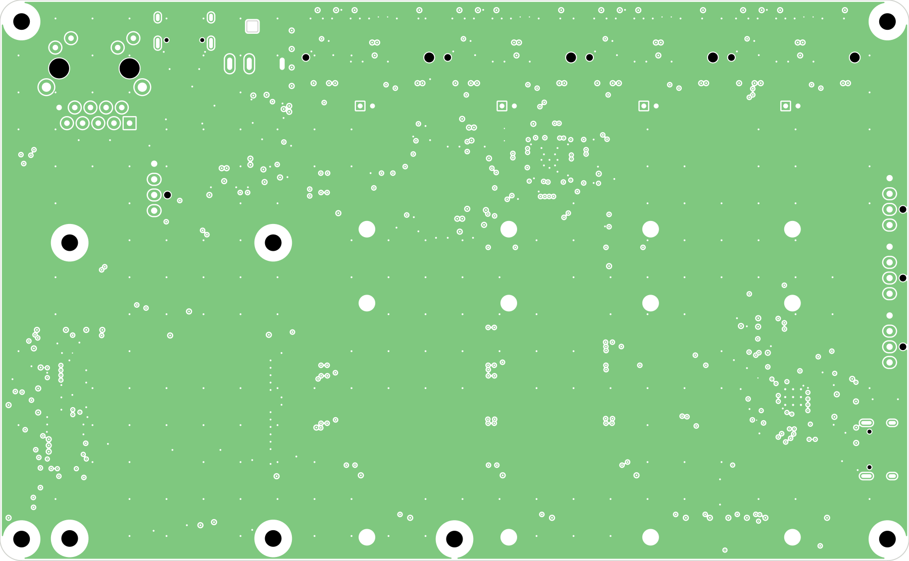
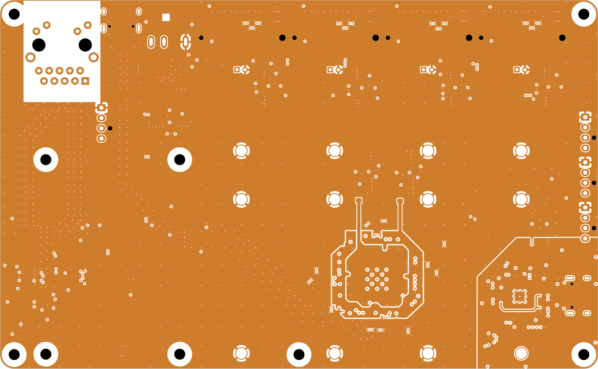
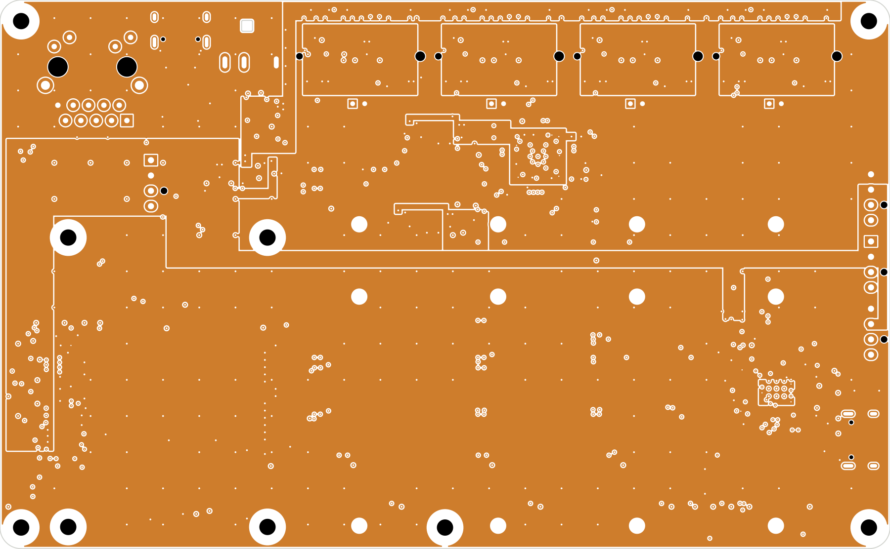

# cm4-place-bt-20261113-1037

| | |
|---|---|
| Task | place the free parts and route |
| Model | claude-fable-5-2 (Claude Code, `claude -p`) |
| Tools given | bt (see the README) |
| Time | 2:55 (finished on its own) |
| Cost at API prices | $33.95 |
| Turns | 166 |
| DRC errors | 17 (footprint_type_mismatch 17) |
| Unconnected | 0 |
| Copper | 7029 mm of track, 732 vias |
| Placement | outline 147.55 × 91.15 mm, parts on top 114 / bottom 102 |
| Hosts reached | api.anthropic.com (20), http-intake.logs.us5.datadoghq.com (128) |

DRC is KiCad 10 with zones refilled, on the board the agent saved. Some boards start with findings of their own; see `../../boards/README.md`.

## Pictures

Start is the board as the agent got it (pads and part outlines; in placement runs the free parts sit in a grid below the board). Reference is the human-routed original ([boards/cm4-nvme-nas](../../boards/cm4-nvme-nas)). The copper pictures show F.Cu (red) and B.Cu (blue) with zone fills left out so the tracks show; DRC errors are circled in magenta on the result.

| Start | Reference | Result |
|---|---|---|
|  |  |  |

All copper layers, tracks and vias only (inner layers in KiCad's colours, under the outer layers), then each inner layer with its zones filled, so plane splits and tracks cutting through a plane show:

| Layer | Reference | Result |
|---|---|---|
| all copper |  |  |
| In1.Cu |  |  |
| In2.Cu |  |  |

## The agent's own summary

From the start of its [NOTES.md](work/NOTES.md):

> State of `/work/RaspberryPiNVMeNAS.kicad_pcb`: all 170 loose parts placed, every net routed, zones filled.

Its review of the bt tool: [BT-REVIEW.md](work/BT-REVIEW.md).

## Progress log

Saved by the agent as it worked, failed attempts included. The notes are here; the pictures are in the archive.

- [001 – first full placement (top side)](work/progress/001-placement-top.md)
- [002 – bottom side placement (seen from the top)](work/progress/002-placement-bottom-pcie-power.md)
- [003 – PCIe: switch fanout, AC-cap hops, socket breakouts, long pairs](work/progress/003-pcie-pairs.md)
- [004 – buck converters, Ethernet, USB, SD, trunks](work/progress/004-bucks-eth-sd.md)
- [005 – autorouting the slow signals: two failed rounds around the RP2040 and the CM4 connector](work/progress/005-autoroute-rp2040-fail.md)
- [006 – final board, top copper](work/progress/006-final-top.md)
- [007 – final board, bottom copper](work/progress/007-final-bottom.md)
- [008 – In2: ground with power islands](work/progress/008-final-in2-power.md)
- [009 – In1: solid ground](work/progress/009-final-in1-ground.md)
- [010 – RP2040 corner, final](work/progress/010-final-rp2040.md)

## Raw files

The prompt is [brief.md](brief.md); the scores are [report.json](report.json). Everything else is in `cm4-place-bt-20261113-1037.tar.xz`, attached to the `runs-2026-11` release:
the full transcript (`transcript.jsonl`), the input board, the agent's working directory with its scripts and intermediate boards, the progress pictures, all renders, the raw DRC and metrics, and the proxy log.
