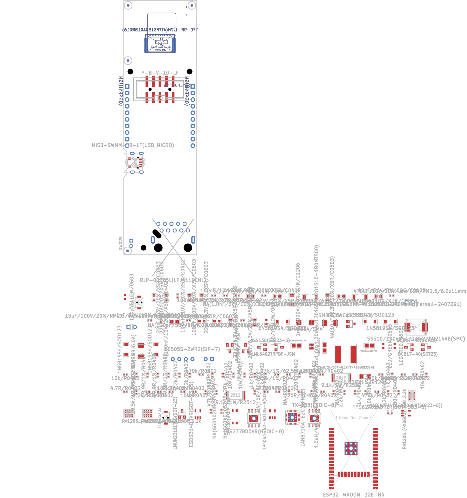
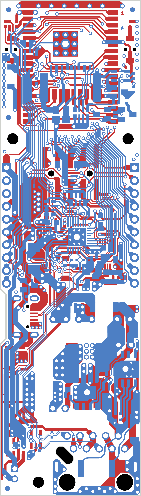
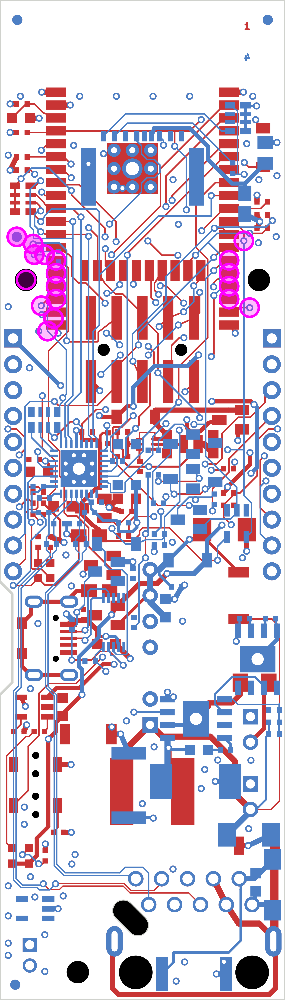
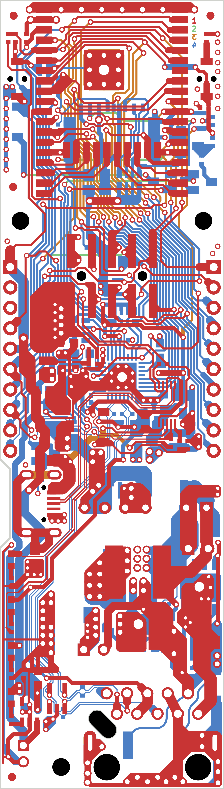
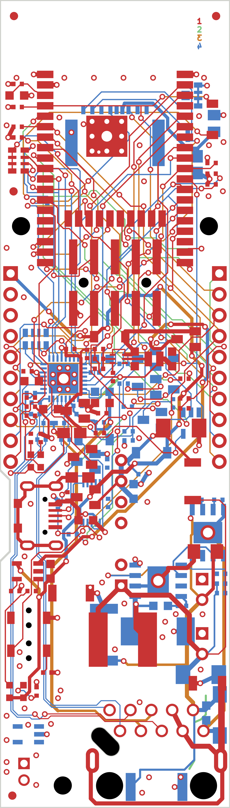
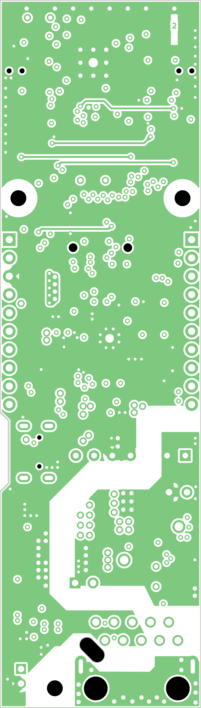
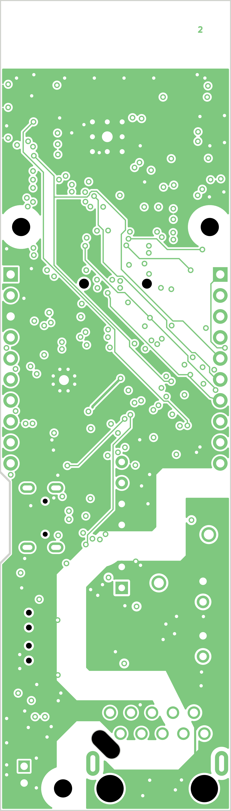
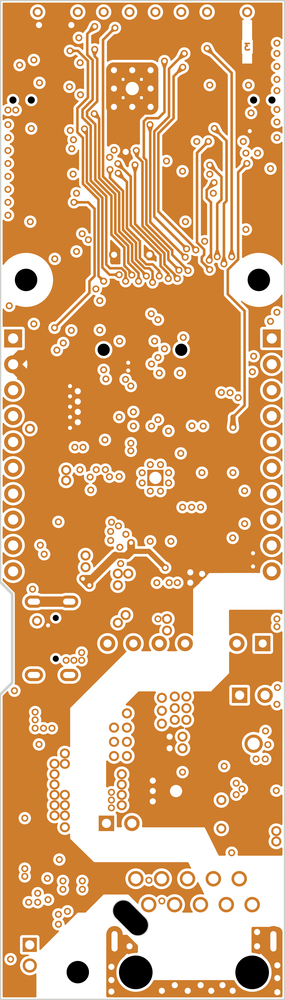
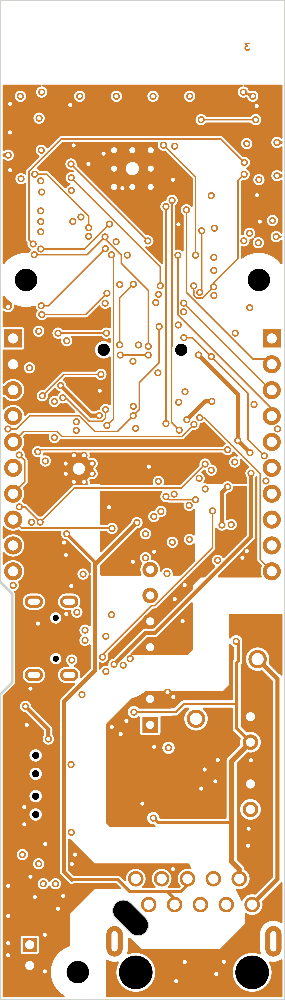

# esp32-iso-bt-20261112-1613

| | |
|---|---|
| Task | place the free parts and route |
| Model | claude-fable-5-2 (Claude Code, `claude -p`) |
| Tools given | bt (see the README) |
| Time | 4:16 (finished on its own) |
| Cost at API prices | $44.43 |
| Turns | 158 |
| DRC errors | 21 (hole_clearance 17, clearance 2, solder_mask_bridge 2) |
| Unconnected | 48 items in 21 nets |
| Copper | 2658 mm of track, 247 vias |
| Placement | outline 28.25 × 98.4 mm, parts on top 65 / bottom 57, flagged off the board: D10 (the check also flags parts that overhang the edge on purpose) |
| Hosts reached | api.anthropic.com (30), http-intake.logs.us5.datadoghq.com (149) |

DRC is KiCad 10 with zones refilled, on the board the agent saved. Some boards start with findings of their own; see `../../boards/README.md`.

## Pictures

Start is the board as the agent got it (pads and part outlines; in placement runs the free parts sit in a grid below the board). Reference is the human-routed original ([boards/esp32-poe-iso](../../boards/esp32-poe-iso)). The copper pictures show F.Cu (red) and B.Cu (blue) with zone fills left out so the tracks show; DRC errors are circled in magenta on the result.

| Start | Reference | Result |
|---|---|---|
|  |  |  |

All copper layers, tracks and vias only (inner layers in KiCad's colours, under the outer layers), then each inner layer with its zones filled, so plane splits and tracks cutting through a plane show:

| Layer | Reference | Result |
|---|---|---|
| all copper |  |  |
| In1.Cu |  |  |
| In2.Cu |  |  |

## The agent's own summary

From the start of its [NOTES.md](work/NOTES.md):

> Placement is complete and I stand behind it. Routing is **not** complete:
> KiCad 10 DRC on the saved board reports **48 unconnected items in 21 nets** and **33 errors**.
> The board must not be ordered as it is. What is open is listed at the end, most important first.

Its review of the bt tool: [BT-REVIEW.md](work/BT-REVIEW.md).

## Progress log

Saved by the agent as it worked, failed attempts included. The notes are here; the pictures are in the archive.

- [001 – starting point](work/progress/001-initial.md)
- [002 – first complete placement](work/progress/002-placement-v1.md)
- [003 – placement v2 (PHY moved)](work/progress/003-placement-v2.md)
- [004 – Ethernet pairs, USB pair and the PoE converter routed](work/progress/004-pairs-and-poe-routed.md)
- [005 – bulk routing passes (several thrown away)](work/progress/005-autoroute-passes.md)
- [006 – state at hand-over (NOT finished)](work/progress/006-final-state.md)

## Raw files

The prompt is [brief.md](brief.md); the scores are [report.json](report.json). Everything else is in `esp32-iso-bt-20261112-1613.tar.xz`, attached to the `runs-2026-11` release:
the full transcript (`transcript.jsonl`), the input board, the agent's working directory with its scripts and intermediate boards, the progress pictures, all renders, the raw DRC and metrics, and the proxy log.
