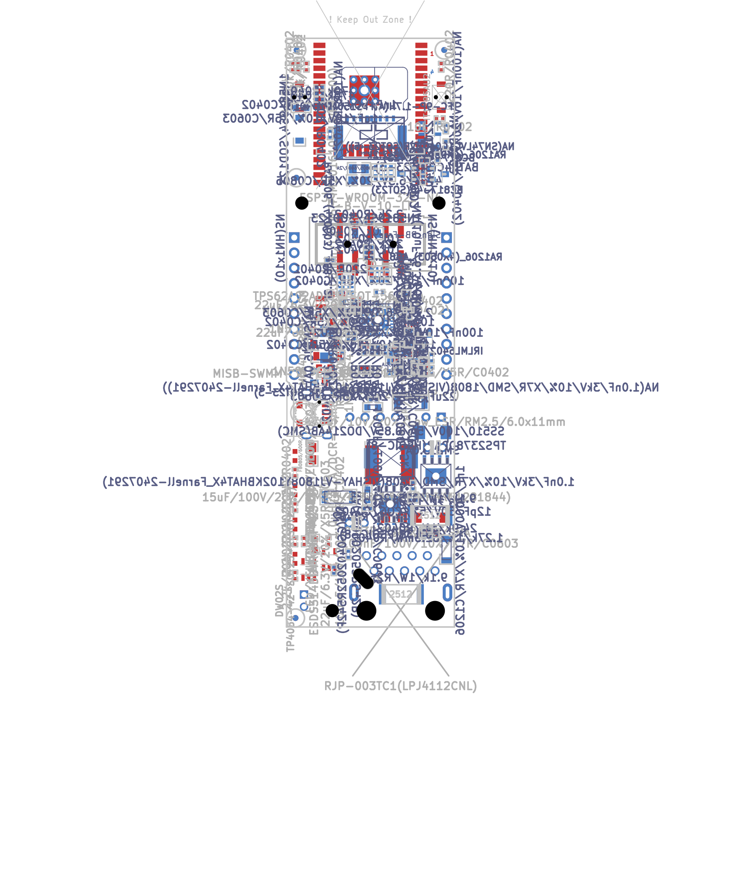
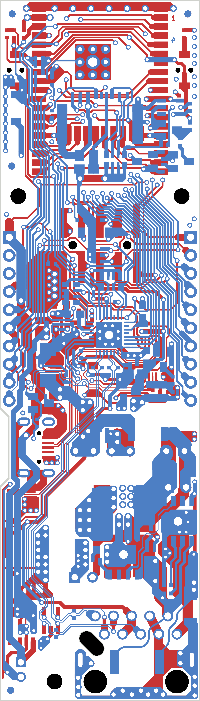
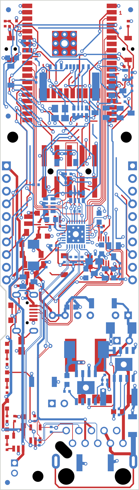
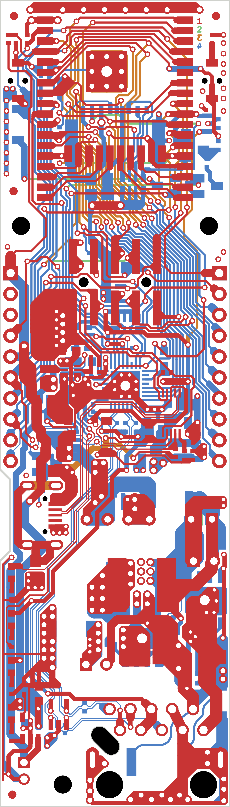
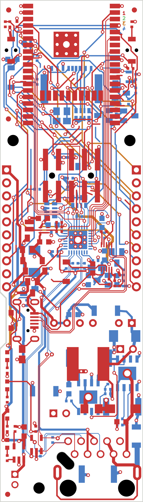
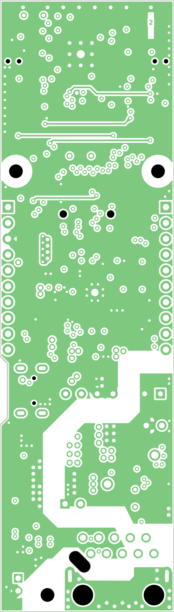
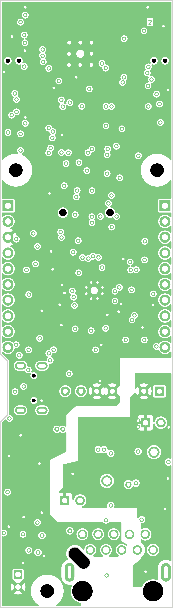
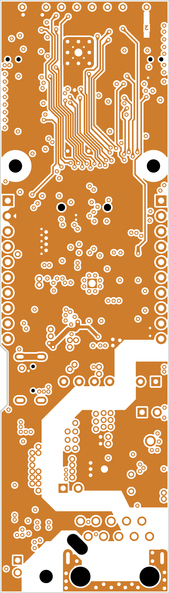
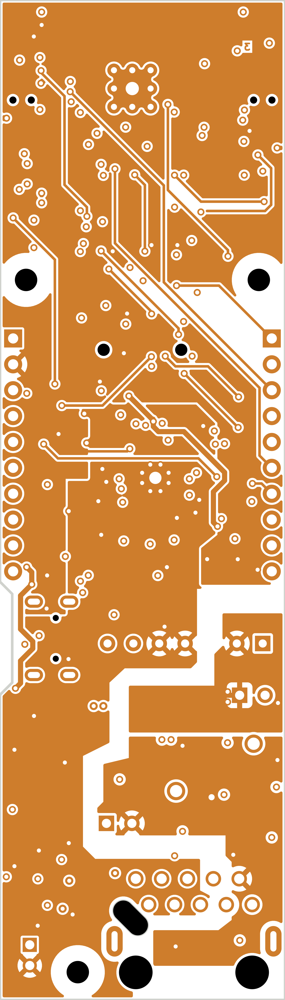

# esp32-route-bt-20261112-2250

| | |
|---|---|
| Task | route only, placement kept |
| Model | claude-fable-5-2 (Claude Code, `claude -p`) |
| Tools given | bt (see the README) |
| Time | 2:40 (finished on its own) |
| Cost at API prices | $30.74 |
| Turns | 136 |
| DRC errors | 0 |
| Unconnected | 43 items in 25 nets |
| Copper | 2489 mm of track, 185 vias |
| Hosts reached | api.anthropic.com (20), http-intake.logs.us5.datadoghq.com (99) |

DRC is KiCad 10 with zones refilled, on the board the agent saved. Some boards start with findings of their own; see `../../boards/README.md`.

## Pictures

Start is the board as the agent got it (pads and part outlines; in placement runs the free parts sit in a grid below the board). Reference is the human-routed original ([boards/esp32-poe-iso](../../boards/esp32-poe-iso)). The copper pictures show F.Cu (red) and B.Cu (blue) with zone fills left out so the tracks show; DRC errors are circled in magenta on the result.

| Start | Reference | Result |
|---|---|---|
|  |  |  |

All copper layers, tracks and vias only (inner layers in KiCad's colours, under the outer layers), then each inner layer with its zones filled, so plane splits and tracks cutting through a plane show:

| Layer | Reference | Result |
|---|---|---|
| all copper |  |  |
| In1.Cu |  |  |
| In2.Cu |  |  |

## The agent's own summary

From the start of its [NOTES.md](work/NOTES.md):

> Board: 28 × 98 mm, 4 layers (F / 0.127 prepreg / In1 / 1.2 core / In2 / 0.127 prepreg / B), all footprints left
> exactly where they were (`bt same` against the original confirms this – see the end of this file).

Its review of the bt tool: [BT-REVIEW.md](work/BT-REVIEW.md).

## Progress log

Saved by the agent as it worked, failed attempts included. The notes are here; the pictures are in the archive.

- [001 – rules and inner planes](work/progress/001-inner-planes.md)
- [002 – Ethernet pairs, centre-tap rail, USB (hand-planned)](work/progress/002-eth-pairs-south.md)
- [003 – RMII trial with `bt route --nets` (thrown away)](work/progress/003-rmii-autoroute-try.md)
- [004 – PoE converter section and PHY fan-out (hand-planned)](work/progress/004-poe-and-phy-fanout.md)
- [005 – RMII bus as fixed lanes, plane vias, start of bulk routing](work/progress/005-rmii-lanes.md)
- [006 – after the first bulk autoroute](work/progress/006-after-first-autoroute.md)
- [007 – net-by-net `bt route --shove` run (discarded)](work/progress/007-shove-run-discarded.md)
- [008 – inner layer used as overflow by the router: +3.3 V plane cut (reverted)](work/progress/008-in2-plane-cut-by-router.md)
- [009 – final state (not complete)](work/progress/009-final-state.md)
- [010 – In2 at the end](work/progress/010-final-inner-layers.md)

## Raw files

The prompt is [brief.md](brief.md); the scores are [report.json](report.json). Everything else is in `esp32-route-bt-20261112-2250.tar.xz`, attached to the `runs-2026-11` release:
the full transcript (`transcript.jsonl`), the input board, the agent's working directory with its scripts and intermediate boards, the progress pictures, all renders, the raw DRC and metrics, and the proxy log.
