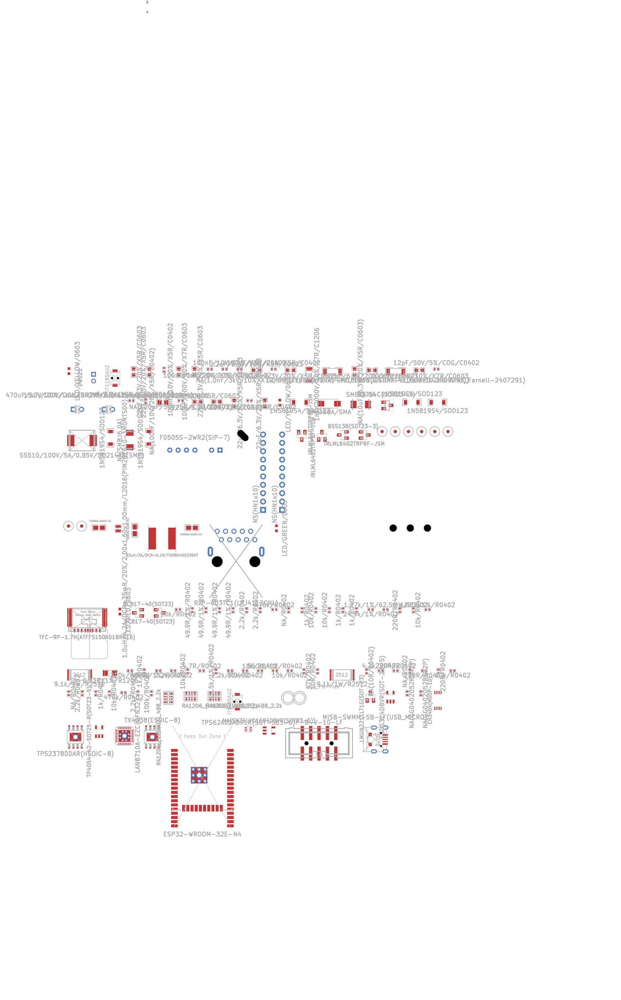
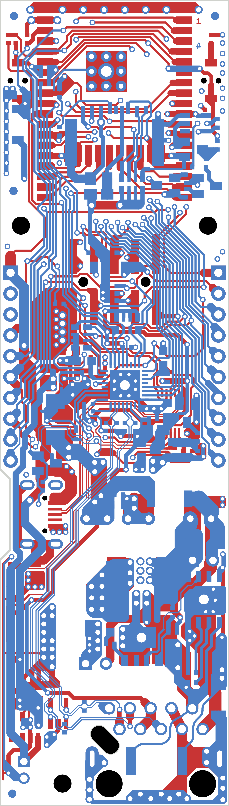
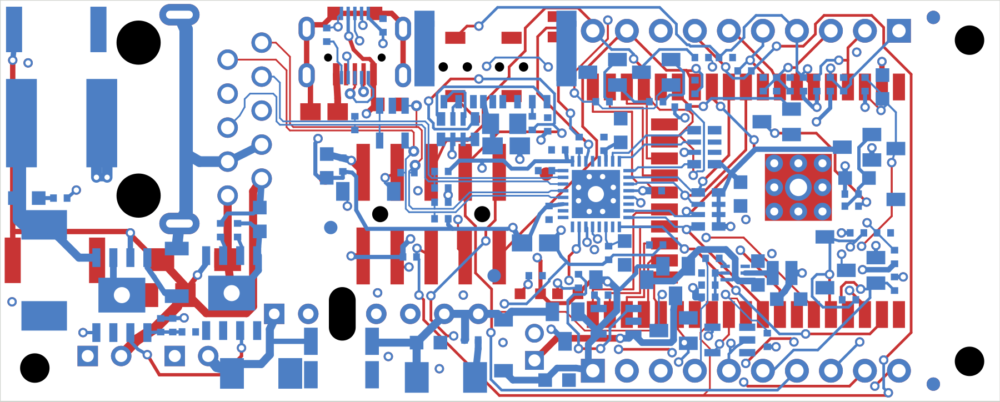
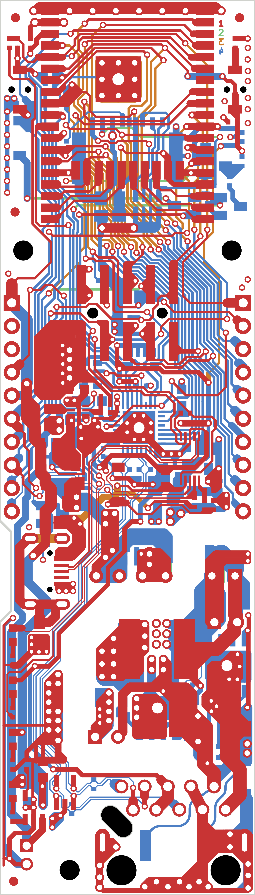
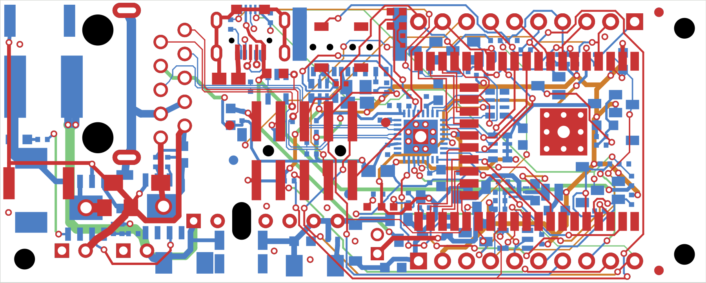
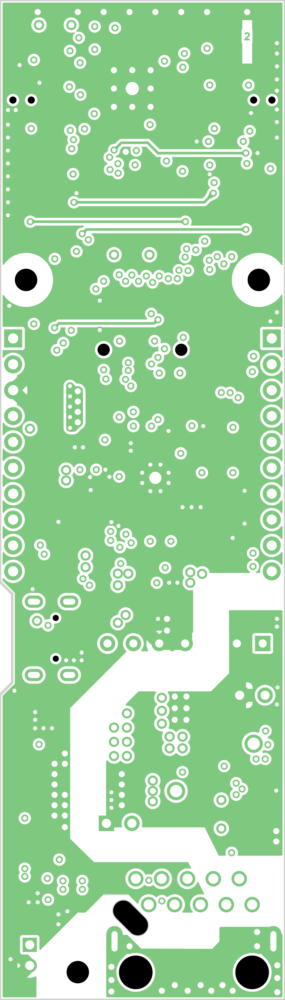
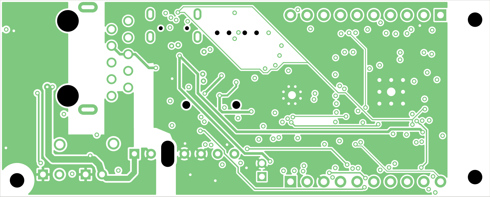
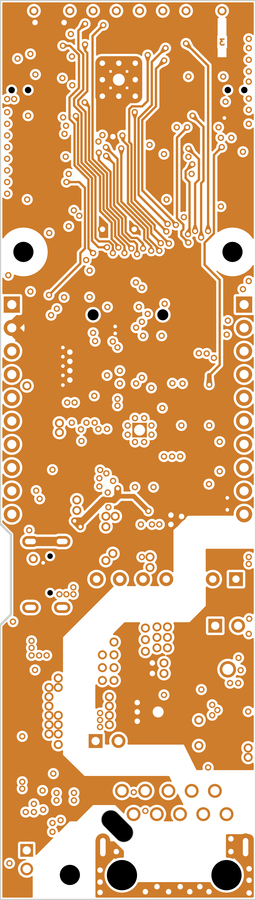
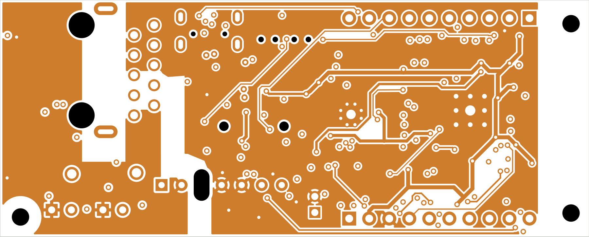

# esp32-small-bt-20261112-1613

| | |
|---|---|
| Task | place the free parts and route |
| Model | claude-fable-5-2 (Claude Code, `claude -p`) |
| Tools given | bt (see the README) |
| Time | 3:01 (finished on its own) |
| Cost at API prices | $45.55 |
| Turns | 166 |
| DRC errors | 0 |
| Unconnected | 39 items in 14 nets |
| Copper | 1999 mm of track, 146 vias |
| Placement | outline 74.8 × 30.1 mm, parts on top 35 / bottom 112, flagged off the board: USB-UART1 LAN_CON1 (the check also flags parts that overhang the edge on purpose) |
| Hosts reached | api.anthropic.com (25), http-intake.logs.us5.datadoghq.com (132) |

DRC is KiCad 10 with zones refilled, on the board the agent saved. Some boards start with findings of their own; see `../../boards/README.md`.

## Pictures

Start is the board as the agent got it (pads and part outlines; in placement runs the free parts sit in a grid below the board). Reference is the human-routed original ([boards/esp32-poe-iso](../../boards/esp32-poe-iso)). The copper pictures show F.Cu (red) and B.Cu (blue) with zone fills left out so the tracks show; DRC errors are circled in magenta on the result.

| Start | Reference | Result |
|---|---|---|
|  |  |  |

All copper layers, tracks and vias only (inner layers in KiCad's colours, under the outer layers), then each inner layer with its zones filled, so plane splits and tracks cutting through a plane show:

| Layer | Reference | Result |
|---|---|---|
| all copper |  |  |
| In1.Cu |  |  |
| In2.Cu |  |  |

## The agent's own summary

From the start of its [NOTES.md](work/NOTES.md):

> Board: **30.0 x 74.7 mm** rectangle (2241 mm2; the original outline noted in the file was 28 x 98 mm),
> 4 copper layers, parts on both sides. All 147 footprints are on the board; none added, removed or edited.

Its review of the bt tool: [BT-REVIEW.md](work/BT-REVIEW.md).

## Progress log

Saved by the agent as it worked, failed attempts included. The notes are here; the pictures are in the archive.

- [001 – first floorplan, 28 mm wide (abandoned)](work/progress/001-floorplan-28mm.md)
- [002 – full placement at 30 x 74.7 mm](work/progress/002-placement-30mm.md)
- [003 – PoE primary side routed by hand](work/progress/003-primary-routed.md)
- [004 – Ethernet pairs, centre-tap supply and USB data routed by hand](work/progress/004-eth-usb-pairs.md)
- [005 – secondary power distribution and PHY supplies](work/progress/005-power-phy.md)
- [006 – bulk signal routing with bt (several attempts)](work/progress/006-bulk-autoroute.md)
- [007 – final state as delivered](work/progress/007-final.md)

## Raw files

The prompt is [brief.md](brief.md); the scores are [report.json](report.json). Everything else is in `esp32-small-bt-20261112-1613.tar.xz`, attached to the `runs-2026-11` release:
the full transcript (`transcript.jsonl`), the input board, the agent's working directory with its scripts and intermediate boards, the progress pictures, all renders, the raw DRC and metrics, and the proxy log.
