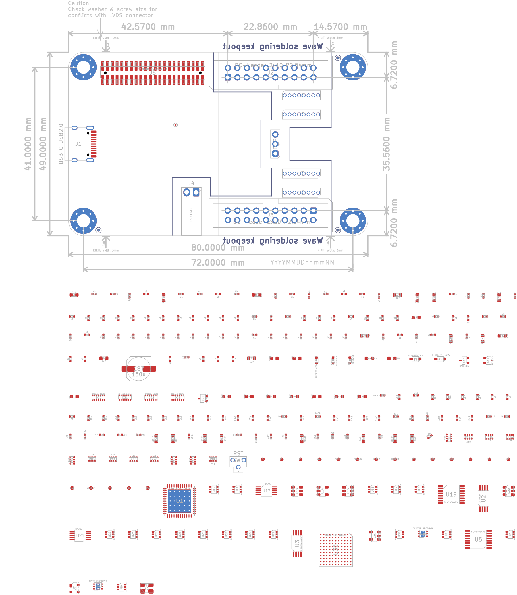
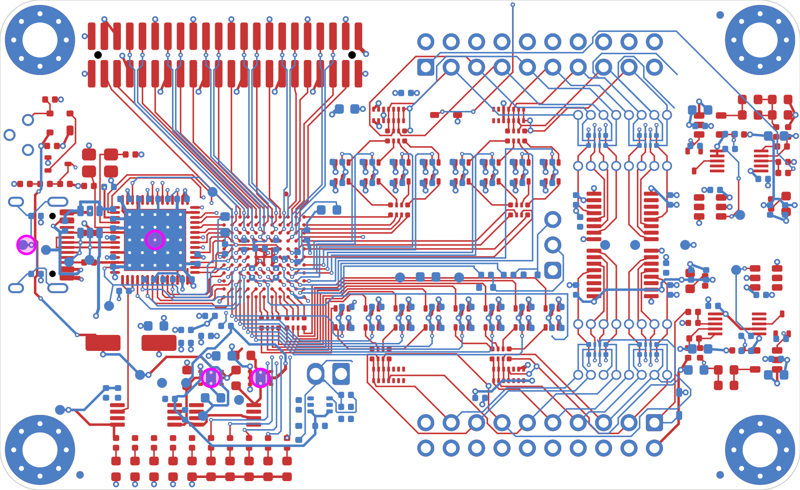
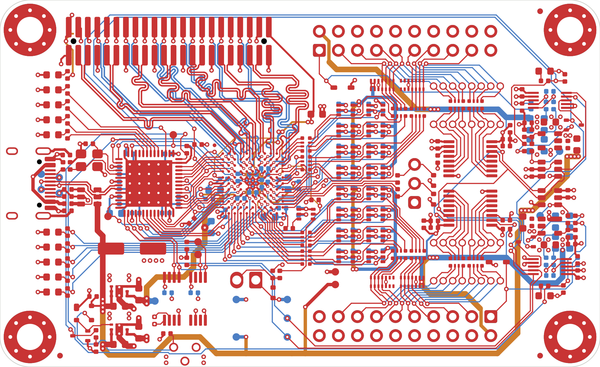
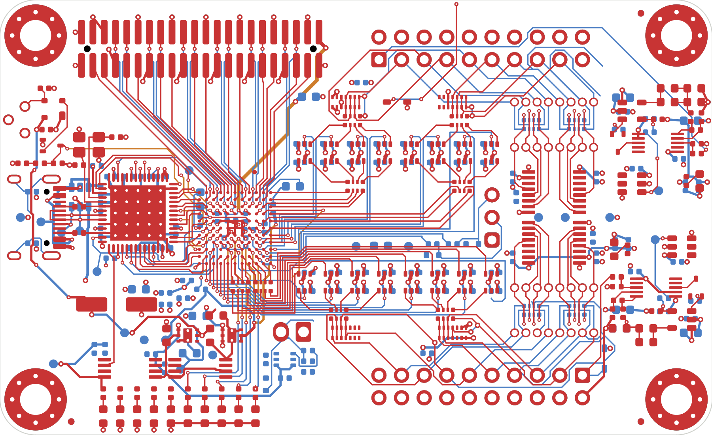
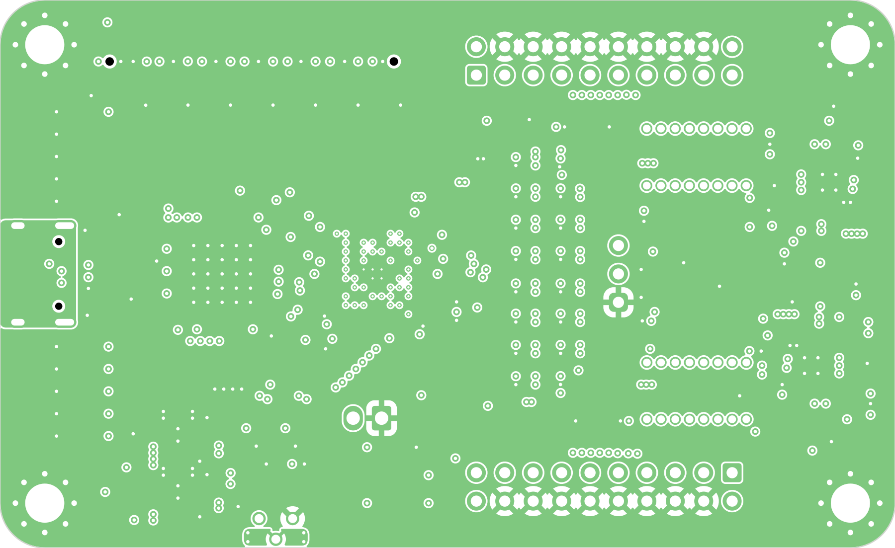
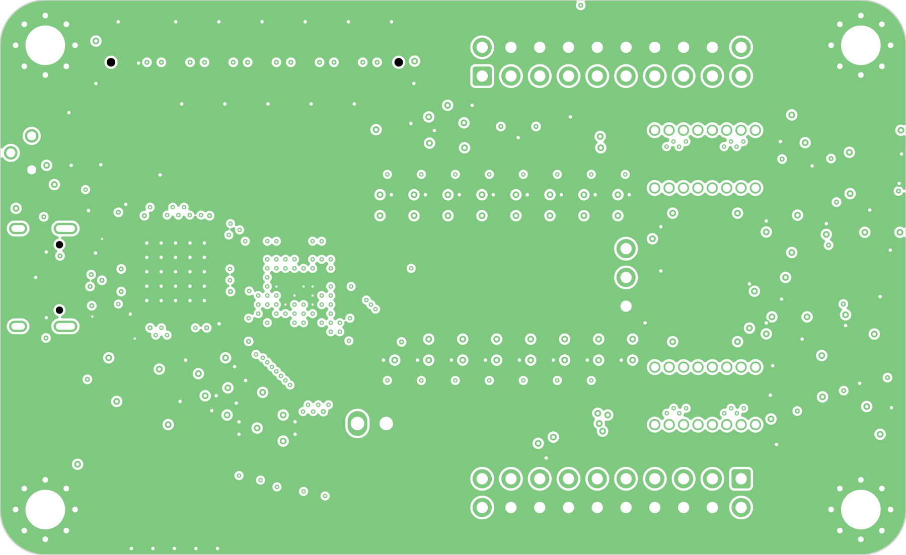
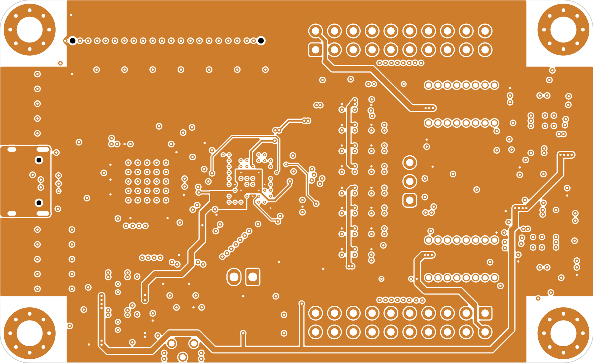
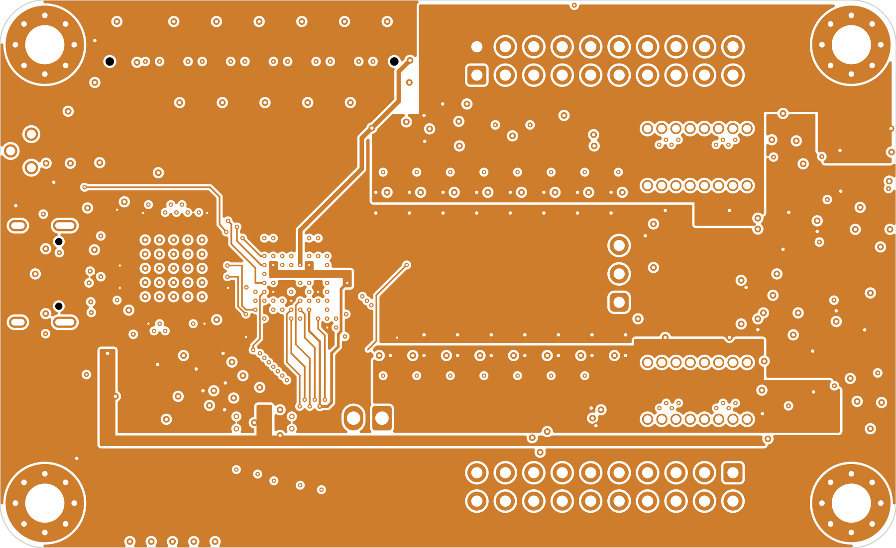

# glasgow-place-bt-20261113-0050

| | |
|---|---|
| Task | place the free parts and route |
| Model | claude-fable-5-2 (Claude Code, `claude -p`) |
| Tools given | bt (see the README) |
| Time | 4:00 (stopped by the time limit) |
| Cost at API prices | not reported (the run was stopped before Claude Code wrote its result) |
| DRC errors | 4 (footprint_type_mismatch 4) |
| Unconnected | 73 items in 22 nets |
| Copper | 3525 mm of track, 354 vias |
| Placement | outline 80.1 × 49.1 mm, parts on top 105 / bottom 138, flagged off the board: SW1 (the check also flags parts that overhang the edge on purpose) |
| Hosts reached | api.anthropic.com (26), http-intake.logs.us5.datadoghq.com (134) |

DRC is KiCad 10 with zones refilled, on the board the agent saved. Some boards start with findings of their own; see `../../boards/README.md`.

## Pictures

Start is the board as the agent got it (pads and part outlines; in placement runs the free parts sit in a grid below the board). Reference is the human-routed original ([boards/glasgow-revc3](../../boards/glasgow-revc3)). The copper pictures show F.Cu (red) and B.Cu (blue) with zone fills left out so the tracks show; DRC errors are circled in magenta on the result.

| Start | Reference | Result |
|---|---|---|
|  |  |  |

All copper layers, tracks and vias only (inner layers in KiCad's colours, under the outer layers), then each inner layer with its zones filled, so plane splits and tracks cutting through a plane show:

| Layer | Reference | Result |
|---|---|---|
| all copper |  |  |
| In1.Cu |  |  |
| In2.Cu |  |  |

## The agent's own summary

None: the run ended before the agent wrote NOTES.md.

## Progress log

Saved by the agent as it worked, failed attempts included. The notes are here; the pictures are in the archive.

- [001 – first scripted placement (front view)](work/progress/001-first-placement-front.md)
- [002 – placement v2 (front)](work/progress/002-placement-v2-front.md)
- [003 – placement v2 (back)](work/progress/003-placement-v2-back.md)
- [004 – USB corner routed by hand](work/progress/004-usb-corner.md)
- [005 – BGA fan-out and LVDS pairs](work/progress/005-fanout-lvds.md)
- [006 – FX2 <-> FPGA FIFO bus](work/progress/006-fx2-fpga-bus.md)
- [007 – level-shifter rows](work/progress/007-port-buffers.md)
- [008 – buses on the FPGA's east and south sides (QA/QB, DA/DB, port-B X, AUX)](work/progress/008-fpga-east-south-buses.md)

## Raw files

The prompt is [brief.md](brief.md); the scores are [report.json](report.json). Everything else is in `glasgow-place-bt-20261113-0050.tar.xz`, attached to the `runs-2026-11` release:
the full transcript (`transcript.jsonl`), the input board, the agent's working directory with its scripts and intermediate boards, the progress pictures, all renders, the raw DRC and metrics, and the proxy log.
