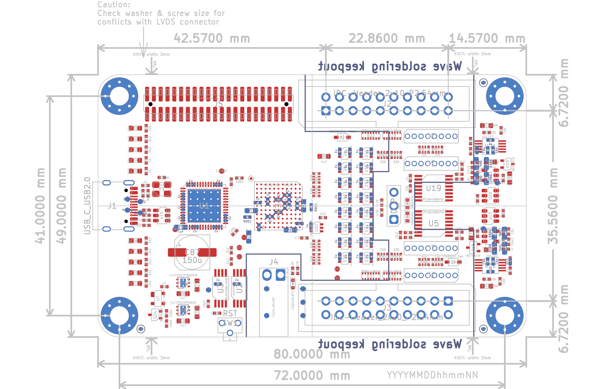
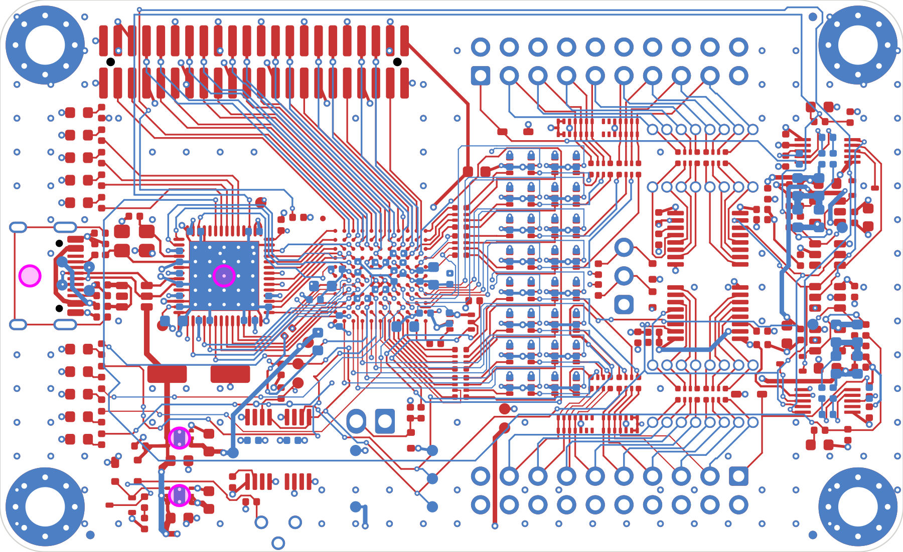
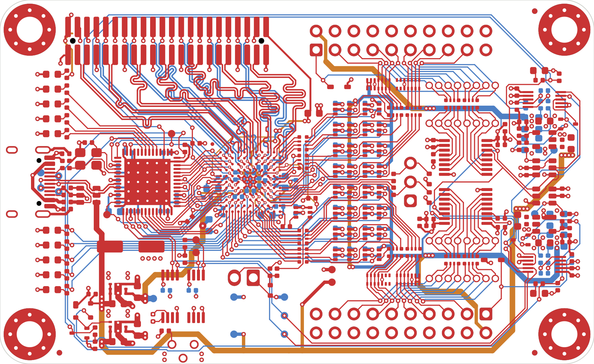
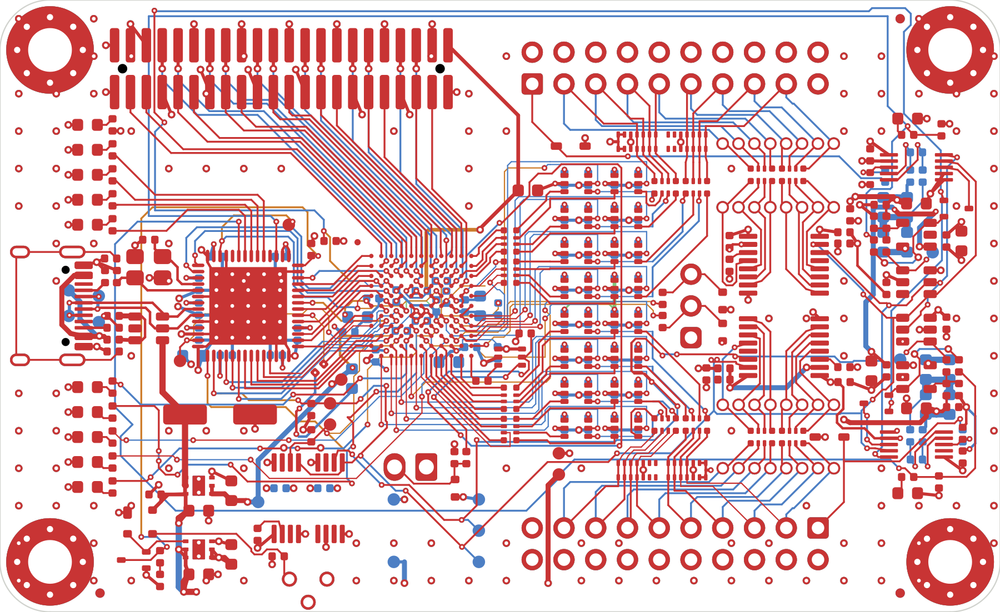
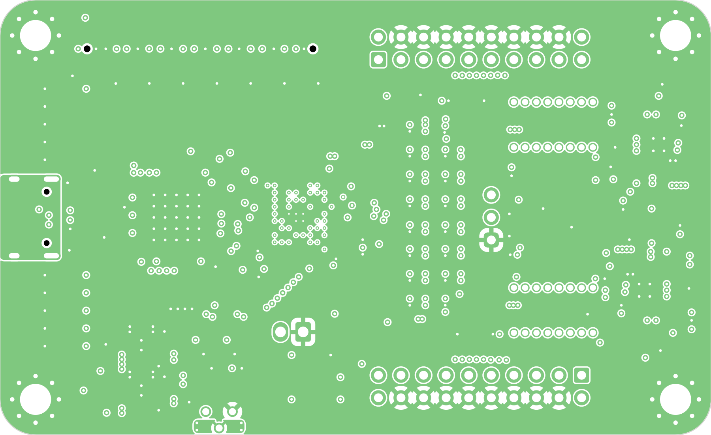
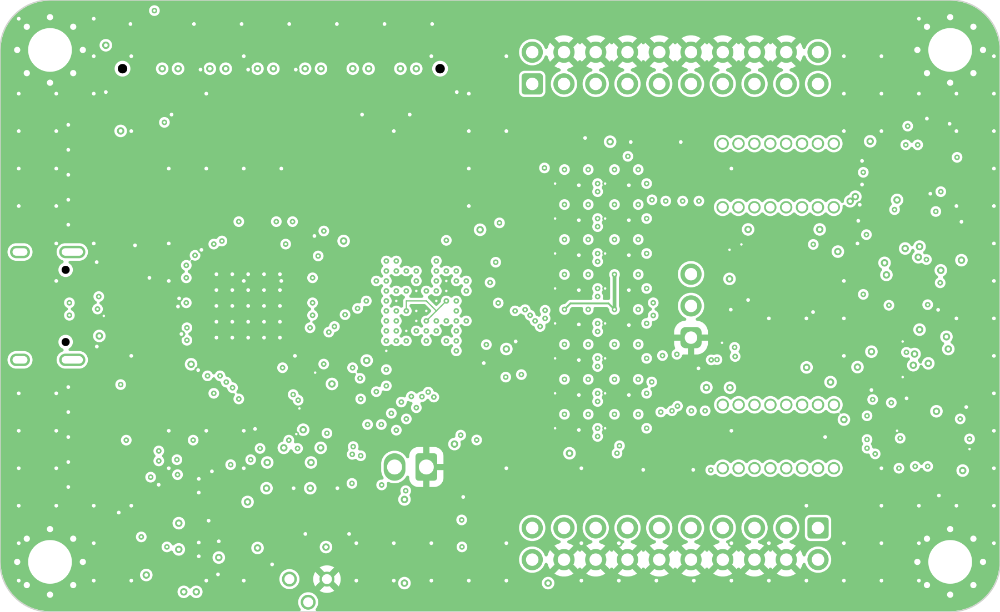
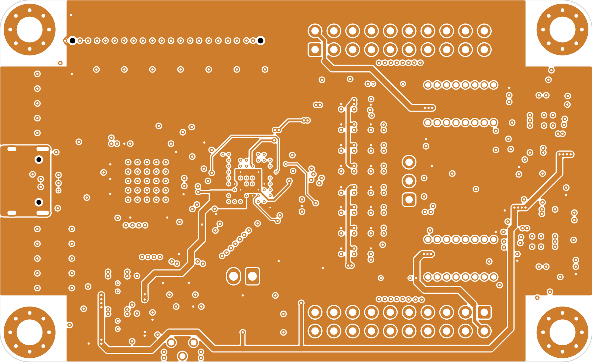
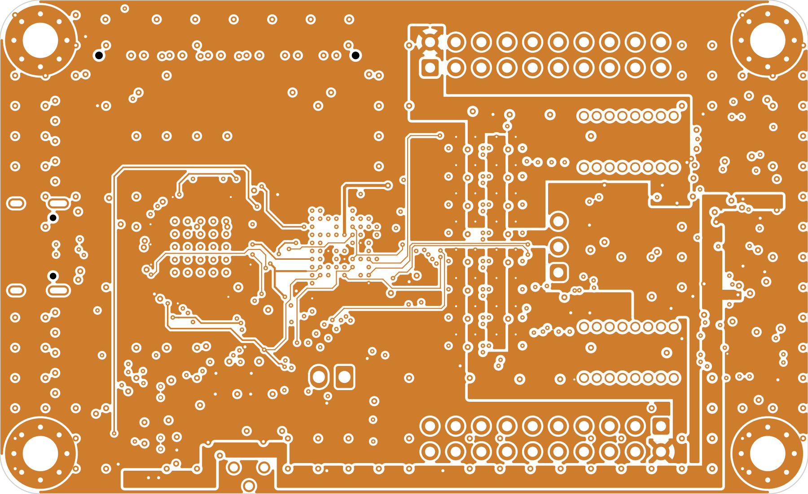

# glasgow-route-bt-20261112-2250

| | |
|---|---|
| Task | route only, placement kept |
| Model | claude-fable-5-2 (Claude Code, `claude -p`) |
| Tools given | bt (see the README) |
| Time | 2:24 (finished on its own) |
| Cost at API prices | $53.93 |
| Turns | 230 |
| DRC errors | 4 (footprint_type_mismatch 4) |
| Unconnected | 0 |
| Copper | 4130 mm of track, 576 vias |
| Hosts reached | api.anthropic.com (13), http-intake.logs.us5.datadoghq.com (165) |

DRC is KiCad 10 with zones refilled, on the board the agent saved. Some boards start with findings of their own; see `../../boards/README.md`.

## Pictures

Start is the board as the agent got it (pads and part outlines; in placement runs the free parts sit in a grid below the board). Reference is the human-routed original ([boards/glasgow-revc3](../../boards/glasgow-revc3)). The copper pictures show F.Cu (red) and B.Cu (blue) with zone fills left out so the tracks show; DRC errors are circled in magenta on the result.

| Start | Reference | Result |
|---|---|---|
|  |  |  |

All copper layers, tracks and vias only (inner layers in KiCad's colours, under the outer layers), then each inner layer with its zones filled, so plane splits and tracks cutting through a plane show:

| Layer | Reference | Result |
|---|---|---|
| all copper |  |  |
| In1.Cu |  |  |
| In2.Cu |  |  |

## The agent's own summary

From the start of its [NOTES.md](work/NOTES.md):

> State: every net is connected, KiCad 10 DRC (`kicad-cli pcb drc --refill-zones --severity-all`) reports 0 unconnected items and only the
> violations that the unrouted board already had (library/footprint mismatches, courtyard and silkscreen warnings, schematic-parity items).
> No footprint was moved, rotated, added or removed (`bt same`). The board is routable-complete, but read "Not finished / not good" before ordering.

Its review of the bt tool: [BT-REVIEW.md](work/BT-REVIEW.md).

## Progress log

Saved by the agent as it worked, failed attempts included. The notes are here; the pictures are in the archive.

- [002 – BGA power/ground + north-side fanout (hand-placed)](work/progress/002-bga-fanout.md)
- [003 – Inner layer planes](work/progress/003-inner-zones.md)
- [004 – LVDS pairs FPGA → J5 (generated geometrically, not autorouted)](work/progress/004-lvds-fan.md)
- [005 – USB, crystal, CC, VBUS, LED strings (left edge)](work/progress/005-usb-xtal.md)
- [006 – FX2 ⇄ FPGA bus, FX2 power pins, BGA west side](work/progress/006-fx2-bus.md)
- [007 – Level-shifter block (16× SN74LVC1T45), generated by script](work/progress/007-shifters.md)
- [008 – I/O side: series resistors, ESD arrays, headers](work/progress/008-io-side.md)
- [009 – Remaining FPGA sides, core rail, bulk of the signals](work/progress/009-most-signals.md)
- [010 – All signal nets connected](work/progress/010-signals-done.md)
- [011 – Power, ground, clean-up, final state (pictures: 011-final-outer / -In1 / -In2)](work/progress/011-final.md)

## Raw files

The prompt is [brief.md](brief.md); the scores are [report.json](report.json). Everything else is in `glasgow-route-bt-20261112-2250.tar.xz`, attached to the `runs-2026-11` release:
the full transcript (`transcript.jsonl`), the input board, the agent's working directory with its scripts and intermediate boards, the progress pictures, all renders, the raw DRC and metrics, and the proxy log.
