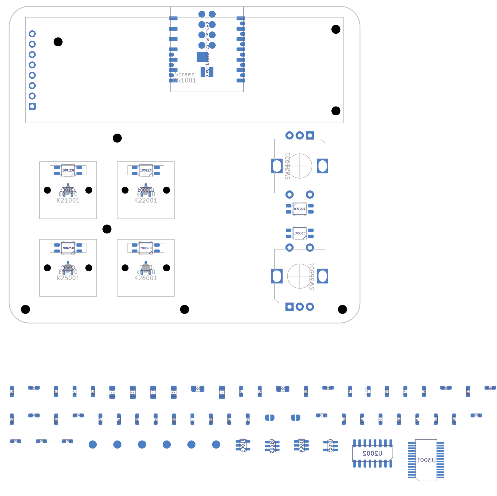
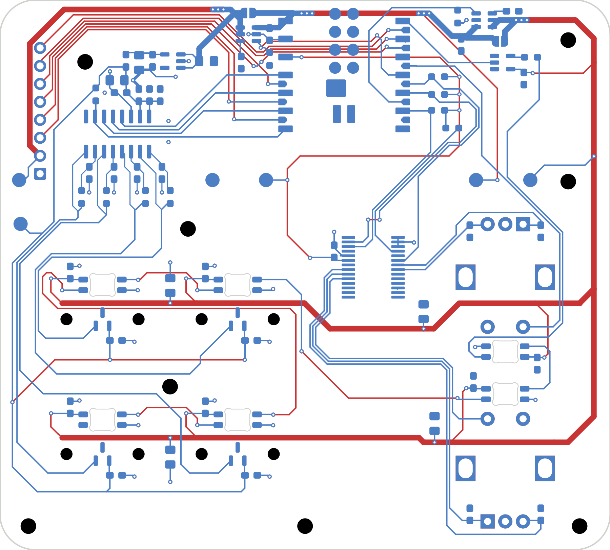
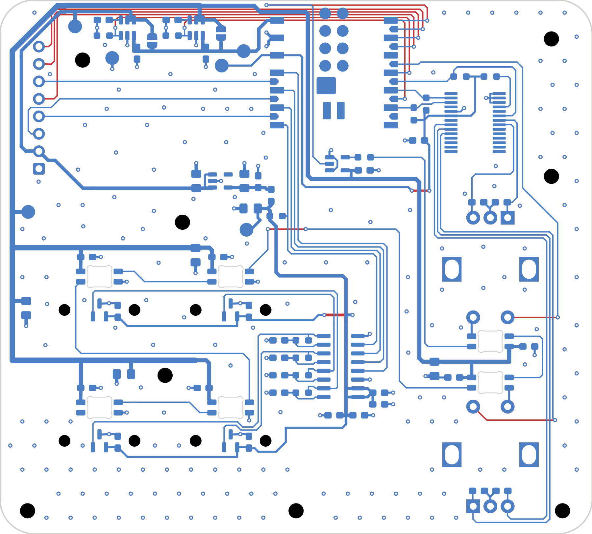

# h4e2-place-20261111-1853

| | |
|---|---|
| Task | place the free parts and route |
| Model | claude-fable-5-2 (Claude Code, `claude -p`) |
| Tools given | none (pcbnew, kicad-cli, whatever it installed) |
| Time | 1:02 (finished on its own) |
| Cost at API prices | $21.67 |
| Turns | 60 |
| DRC errors | 0 |
| Unconnected | 0 |
| Copper | 2202 mm of track, 229 vias |
| Placement | outline 86.2 × 77.88 mm, parts on top 0 / bottom 63 |
| Hosts reached | api.anthropic.com (12), http-intake.logs.us5.datadoghq.com (43), files.pythonhosted.org (1), pypi.org (1) |

DRC is KiCad 10 with zones refilled, on the board the agent saved. Some boards start with findings of their own; see `../../boards/README.md`.

## Pictures

Start is the board as the agent got it (pads and part outlines; in placement runs the free parts sit in a grid below the board). Reference is the human-routed original ([boards/h4e2](../../boards/h4e2)). The copper pictures show F.Cu (red) and B.Cu (blue) with zone fills left out so the tracks show; DRC errors are circled in magenta on the result.

| Start | Reference | Result |
|---|---|---|
|  |  |  |

## The agent's own summary

From the start of its [NOTES.md](work/NOTES.md):

> Board: 86 × 77.7 mm, 2 layers. All 62 loose parts were placed on B.Cu, the board was routed, and
> ground zones were added on both layers. Outline, locked footprints, footprint definitions and nets are
> unchanged (checked by script against the original file).

## Follow-up

Asked afterwards which tools would have made the job faster or cheaper: [ANSWER.md](ask/ANSWER.md).

## Raw files

The prompt is [brief.md](brief.md); the scores are [report.json](report.json). Everything else is in `h4e2-place-20261111-1853.tar.xz`, attached to the `runs-2026-11` release:
the full transcript (`transcript.jsonl`), the input board, the agent's working directory with its scripts and intermediate boards, the progress pictures, all renders, the raw DRC and metrics, and the proxy log.
