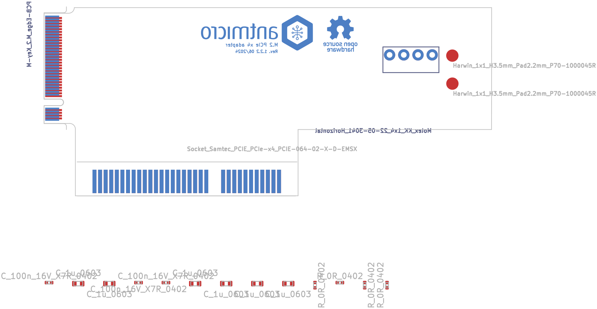
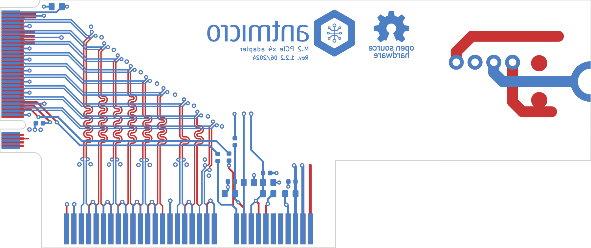
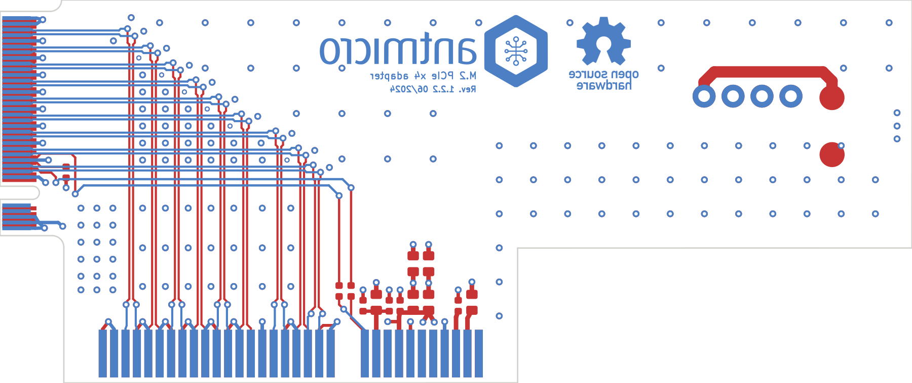
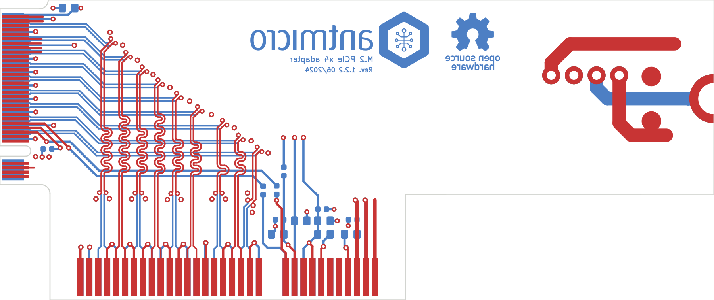
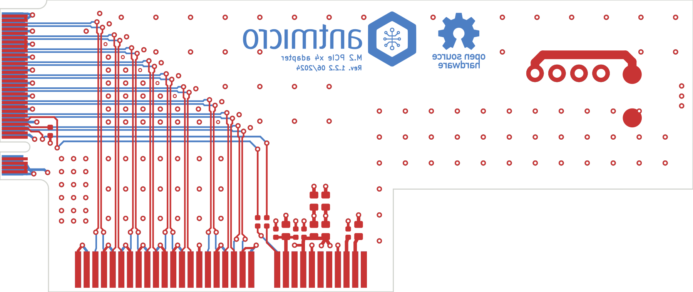
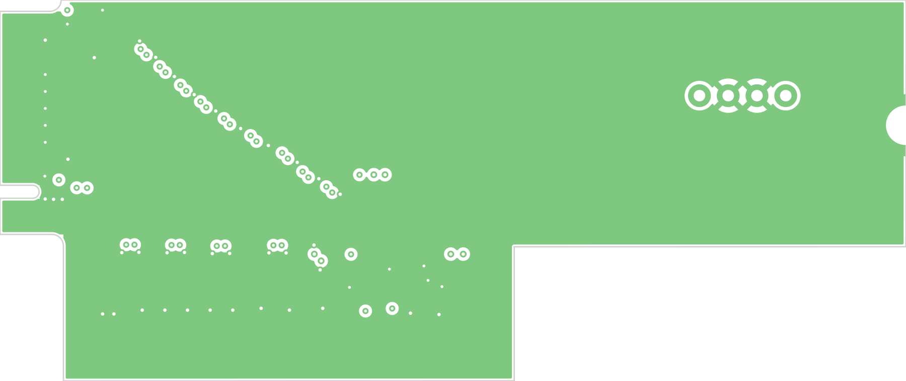
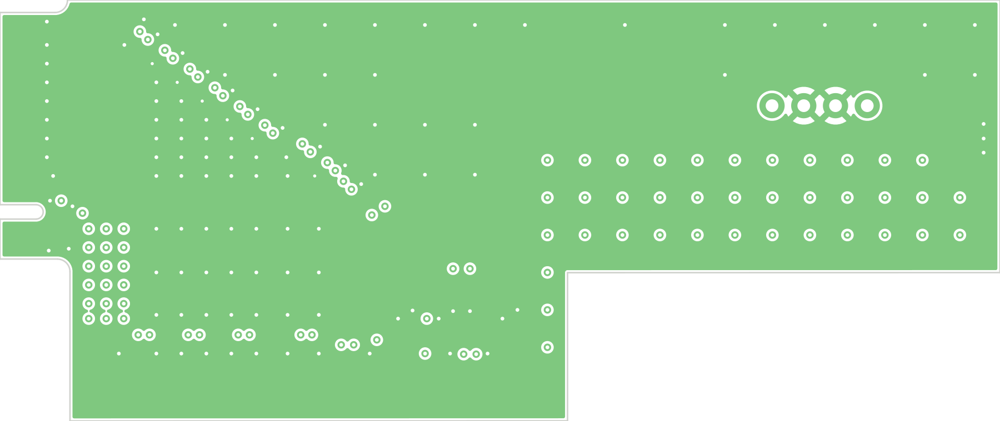
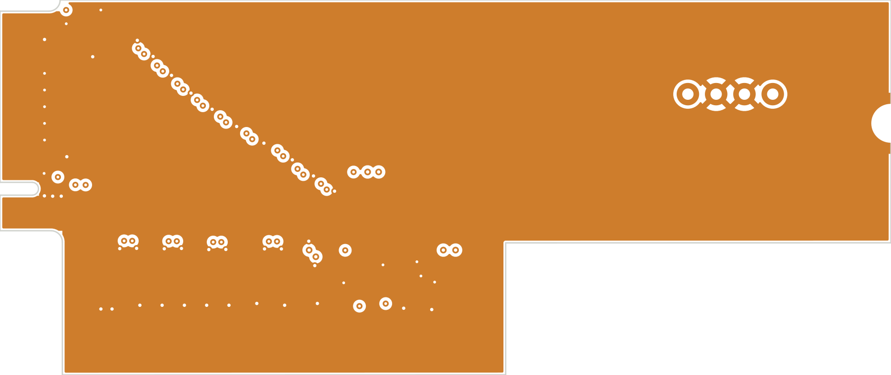
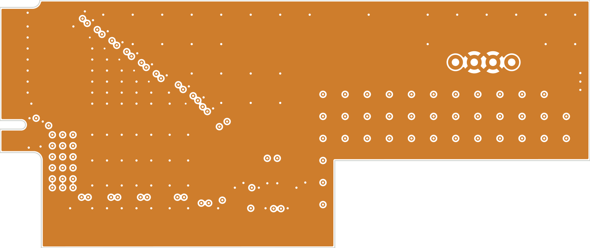

# m2-place-bt-20261113-1037

| | |
|---|---|
| Task | place the free parts and route |
| Model | claude-fable-5-2 (Claude Code, `claude -p`) |
| Tools given | bt (see the README) |
| Time | 0:22 (finished on its own) |
| Cost at API prices | $6.93 |
| Turns | 54 |
| DRC errors | 0 |
| Unconnected | 0 |
| Copper | 886 mm of track, 218 vias |
| Placement | outline 80.13 × 33.85 mm, parts on top 13 / bottom 0 |
| Hosts reached | api.anthropic.com (7), http-intake.logs.us5.datadoghq.com (26) |

DRC is KiCad 10 with zones refilled, on the board the agent saved. Some boards start with findings of their own; see `../../boards/README.md`.

## Pictures

Start is the board as the agent got it (pads and part outlines; in placement runs the free parts sit in a grid below the board). Reference is the human-routed original ([boards/m2-pcie-adapter](../../boards/m2-pcie-adapter)). The copper pictures show F.Cu (red) and B.Cu (blue) with zone fills left out so the tracks show; DRC errors are circled in magenta on the result.

| Start | Reference | Result |
|---|---|---|
|  |  |  |

All copper layers, tracks and vias only (inner layers in KiCad's colours, under the outer layers), then each inner layer with its zones filled, so plane splits and tracks cutting through a plane show:

| Layer | Reference | Result |
|---|---|---|
| all copper |  |  |
| In1.Cu |  |  |
| In2.Cu |  |  |

## The agent's own summary

From the start of its [NOTES.md](work/NOTES.md):

> Status: placed, routed, zones filled. KiCad 10 DRC (with schematic parity): 0 errors / 0 warnings
> introduced, 0 unconnected. The only remaining entries (20) are the "footprint library
> 'antmicro-footprints' not in configuration" notices that the board had before I touched it.
> Locked parts are untouched (`bt same`), the .kicad_pro is byte-identical to the original
> (no net-class or rule changes were needed).

Its review of the bt tool: [BT-REVIEW.md](work/BT-REVIEW.md).

## Progress log

Saved by the agent as it worked, failed attempts included. The notes are here; the pictures are in the archive.

- [001 – starting point](work/progress/001-start.md)
- [002 – differential pairs (scripted, not autorouted)](work/progress/002-pairs.md)
- [003 – first zone attempt (kept as a failure record)](work/progress/003-zones-first.md)
- [004 – stitching, first DRC round](work/progress/004-stitched.md)
- [See 005-final-all.md.](work/progress/005-final-B.md)
- [See 005-final-all.md.](work/progress/005-final-F.md)
- [See 005-final-all.md.](work/progress/005-final-In1.md)
- [005 – final](work/progress/005-final-all.md)
- [See 005-final-all.md.](work/progress/005-final-pcie-end.md)

## Raw files

The prompt is [brief.md](brief.md); the scores are [report.json](report.json). Everything else is in `m2-place-bt-20261113-1037.tar.xz`, attached to the `runs-2026-11` release:
the full transcript (`transcript.jsonl`), the input board, the agent's working directory with its scripts and intermediate boards, the progress pictures, all renders, the raw DRC and metrics, and the proxy log.
