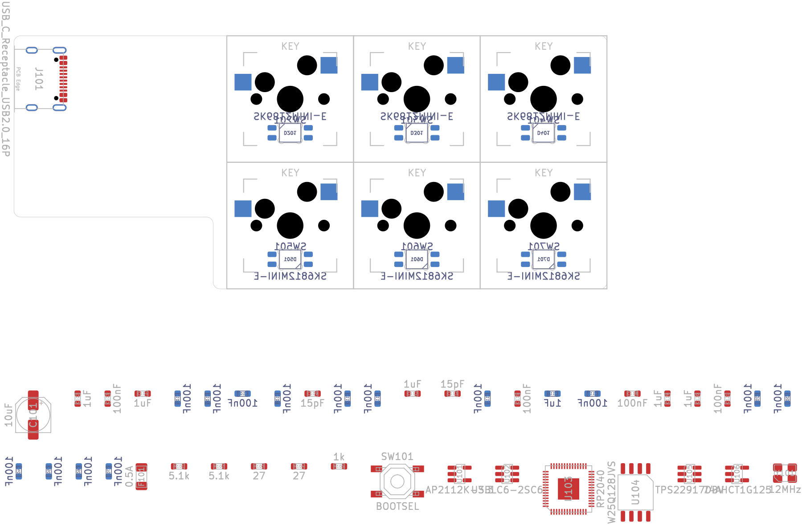
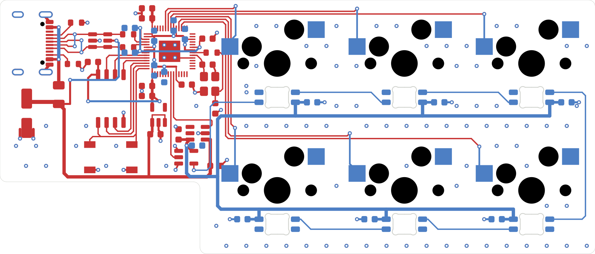

# macropad-a-20261111-1853

| | |
|---|---|
| Task | place the free parts and route |
| Model | claude-fable-5-2 (Claude Code, `claude -p`) |
| Tools given | none (pcbnew, kicad-cli, whatever it installed) |
| Time | 0:35 (finished on its own) |
| Cost at API prices | $12.27 |
| Turns | 33 |
| DRC errors | 0 |
| Unconnected | 0 |
| Copper | 881 mm of track, 138 vias |
| Placement | outline 89.2 × 38.15 mm, parts on top 27 / bottom 14 |
| Hosts reached | api.anthropic.com (8), http-intake.logs.us5.datadoghq.com (17), files.pythonhosted.org (1), pypi.org (1) |

DRC is KiCad 10 with zones refilled, on the board the agent saved. Some boards start with findings of their own; see `../../boards/README.md`.

## Pictures

Start is the board as the agent got it (pads and part outlines; in placement runs the free parts sit in a grid below the board). Reference is the human-routed original ([boards/macropad-top](../../boards/macropad-top)). The copper pictures show F.Cu (red) and B.Cu (blue) with zone fills left out so the tracks show; DRC errors are circled in magenta on the result.

| Start | Reference | Result |
|---|---|---|
|  |  |  |

## The agent's own summary

From the start of its [NOTES.md](work/NOTES.md):

> - All 30 unplaced footprints are placed, every net is routed, and both layers have a GND pour.
> - `kicad-cli pcb drc --schematic-parity --severity-all` (also with `--refill-zones`): **0 unconnected, 0 parity issues, 1 remaining message**.
>   The remaining message is `lib_footprint_mismatch` for U103 (the board copy of the QFN-56 differs from the library copy). It was there before I started and I did not touch footprint definitions.
> - Locked parts (switches, LEDs, J101) are untouched. No footprints were added or removed. The board outline is unchanged.
> - Checked only by DRC and by looking at rendered images. Nothing was simulated, and no Gerbers / BOM / CPL were generated.

## Follow-up

Asked afterwards which tools would have made the job faster or cheaper: [ANSWER.md](ask/ANSWER.md).

## Raw files

The prompt is [brief.md](brief.md); the scores are [report.json](report.json). Everything else is in `macropad-a-20261111-1853.tar.xz`, attached to the `runs-2026-11` release:
the full transcript (`transcript.jsonl`), the input board, the agent's working directory with its scripts and intermediate boards, the progress pictures, all renders, the raw DRC and metrics, and the proxy log.
