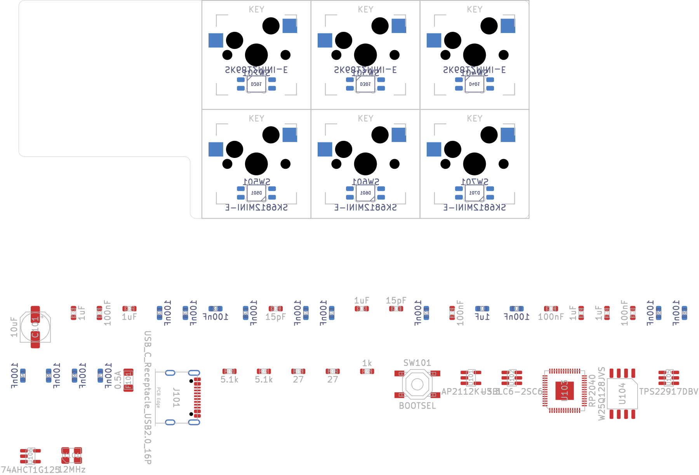
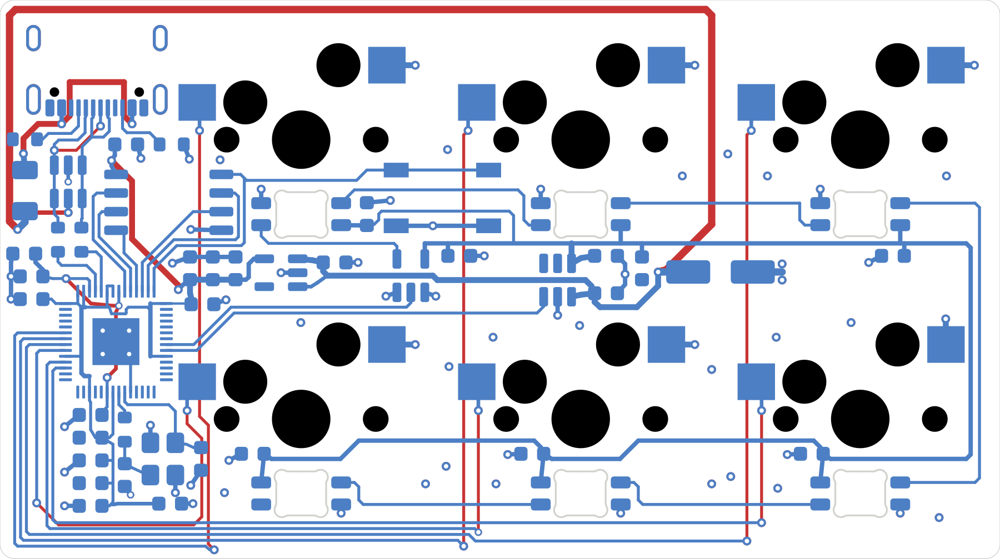

# macropad-b-20261111-1853

| | |
|---|---|
| Task | place the free parts and route |
| Model | claude-fable-5-2 (Claude Code, `claude -p`) |
| Tools given | none (pcbnew, kicad-cli, whatever it installed) |
| Time | 1:17 (finished on its own) |
| Cost at API prices | $25.90 |
| Turns | 51 |
| DRC errors | 0 |
| Unconnected | 0 |
| Copper | 1094 mm of track, 93 vias |
| Placement | outline 68.2 × 38.15 mm, parts on top 0 / bottom 42, flagged off the board: J101 (the check also flags parts that overhang the edge on purpose) |
| Hosts reached | api.anthropic.com (12), http-intake.logs.us5.datadoghq.com (39), files.pythonhosted.org (1), pypi.org (1) |

DRC is KiCad 10 with zones refilled, on the board the agent saved. Some boards start with findings of their own; see `../../boards/README.md`.

## Pictures

Start is the board as the agent got it (pads and part outlines; in placement runs the free parts sit in a grid below the board). Reference is the human-routed original ([boards/macropad-top](../../boards/macropad-top)). The copper pictures show F.Cu (red) and B.Cu (blue) with zone fills left out so the tracks show; DRC errors are circled in magenta on the result.

| Start | Reference | Result |
|---|---|---|
|  |  |  |

## The agent's own summary

From the start of its [NOTES.md](work/NOTES.md):

> - Board is now a plain rectangle, **68.15 × 38.1 mm** (was an 89.15 mm wide L-shape). The key area is untouched; the outline was only redrawn left of it (new left edge at x = 108.0, 1 mm corner radii).
> - All 48 movable parts are on **B.Cu**, including the USB-C connector. Locked switches and LEDs were not touched (checked by script: position, rotation, layer, lock flag, pads).
> - Fully routed: 0 unconnected, 0 schematic-parity issues.
> - `kicad-cli pcb drc --severity-all --schematic-parity`: **0 errors, 1 warning**. The warning is `lib_footprint_mismatch` on U103 (QFN-56 differs from the library copy). It is in the original board too; I did not change footprint definitions.
> - Gerber and drill export run without complaint (test export only, not left in /work).
> - Files changed: `macropad-top.kicad_pcb`, `macropad-top.kicad_pro` (one added net class, see below). `.kicad_dru` is unchanged.

## Follow-up

Asked afterwards which tools would have made the job faster or cheaper: [ANSWER.md](ask/ANSWER.md).

## Raw files

The prompt is [brief.md](brief.md); the scores are [report.json](report.json). Everything else is in `macropad-b-20261111-1853.tar.xz`, attached to the `runs-2026-11` release:
the full transcript (`transcript.jsonl`), the input board, the agent's working directory with its scripts and intermediate boards, the progress pictures, all renders, the raw DRC and metrics, and the proxy log.
