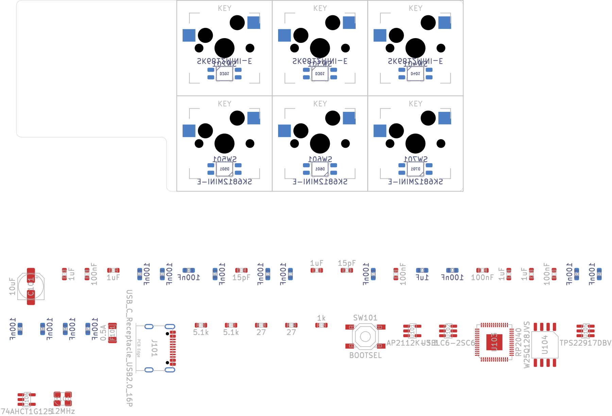
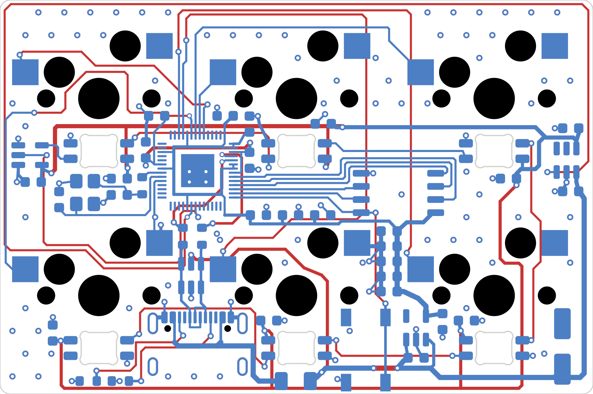

# macropad-b-bt-20261112-1613

| | |
|---|---|
| Task | place the free parts and route |
| Model | claude-fable-5-2 (Claude Code, `claude -p`) |
| Tools given | bt (see the README) |
| Time | 1:02 (finished on its own) |
| Cost at API prices | $20.42 |
| Turns | 58 |
| DRC errors | 0 |
| Unconnected | 0 |
| Copper | 1143 mm of track, 157 vias |
| Placement | outline 57.25 × 38.2 mm, parts on top 0 / bottom 42, flagged off the board: SW101 C101 J101 (the check also flags parts that overhang the edge on purpose) |
| Hosts reached | api.anthropic.com (10), http-intake.logs.us5.datadoghq.com (40) |

DRC is KiCad 10 with zones refilled, on the board the agent saved. Some boards start with findings of their own; see `../../boards/README.md`.

## Pictures

Start is the board as the agent got it (pads and part outlines; in placement runs the free parts sit in a grid below the board). Reference is the human-routed original ([boards/macropad-top](../../boards/macropad-top)). The copper pictures show F.Cu (red) and B.Cu (blue) with zone fills left out so the tracks show; DRC errors are circled in magenta on the result.

| Start | Reference | Result |
|---|---|---|
|  |  |  |

## The agent's own summary

From the start of its [NOTES.md](work/NOTES.md):

> Result: `macropad-top.kicad_pcb`, 2 layers, **57.15 x 38.1 mm** (was 89.15 x 38.1). All 42 loose parts are on B.Cu.
> KiCad 10 DRC with the project's JLCPCB rules: **0 errors, 0 unconnected**, 9 cosmetic warnings (listed at the end).
> Locked switches/LEDs untouched (`bt same`), no footprints added/removed/edited, `.kicad_pro`/`.kicad_dru` unchanged.
> 457 track segments, 157 vias (4 of them 0.5/0.3, the rest 0.6/0.3), GND pour on both layers.

Its review of the bt tool: [BT-REVIEW.md](work/BT-REVIEW.md).

## Progress log

Saved by the agent as it worked, failed attempts included. The notes are here; the pictures are in the archive.

- [001 – starting point](work/progress/001-start.md)
- [002 – placement v1 (all 42 parts on B.Cu, outline cut to x=119)](work/progress/002-placement-v1.md)
- [003 – hand-routed MCU neighbourhood and USB entry](work/progress/003-mcu-usb-local.md)
- [004 – QSPI, 3V3 trunk, 5V and LED supply](work/progress/004-critical-and-power.md)
- [005 – keys, LED chain, enable, BOOTSEL: everything but ground](work/progress/005-all-signals.md)
- [006 – ground](work/progress/006-ground.md)
- [007 – final board](work/progress/007-final.md)

## Raw files

The prompt is [brief.md](brief.md); the scores are [report.json](report.json). Everything else is in `macropad-b-bt-20261112-1613.tar.xz`, attached to the `runs-2026-11` release:
the full transcript (`transcript.jsonl`), the input board, the agent's working directory with its scripts and intermediate boards, the progress pictures, all renders, the raw DRC and metrics, and the proxy log.
