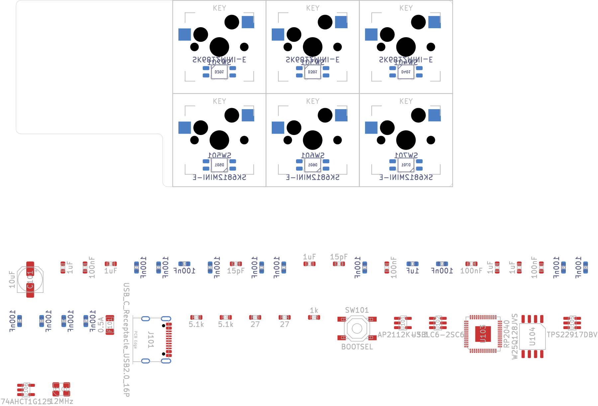
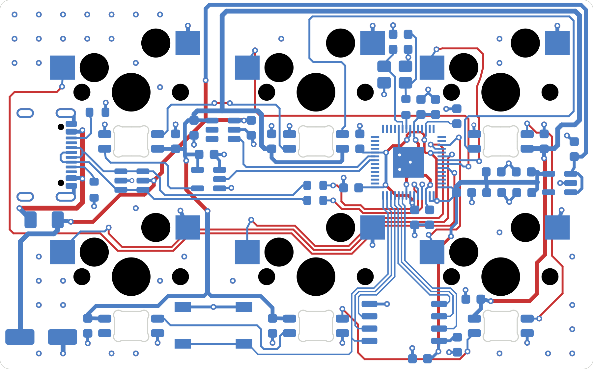

# macropad-b-mcp-20261112-1243

| | |
|---|---|
| Task | place the free parts and route |
| Model | claude-fable-5-2 (Claude Code, `claude -p`) |
| Tools given | KiCad MCP server |
| Time | 1:15 (finished on its own) |
| Cost at API prices | $25.22 |
| Turns | 69 |
| DRC errors | 0 |
| Unconnected | 0 |
| Copper | 1138 mm of track, 129 vias |
| Placement | outline 61.2 × 38.15 mm, parts on top 0 / bottom 42, flagged off the board: J101 (the check also flags parts that overhang the edge on purpose) |
| Hosts reached | api.anthropic.com (14), http-intake.logs.us5.datadoghq.com (40), api.freerouting.app (2); denied: api.github.com |

DRC is KiCad 10 with zones refilled, on the board the agent saved. Some boards start with findings of their own; see `../../boards/README.md`.

## Pictures

Start is the board as the agent got it (pads and part outlines; in placement runs the free parts sit in a grid below the board). Reference is the human-routed original ([boards/macropad-top](../../boards/macropad-top)). The copper pictures show F.Cu (red) and B.Cu (blue) with zone fills left out so the tracks show; DRC errors are circled in magenta on the result.

| Start | Reference | Result |
|---|---|---|
|  |  |  |

## The agent's own summary

From the start of its [NOTES.md](work/NOTES.md):

> - Board is now a 61.15 x 38.1 mm rectangle (1 mm corner radius), about 2330 mm². The original outline was about 3075 mm².
> - The left edge moved from the old extension to x = 115.0 mm, 1.95 mm left of the key area. The key area itself is untouched.
> - All 42 previously unplaced parts are on B.Cu, including the USB-C connector. The 12 locked footprints (switches, LEDs) were not moved; a script check confirms position, rotation, side and pad nets are identical to the original.
> - DRC (`kicad-cli pcb drc --severity-all --schematic-parity`): 0 errors, 0 unconnected, 0 parity issues. One warning remains: U103 "does not match copy in library". It was in the original file and I did not touch footprint definitions.
> - Gerber and drill export run without errors. I did not upload to JLCPCB or run their DFM check.

## Follow-up

Asked afterwards which tools would have made the job faster or cheaper: [ANSWER.md](ask/ANSWER.md).

## Raw files

The prompt is [brief.md](brief.md); the scores are [report.json](report.json). Everything else is in `macropad-b-mcp-20261112-1243.tar.xz`, attached to the `runs-2026-11` release:
the full transcript (`transcript.jsonl`), the input board, the agent's working directory with its scripts and intermediate boards, the progress pictures, all renders, the raw DRC and metrics, and the proxy log.
