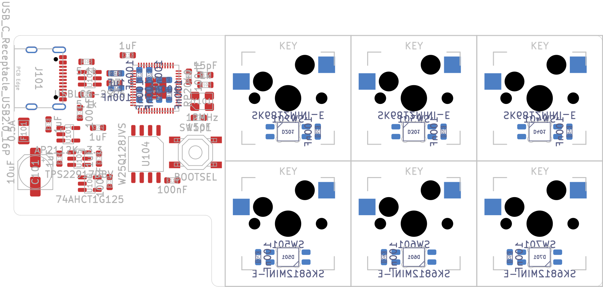
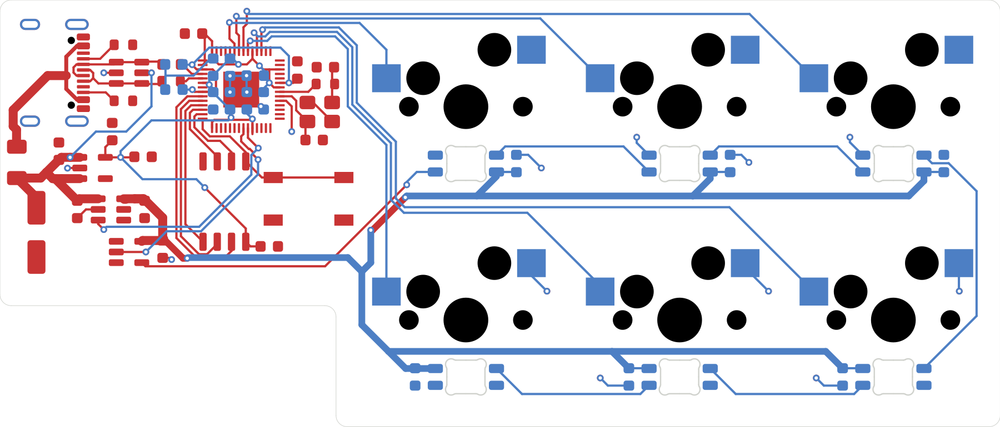
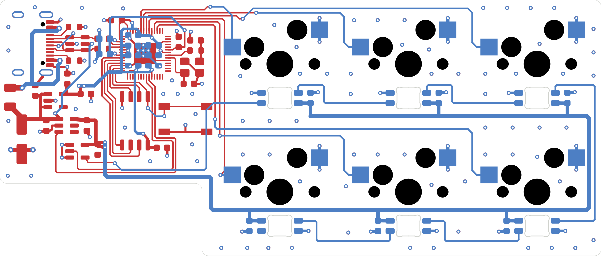

# macropad-top-20261111-1720

| | |
|---|---|
| Task | route only, placement kept |
| Model | claude-fable-5-2 (Claude Code, `claude -p`) |
| Tools given | none (pcbnew, kicad-cli, whatever it installed) |
| Time | 0:49 (finished on its own) |
| Cost at API prices | $14.64 |
| Turns | 32 |
| DRC errors | 0 |
| Unconnected | 0 |
| Copper | 1060 mm of track, 161 vias |
| Hosts reached | api.anthropic.com (8), http-intake.logs.us5.datadoghq.com (21), files.pythonhosted.org (1), pypi.org (1) |

DRC is KiCad 10 with zones refilled, on the board the agent saved. Some boards start with findings of their own; see `../../boards/README.md`.

## Pictures

Start is the board as the agent got it (pads and part outlines; in placement runs the free parts sit in a grid below the board). Reference is the human-routed original ([boards/macropad-top](../../boards/macropad-top)). The copper pictures show F.Cu (red) and B.Cu (blue) with zone fills left out so the tracks show; DRC errors are circled in magenta on the result.

| Start | Reference | Result |
|---|---|---|
|  |  |  |

## The agent's own summary

From the start of its [NOTES.md](work/NOTES.md):

> Board: 2 layers, 1.6 mm, routed for JLCPCB's standard process. Placement is untouched
> (all 54 footprints verified identical in position, rotation and side to the original).

## Follow-up

Asked afterwards which tools would have made the job faster or cheaper: [ANSWER.md](ask/ANSWER.md).

## Raw files

The prompt is [brief.md](brief.md); the scores are [report.json](report.json). Everything else is in `macropad-top-20261111-1720.tar.xz`, attached to the `runs-2026-11` release:
the full transcript (`transcript.jsonl`), the input board, the agent's working directory with its scripts and intermediate boards, the progress pictures, all renders, the raw DRC and metrics, and the proxy log.
