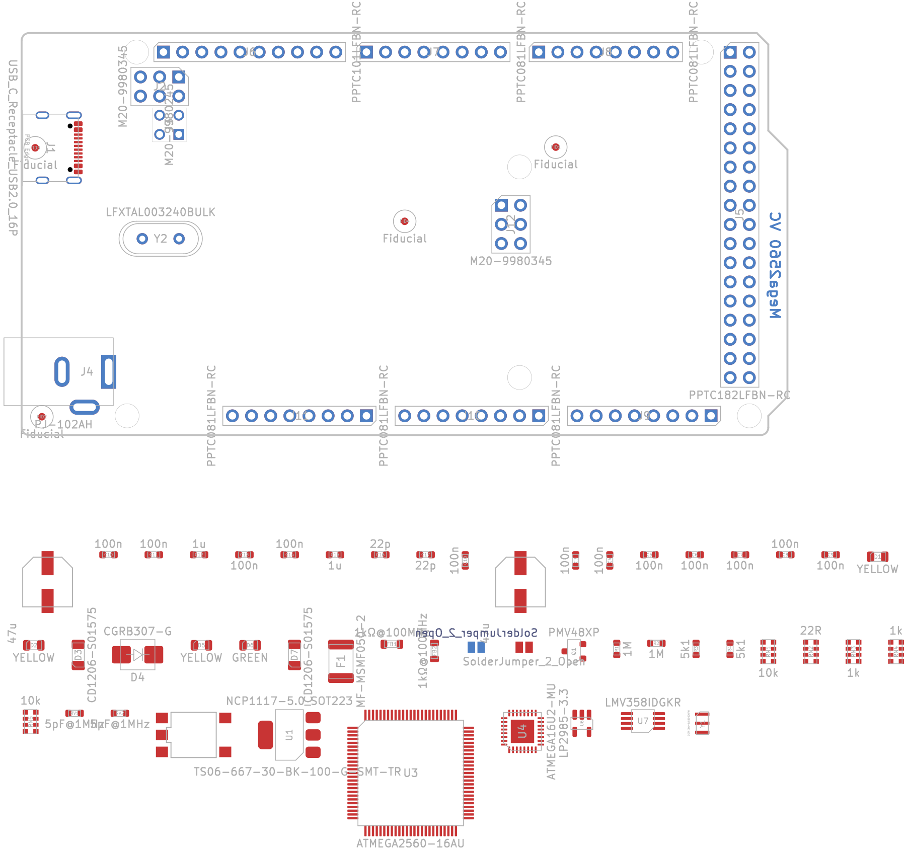
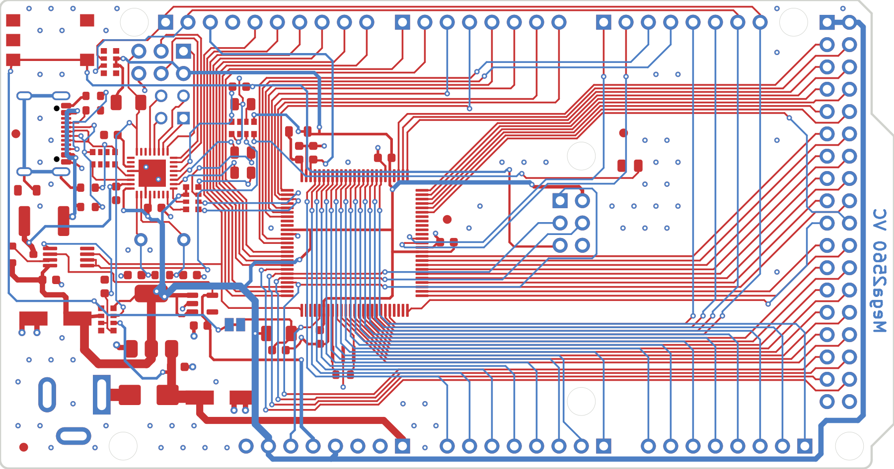

# mega-place-20261112-1222

| | |
|---|---|
| Task | place the free parts and route |
| Model | claude-fable-5-2 (Claude Code, `claude -p`) |
| Tools given | none (pcbnew, kicad-cli, whatever it installed) |
| Time | 2:47 (finished on its own) |
| Cost at API prices | $50.60 |
| Turns | 159 |
| DRC errors | 4 (courtyards_overlap 4) |
| Unconnected | 0 |
| Copper | 5488 mm of track, 196 vias |
| Placement | outline 101.85 × 53.59 mm, parts on top 48 / bottom 1 |
| Hosts reached | api.anthropic.com (19), http-intake.logs.us5.datadoghq.com (113), pypi.org (4), repo1.maven.org (12), api.adoptium.net (2), gitlab.com (1), sourceforge.net (1), registry.npmjs.org (1), files.pythonhosted.org (3), download.kicad.org (1), cdn.azul.com (1), jitpack.io (38), deb.debian.org (1), conda.anaconda.org (1), www.oracle.com (2), download.java.net (1), corretto.aws (3), download.oracle.com (1), aka.ms (1), download.visualstudio.microsoft.com (1), repo.maven.apache.org (21), maven-central.storage-download.googleapis.com (1), api.freerouting.app (1); denied: github.com, objects.githubusercontent.com, raw.githubusercontent.com, codeload.github.com, api.github.com |

DRC is KiCad 10 with zones refilled, on the board the agent saved. Some boards start with findings of their own; see `../../boards/README.md`.

## Pictures

Start is the board as the agent got it (pads and part outlines; in placement runs the free parts sit in a grid below the board). Reference is the human-routed original ([boards/mega](../../boards/mega)). The copper pictures show F.Cu (red) and B.Cu (blue) with zone fills left out so the tracks show; DRC errors are circled in magenta on the result.

| Start | Reference | Result |
|---|---|---|
|  |  |  |

## The agent's own summary

From the start of its [NOTES.md](work/NOTES.md):

> Board: `Arduino_Mega_2560.kicad_pcb`, 2 layers, KiCad 10.0.8. Every net is fully routed.

## Follow-up

Asked afterwards which tools would have made the job faster or cheaper: [ANSWER.md](ask/ANSWER.md).

## Raw files

The prompt is [brief.md](brief.md); the scores are [report.json](report.json). Everything else is in `mega-place-20261112-1222.tar.xz`, attached to the `runs-2026-11` release:
the full transcript (`transcript.jsonl`), the input board, the agent's working directory with its scripts and intermediate boards, the progress pictures, all renders, the raw DRC and metrics, and the proxy log.
