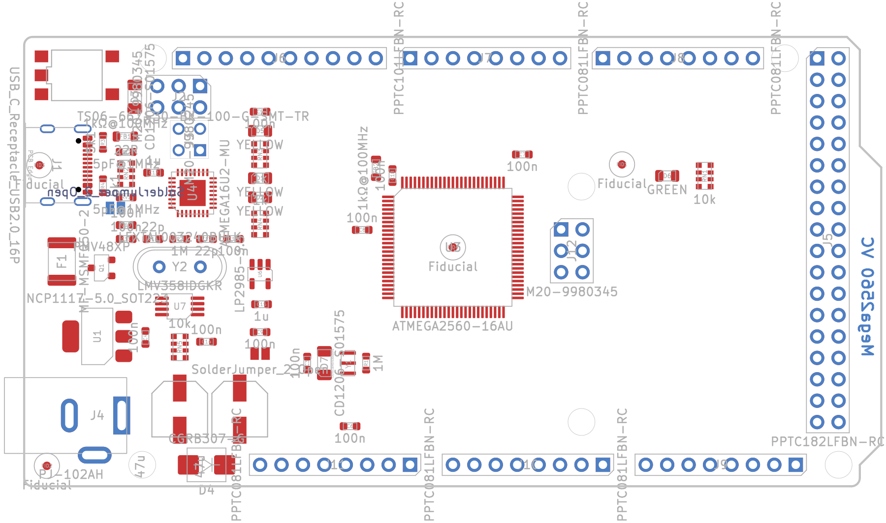
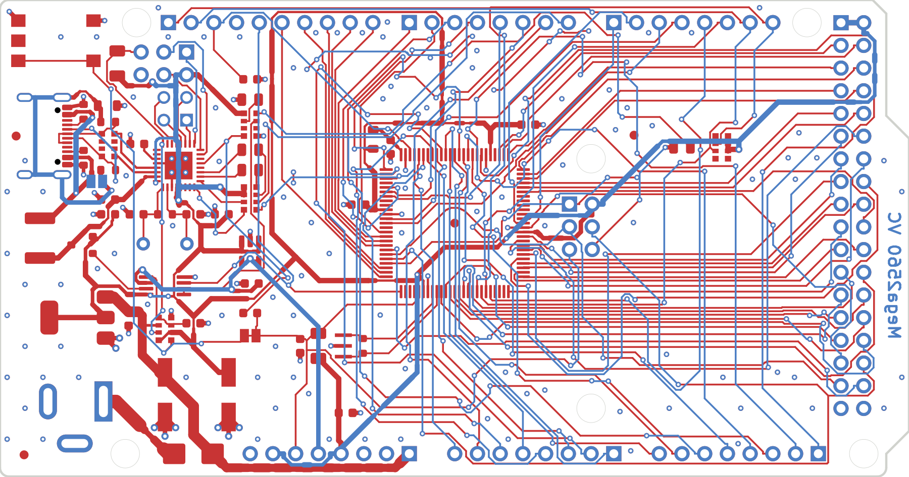

# mega-route-20261112-1222

| | |
|---|---|
| Task | route only, placement kept |
| Model | claude-fable-5-2 (Claude Code, `claude -p`) |
| Tools given | none (pcbnew, kicad-cli, whatever it installed) |
| Time | 2:22 (finished on its own) |
| Cost at API prices | $18.61 |
| Turns | 173 |
| DRC errors | 12 (courtyards_overlap 12) |
| Unconnected | 0 |
| Copper | 4987 mm of track, 342 vias |
| Hosts reached | api.anthropic.com (18), http-intake.logs.us5.datadoghq.com (105), api.adoptium.net (2), jitpack.io (9), repo1.maven.org (5), pypi.org (5), about.gitlab.com (1), gitlab.com (1), sourceforge.net (1), api.freerouting.app (1), registry.npmjs.org (1), hub.docker.com (1), files.pythonhosted.org (3), deb.debian.org (19), cdn.azul.com (1), corretto.aws (1), conda.anaconda.org (1); denied: github.com, raw.githubusercontent.com, codeload.github.com, ghcr.io, gitee.com, ghproxy.com, mirror.ghproxy.com |

DRC is KiCad 10 with zones refilled, on the board the agent saved. Some boards start with findings of their own; see `../../boards/README.md`.

## Pictures

Start is the board as the agent got it (pads and part outlines; in placement runs the free parts sit in a grid below the board). Reference is the human-routed original ([boards/mega](../../boards/mega)). The copper pictures show F.Cu (red) and B.Cu (blue) with zone fills left out so the tracks show; DRC errors are circled in magenta on the result.

| Start | Reference | Result |
|---|---|---|
|  |  |  |

## The agent's own summary

From the start of its [NOTES.md](work/NOTES.md):

> Board: `Arduino_Mega_2560.kicad_pcb` (KiCad 10.0.8), 2 layers, 1.6 mm, intended for JLCPCB standard service.
> Placement is untouched (all 66 footprints verified identical to the original: position, rotation, side, pad nets).

## Follow-up

Asked afterwards which tools would have made the job faster or cheaper: [ANSWER.md](ask/ANSWER.md).

## Raw files

The prompt is [brief.md](brief.md); the scores are [report.json](report.json). Everything else is in `mega-route-20261112-1222.tar.xz`, attached to the `runs-2026-11` release:
the full transcript (`transcript.jsonl`), the input board, the agent's working directory with its scripts and intermediate boards, the progress pictures, all renders, the raw DRC and metrics, and the proxy log.
