# orangecrab-bt-20261112-1613

| | |
|---|---|
| Task | place the free parts and route |
| Model | claude-fable-5-2 (Claude Code, `claude -p`) |
| Tools given | bt (see the README) |
| Time | 4:38 (finished on its own) |
| Cost at API prices | $52.14 |
| Turns | 245 |
| DRC errors | 86 (malformed_courtyard 1, courtyards_overlap 1, copper_edge_clearance 84) |
| Unconnected | 70 items in 26 nets |
| Copper | 2384 mm of track, 454 vias |
| Placement | outline 50.9 × 22.96 mm, parts on top 57 / bottom 87 |
| Hosts reached | api.anthropic.com (30), http-intake.logs.us5.datadoghq.com (200) |

DRC is KiCad 10 with zones refilled, on the board the agent saved. Some boards start with findings of their own; see `../../boards/README.md`.

## Pictures

Start is the board as the agent got it (pads and part outlines; in placement runs the free parts sit in a grid below the board). Reference is the human-routed original ([boards/orangecrab](../../boards/orangecrab)). The copper pictures show F.Cu (red) and B.Cu (blue) with zone fills left out so the tracks show; DRC errors are circled in magenta on the result.

| Start | Reference | Result |
|---|---|---|
| 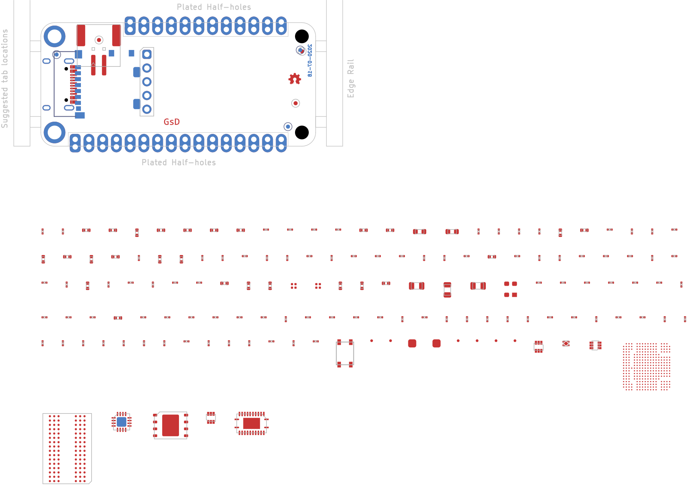 |  | 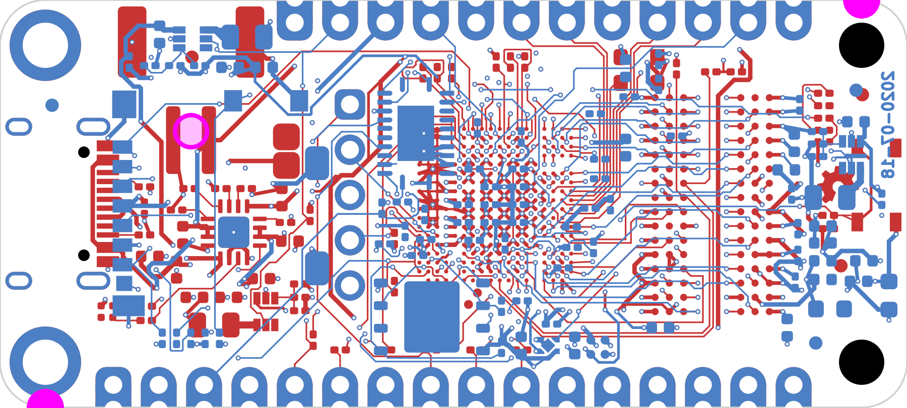 |

All copper layers, tracks and vias only (inner layers in KiCad's colours, under the outer layers), then each inner layer with its zones filled, so plane splits and tracks cutting through a plane show:

| Layer | Reference | Result |
|---|---|---|
| all copper | 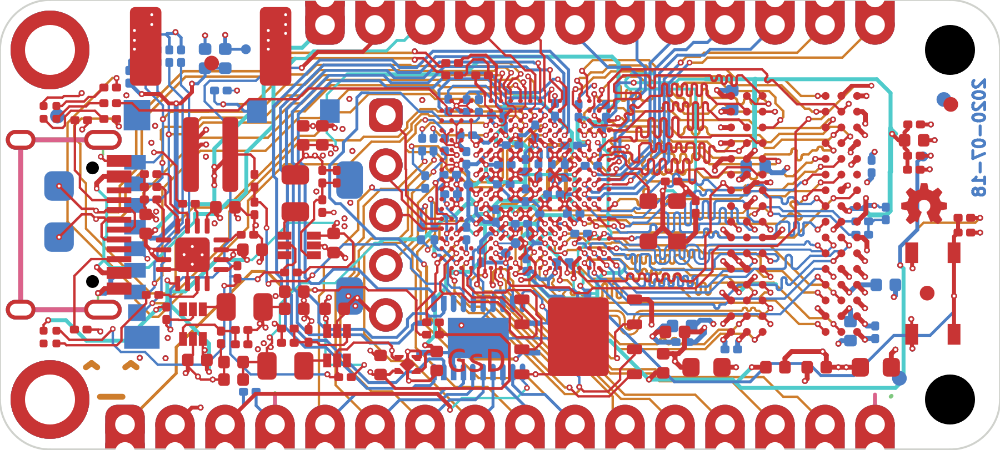 | 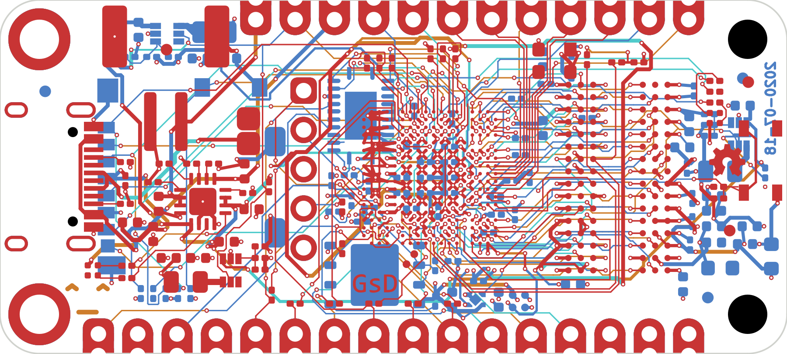 |
| In1.Cu | 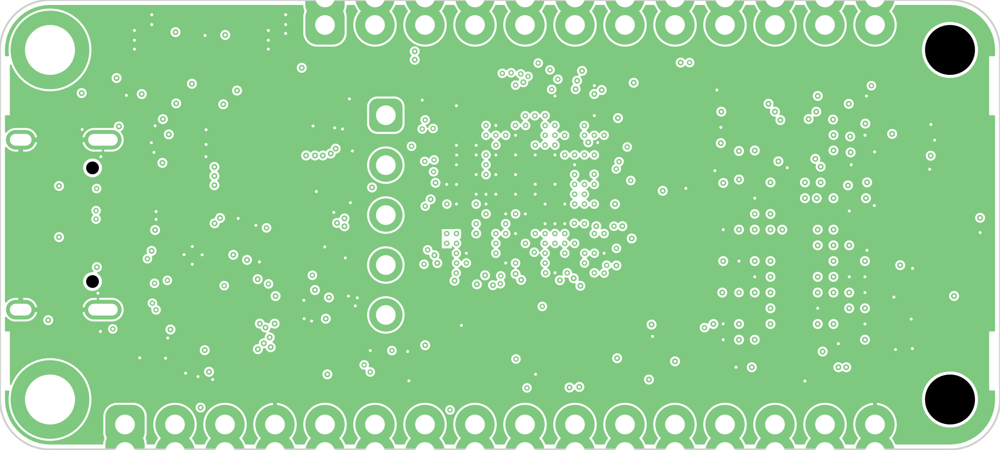 | 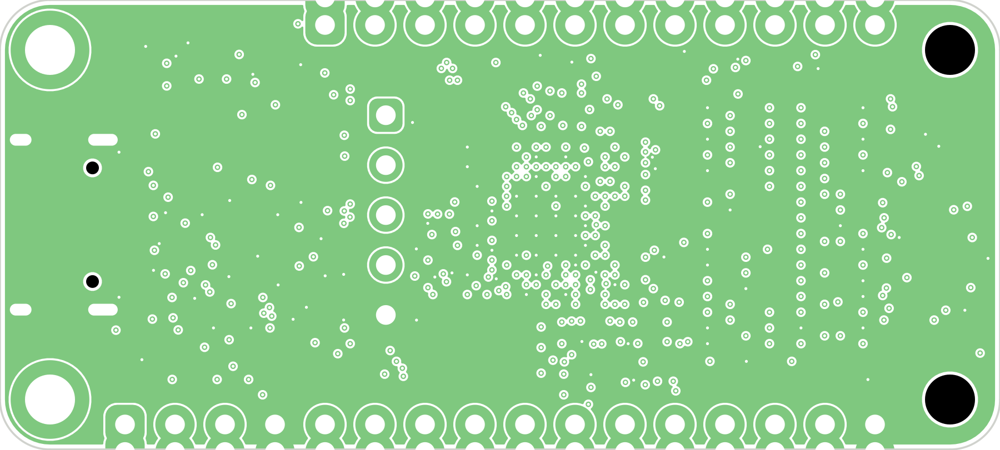 |
| In2.Cu | 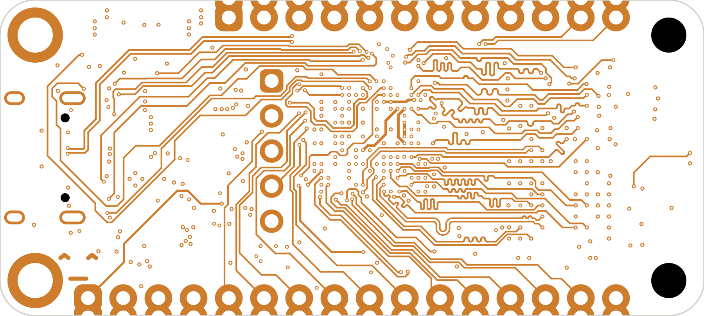 | 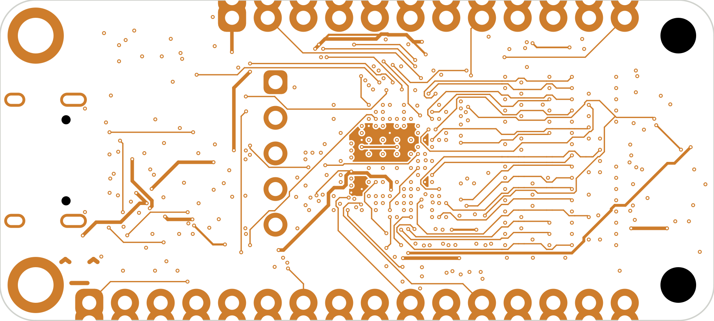 |
| In3.Cu | 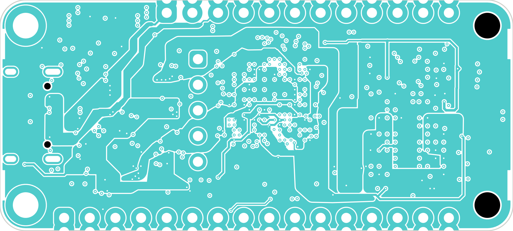 | 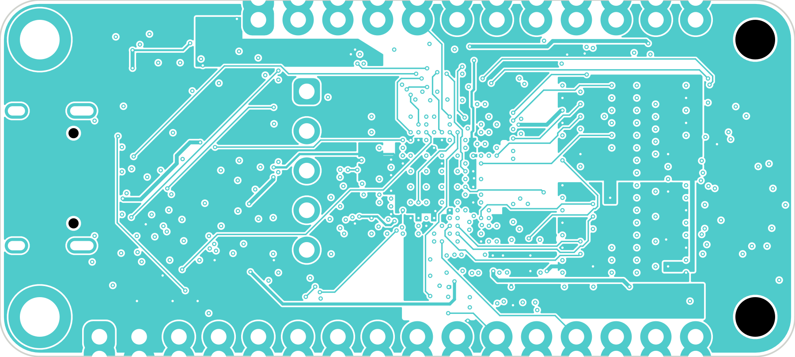 |
| In4.Cu | 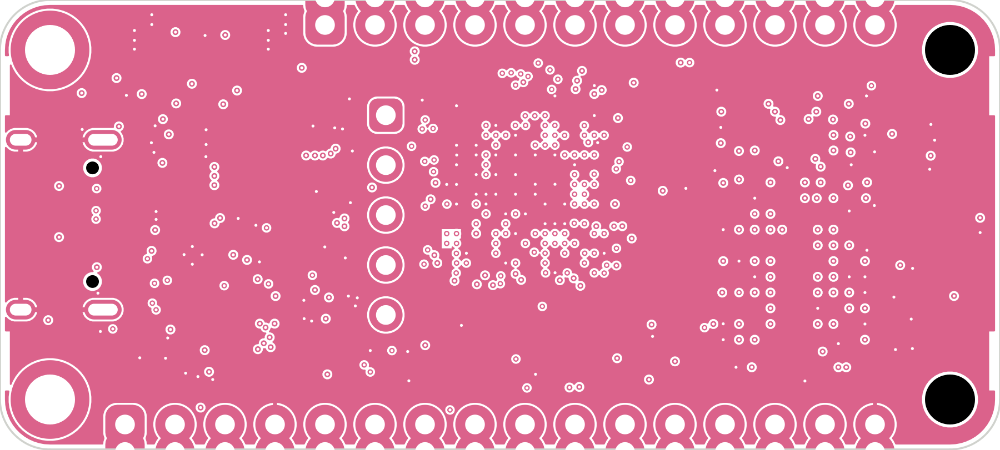 | 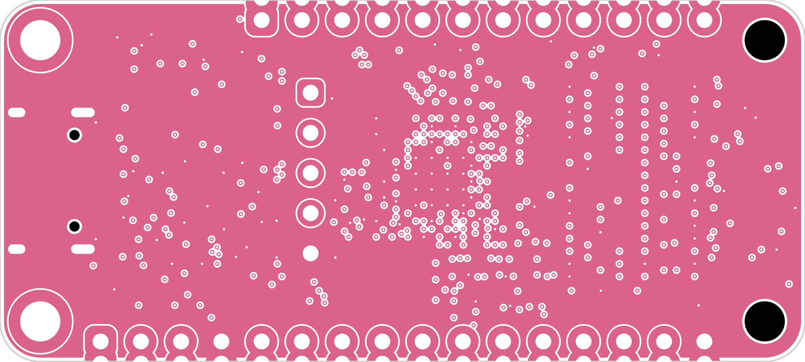 |

## The agent's own summary

From the start of its [NOTES.md](work/NOTES.md):

> **The board is not finished and must not be ordered as it is.** All 163 footprints are
> placed (locked ones untouched, verified by UUID), the DDR3 interface is completely routed,
> about 95 % of the other signal connections and most of the power distribution are in, and
> KiCad DRC shows no clearance, short, hole or courtyard errors beyond the 86 the empty board
> already had. But **69 connections in 26 nets are still open** (list in `UNROUTED.txt`,
> summary below), among them things the board cannot work without: the 2.5 V / 3.3 V / 1.35 V
> ring balls of the FPGA, the USB data lines between connector and series resistors, flash
> MISO, one DDR3 VDD ball. I ran out of working budget in the dense areas around the FPGA;
> what is missing is listed honestly at the end.

Its review of the bt tool: [BT-REVIEW.md](work/BT-REVIEW.md).

## Progress log

Saved by the agent as it worked, failed attempts included. The notes are here; the pictures are in the archive.

- [001 – starting point](work/progress/001-start.md)
- [002 – floorplan](work/progress/002-floorplan.md)
- [003 – DDR3, first try: let `bt route` do everything (thrown away)](work/progress/003-ddr-autoroute-attempt.md)
- [004 – DDR3, second try: fixed dog-bone vias at the DDR, router picks the FPGA side (thrown away)](work/progress/004-ddr-directed-attempt.md)
- [005 – DDR3, third try: every escape via placed by hand, ordered-lane bus router](work/progress/005-ddr-bus-lanes.md)
- [006 – DDR3 routed (kept)](work/progress/006-ddr-routed.md)
- [007 – FPGA power vias, decoupling, IO "highway", first try at the top-side fan-out](work/progress/007-top-fanout-first-try.md)
- [008 – placement after the re-plan (before signal autoroute)](work/progress/008-placement-complete.md)
- [009 – remaining signals, power distribution (partly failed)](work/progress/009-signals-and-power.md)
- [010 / 011 – state at hand-over](work/progress/010-final-unrouted.md)

## Raw files

The prompt is [brief.md](brief.md); the scores are [report.json](report.json). Everything else is in `orangecrab-bt-20261112-1613.tar.xz`, attached to the `runs-2026-11` release:
the full transcript (`transcript.jsonl`), the input board, the agent's working directory with its scripts and intermediate boards, the progress pictures, all renders, the raw DRC and metrics, and the proxy log.
