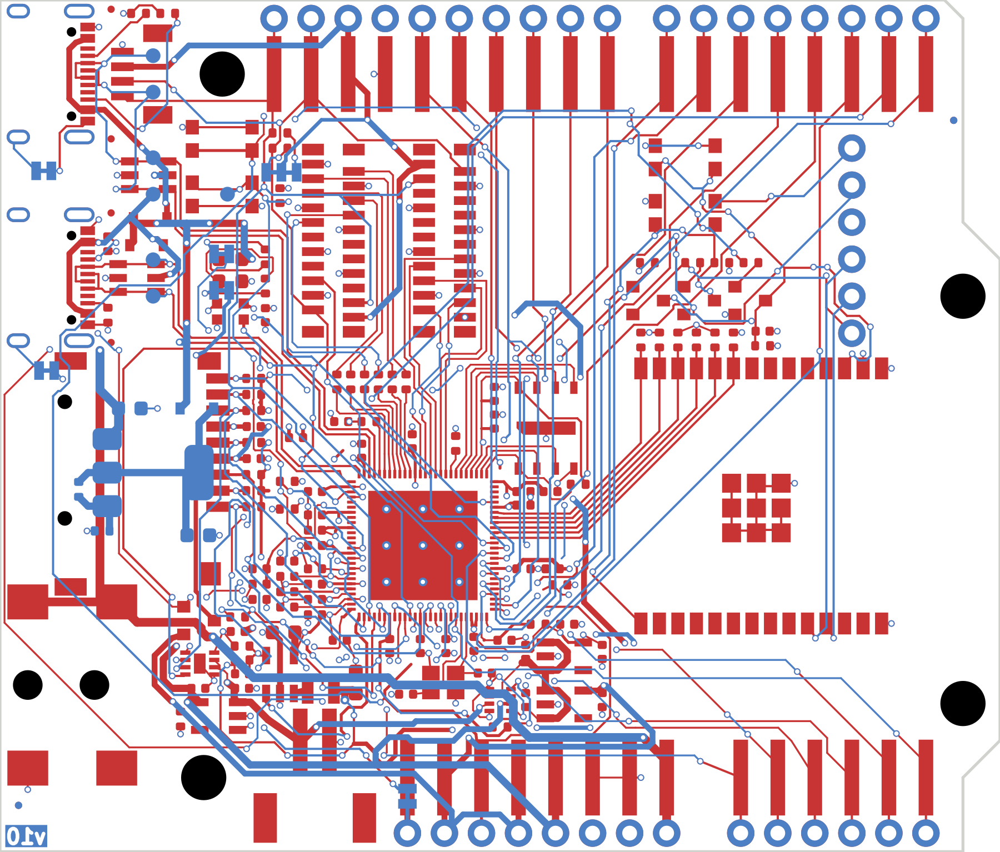

# redboard-place-bt-20261116-1017

| | |
|---|---|
| Task | place the free parts and route |
| Model | claude-fable-5-2 (Claude Code, `claude -p`) |
| Tools given | bt (see the README) |
| Time | 4:44 (finished on its own) |
| Cost at API prices | $44.87 |
| Turns | 140 |
| DRC errors | 0 |
| Unconnected | 0 |
| Copper | 3814 mm of track, 422 vias |
| Placement | outline 68.78 × 58.62 mm, parts on top 116 / bottom 19, flagged off the board: U3 (the check also flags parts that overhang the edge on purpose) |
| Hosts reached | api.anthropic.com (35), http-intake.logs.us5.datadoghq.com (181) |

DRC is KiCad 10 with zones refilled, on the board the agent saved. Some boards start with findings of their own; see `../../boards/README.md`.

## Pictures

Start is the board as the agent got it (pads and part outlines; in placement runs the free parts sit in a grid below the board). Reference is the human-routed original ([boards/redboard-p4-wifi](../../boards/redboard-p4-wifi)). The copper pictures show F.Cu (red) and B.Cu (blue) with zone fills left out so the tracks show; DRC errors are circled in magenta on the result.

| Start | Reference | Result |
|---|---|---|
|  |  |  |

## The agent's own summary

From the start of its [NOTES.md](work/NOTES.md):

> `SparkFun_IoT_RedBoard-ESP32-P4_WiFi_BLE.kicad_pcb` is placed and fully routed.
> KiCad 10 DRC on the delivered file: **0 unconnected, 0 clearance/short errors, 0 schematic-parity issues.**
> Left over: 10 `track_dangling` warnings (dead-end stubs, 0.04–2.5 mm), and 7 courtyard overlaps + 4 silk-edge warnings that are between locked parts and existed before I started.
> Locked parts are untouched (`bt same`: nothing locked moved, no parts added/removed, pad nets unchanged). The `.kicad_pro` is byte-identical to the original.

Its review of the bt tool: [BT-REVIEW.md](work/BT-REVIEW.md).

## Progress log

Saved by the agent as it worked, failed attempts included. The notes are here; the pictures are in the archive.

- [001 – starting point](work/progress/001-start.md)
- [002 – first complete placement](work/progress/002-placement-v1.md)
- [003 – hand-built escape of the ESP32-P4 north side](work/progress/003-u1-north-escape.md)
- [004 – rest of the P4 escape, USB pairs, plane vias](work/progress/004-u1-escape-planes.md)
- [005 – first batch route (thrown away)](work/progress/005-batch-route.md)
- [006 – re-plan and staged routing](work/progress/006-replan.md)
- [007 – the power layer came back in pieces](work/progress/007-in2-fragmented.md)
- [008 – final state](work/progress/008-final.md)

## Raw files

The prompt is [brief.md](brief.md); the scores are [report.json](report.json). Everything else is in `redboard-place-bt-20261116-1017.tar.xz`, attached to the `runs-2026-11` release:
the full transcript (`transcript.jsonl`), the input board, the agent's working directory with its scripts and intermediate boards, the progress pictures, all renders, the raw DRC and metrics, and the proxy log.
